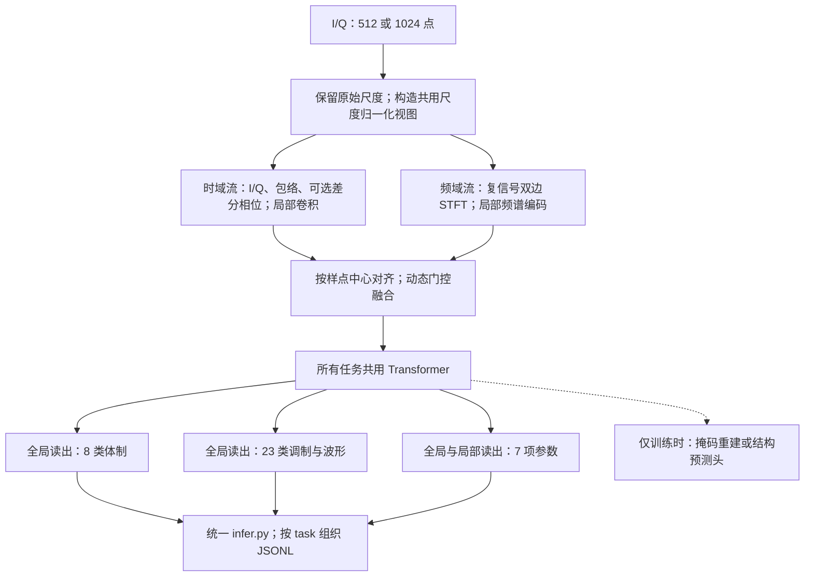

# C01 多类型电磁信号通用感知技术路线：双 A100 实施版

> 制定日期：2026 年 11 月 10 日。目标：初赛形成可提交成果，同时保留复赛效率优化与技术答辩的扩展空间。资源：2 张 A100 80GB。时间：按用户提供的 12 月底提交安排；12 月中旬前完成首个完整提交包。
>
> 本文依据工作区赛题 PDF、三场合肥讲座解析、已有两份路线，以及截至制定日期核查的公开论文。已对 `/mnt/disk1/wangxinbei_contest_dataset/C01` 的全部训练 Parquet、官方 Schema 与接口样例完成审计，详见[数据核验与路线修订](C01_数据核验与路线修订.md)。代码和小规模全流程初测已完成，见 [README](README.md) 与[初测报告](docs/self_test_report.md)。当前未获得官方评测程序，尚未开展全量长期训练；本文中的架构收益仍待对照实验验证。

## 1. 推荐路线与优先级

**建设一个共享的时频双流电磁编码器，以联合监督建立比赛基线，再通过无标签预训练、参数头优化和物理特征消融提高表现，最终交付一个基座、一个检查点、一个推理入口。**

建议项目名称为：**面向多任务电磁感知的时频对齐与物理结构保留基座模型**。

技术重点有三个：

1. **同一时刻的时域与频域特征对齐融合。** 波形分支保留相位变化、边沿与脉冲位置，频谱分支提取谱占用、频率偏移和扫频结构，用样本自适应门控共同形成统一表征。
2. **分类与参数估计共享表征，同时保留参数所需的尺度和位置。** 分类头读取全局语义；参数头同时读取全局特征与按时间排列的局部特征，避免把脉宽、时延等信息在池化阶段丢掉。
3. **以结构学习作为关键预训练方向，用比赛验证选择目标。** 在相同共享架构下比较 I/Q 掩码重建、Atomic 和 Atomic+Emergent 结构预测，再验证词表迭代与连续辅助目标。以两项分类准确率和七项参数误差决定保留模块，谱辅助和雷达掩码单独对照。

首轮主模型采用 **8 层、宽度 384 的共享 Transformer**，预计完整网络约 15M–25M 参数，实际以实现统计为准。另用 6 层、宽度 256 的模型完成快速消融。只有更大模型在相同数据和可比预算下有稳定收益，才扩至 12 层、宽度 512。参数上限 1B 是约束，不是需要达到的规模。

## 2. 从评分和规则反推研发投入

### 2.1 必须覆盖的比赛要求

| 要求 | 本项目对应方案 | 需要形成的证据 |
|---|---|---|
| 时频双流编码与动态融合 | 时域局部编码、复基带双边时频谱、按样点中心对齐的门控融合 | 网络图；单流、简单拼接、门控融合消融 |
| 基座多任务适配 | 共用前端、融合层和主干，接两类分类头及参数头 | 一个最终检查点；各任务调用同一基座的代码 |
| 参数量不超过 1B，共用基座权重超过 80% | 专用头保持小规模，设计上争取共享比例超过 90% | 去重参数清单、计算口径、最终实际比例 |
| 禁止按任务分别训练多个基座、禁止多个小模型集成 | 最终模型联合训练并统一推理 | 不按任务加载不同主干；不将多个检查点预测求平均 |
| 国产平台迁移和效率提升 | 标准实数算子、可替换频谱前处理、固定长度分桶、数值一致性测试 | 平台适配记录和实际资源报告 |
| 完整可复现交付 | 代码、权重、配置、依赖、日志、报告和离线 Linux 镜像 | 断网端到端复测记录 |

以上来自[赛题 PDF 第 1–2、5–6 页](<C01 多类型电磁信号感知赛题任务详情描述文档.pdf>)。训练阶段可以运行多组候选实验，最终只交付一套符合规则的模型。实验候选也优先保持统一基座与多任务训练方式。

共享比例采用保守的内部检查：

\[
r_{share}=N_{所有任务共同使用的参数}/N_{最终模型全部去重参数}>0.8.
\]

最终统计需要计入全部前端、融合层、主干和专用头；预训练时使用、推理时移除的解码器另列。若官方给出其他统计口径，再补报官方口径。

### 2.2 初赛和复赛投入不同

初赛权重是体制识别 30、调制识别 30、参数估计 40。将两个准确率和参数精度都写成 0–1 后，原始分数可表示为：

\[
S_{pre}=30A_{protocol}+30A_{modulation}+40P_{parameter}.
\]

两项识别每提高 1 个百分点，分别约增加 0.3 分；参数精度提高 0.01，约增加 0.4 分。**参数任务必须从第一版就做对，不能等分类优化结束再补。** 这里的“参数精度”是官方换算后的指标，并不等于 RMSE 降低 1%。

复赛自动评测内部权重为 20/20/30/30，最后一项为效率；自动评测占复赛总成绩 70%，专家评审占 30%。因此效率项最多影响总成绩 21 分。按 PDF，效率分基于参赛队伍推理时延排名，不能预先把某个加速倍数换算成固定得分。[赛题 PDF 第 7–9 页](<C01 多类型电磁信号感知赛题任务详情描述文档.pdf>)

首期投入先围绕数据正确性、参数任务和共享双流模型展开；复赛再依据实测耗时决定压缩、量化或蒸馏。首版就记录端到端延迟，为后续比较保留基线。

### 2.3 三项需要尽早确认的评分信息

- 七个参数如何聚合 RMSE，是否逐字段归一化，以及固定参考尺度的具体值。
- `frequency_shift` 等字段的准确物理定义、单位，采样率是否固定或能在测试时获得。
- 推理调用签名、目标国产硬件、批量和计时范围，以及正式截止日期。

PDF 第 7 页表格写“样本方差”，第 8 页给出的具体公式是 RMSE 与固定参考尺度换算；本地先逐字段报告 RMSE，并将选模分明确标为代理分。上述未决信息不妨碍先完成数据审计、训练和接口开发。

## 3. 怎样使用已有讲座与前沿研究

### 3.1 三场讲座的采用顺序

| 调研内容 | 本项目采用方式 | 优先级与理由 |
|---|---|---|
| 讲座 3：IQFM 统一 I/Q 预训练 | 复用“预训练共享编码器—多任务适配”的建设方式 | 主线。与赛题基座和多任务要求一致 |
| 讲座 3：RW-DPhase | 保留 I/Q，增加幅度可靠性加权的差分相位辅助通道 | 优先消融。针对调制和雷达波形识别，控制额外开销 |
| 讲座 3：KRMAE | 在雷达训练侧比较随机掩码与关键区域/背景混合掩码 | 第二阶段。讲座展示的收益集中在少标签条件，不能推定满标签也提高 |
| 讲座 2：RoPE-fs | 只有推理时有可信采样率，才使用物理时间坐标 | 条件采用。当前 PDF 输入只有 `task/sample_id/iq` |
| 讲座 2：Atomic/Emergent | 与重建预训练作为关键对照；先比较 Atomic、Atomic+Emergent，再做词表第二轮优化 | 重点方向。结合用户补充的成果介绍细化，检查连续参数性能与词表构建成本 |
| 讲座 1：多尺度预测 MSP | 借鉴不同时间尺度的监督思想，明确本项目目标定义后单独验证 | 备选。讲座材料未完整给出实现细节 |
| 讲座 1：Mamba/APA | 实际出现长序列或推理瓶颈时再评估 | 后置。512/1024 点按 16 点分块仅 32/64 个 token |

讲座来源：[讲座 1 解析](合肥讲座/讲座1/讲座1_SigMA短序列预训练与长信号迁移_解析.md)、[讲座 2 解析](合肥讲座/讲座2/讲座2_异构观测下的物理时间对齐与结构化预训练_解析.md)、[讲座 3 解析](合肥讲座/讲座3/讲座3_电磁信号大模型构建技术及应用展望_解析.md)。本文的融合结构、超参数和组合实验是本项目设计，不是讲座原作者的完整实现。

### 3.2 公开研究提供的具体依据

| 研究及核查版本 | 可借鉴的结论或机制 | 在本路线中的实际用途与边界 |
|---|---|---|
| [EMind，2025，v1](https://arxiv.org/html/2508.18785v1) | 原始 I/Q 预训练、多源变长组织、采样率条件以及多任务迁移 | 参考数据组织和预训练流程。论文使用采样率信息，本赛题缺少该信息时需改输入；不能直接照搬其参数回归条件 |
| [SpectrumFM，2025，v2](https://arxiv.org/html/2505.06256v2) | 卷积与注意力编码，掩码重建与下一时隙预测，面向多类频谱任务适配 | 支撑“小型局部编码器加共享注意力主干”。C01 短窗先做重建，未来预测另行实验 |
| [Radio-FM，2026-08，v1](https://arxiv.org/html/2608.05793v1) | I/Q 通道建模、通道交互、独立掩码与 token 预算组批 | 借鉴异构数据训练。其双通道指 I/Q 通道，与本项目的时域/频域双流不同；独立遮挡作为候选对照 |
| [WirelessJEPA，2026-01，v1](https://arxiv.org/html/2601.20190v1) | 对遮挡区域预测潜在特征，原工作使用真实多天线 I/Q 和时空掩码 | 为结构目标不稳定时提供连续潜在目标候选。单路 C01 不能照搬多天线几何掩码 |
| [LWM-TF，2026-10，v1](https://arxiv.org/html/2610.21013v1) | 在已知 5G NR 时频资源网格上比较功率目标与复数重建，另预测尺度 | 启发“谱形与尺度分开监督”。它的输入经过接收链处理，本赛题只有原始 I/Q，采用局部 STFT 需要重新验证 |
| [RFShape，2026-11-02，v1](https://arxiv.org/html/2611.03947v1) | 小型共享编码器通过输入表示调整服务异构任务 | 支撑优先研究输入表示与共享表征。属于较新的预印本，本路线不沿用其公开准确率作为参赛目标 |
| [RadChar 多任务研究，2023/2024 版本](https://arxiv.org/abs/2306.13105) | 雷达分类和参数估计联合建模 | 为共享分类/回归表征提供任务相关参考。赛方数据是否来自相同生成流程尚未确认 |

这些工作共同提示：可迁移表征、输入表示与目标设计值得投入，但没有一篇论文证明上述模块组合能提高 C01 得分。本文安排独立对照建立证据。

另需区分同名工作：公开的 [Mashaal 与 Abou-Zeid 的 IQFM](https://arxiv.org/abs/2506.06718)使用空口多天线 I/Q 和任务感知对比学习，不能将其结果归到讲座 3 的重建式 IQFM 名下。

### 3.3 新增重点：Observations Drift, Structures Remain

用户补充了该研究的成果介绍全文，披露了 **512 个 Atomic 单元、512 次合并形成 1024 个预测目标、组合最大展开 5 个原子位置，以及两轮词表优化**。这些细节使结构预训练具备更具体的参考配置，现将其提升为重建预训练之后的关键对照。当前依据是用户提供的介绍和讲座原图，未取得论文完整实现；项目适配、目标组合与采用条件详见[结构化预训练与时间对齐方案](C01_结构化预训练与时间对齐_适配方案.md)。

研究介绍展示的下游主要是分类，不能推定连续参数估计也提高。C01 保留连续信息及参数局部读出；缺少采样率时只实施样点坐标对齐，RoPE-fs 条件采用。

## 4. 数据与评测：先建立可信的实验地基

### 4.1 已完成的全量数据核验

PDF 可确认约 120 万训练样本、512/1024 点 I/Q、8 类体制、23 类调制/波形、7 项参数，以及训练标签有效位。测试只提供 `task/sample_id/iq`。[赛题 PDF 第 3–5 页](<C01 多类型电磁信号感知赛题任务详情描述文档.pdf>)

现已在用户指定目录读取全部三份训练文件，对每条 I/Q 和全部标签完成扫描，生成[统计 JSON](artifacts/c01_data_audit/data_audit.json)及[样本索引](artifacts/c01_data_audit/sample_manifest.parquet)。以下结论已由当前数据复核：

| 项目 | 实测结果 | 对路线的影响 |
|---|---|---|
| 总量与任务 | 共 1,179,000 条；调制 207,000、体制 144,000、参数 828,000 | 全部三份都读；首轮按任务均衡抽样 |
| 类别 | 调制 23 类各 9,000 条；体制 8 类各 18,000 条 | 使用官方 Schema 固定标签顺序 |
| 参数有效位 | 通信三项和雷达四项各适用 414,000 条 | 每项分别计算有效样本损失与指标 |
| 通信网格 | 码元率 6 值、带宽 21 值、频移 13 值，共 75 个三参数组合 | 明确增加分类概率期望加残差对照，保留连续回归 |
| 雷达参数 | 脉宽、PRI、时延连续；脉冲数为 2–6 | 时间量连续回归，保留局部位置读出 |
| 内容重复 | 13,129 个跨任务重复哈希组，涉及 26,305 条记录 | 必须先按波形内容锁组再划分；可在训练侧合并已知标签监督 |
| 样例 | 六条均与训练记录的 ID、I/Q 一致 | 专作接口冒烟，从性能报告划分中隔离 |
| 输入质量 | 全量 `[T,2]` Float32、512/1024 点；未发现非有限、空或全零波形 | 同时支持训练嵌套列表和样例固定内层列表 |

调制任务中，512 点恰好全部是雷达波形，1024 点全部是通信调制；参数任务中，两种长度也分别对应雷达与通信有效字段。但体制 Radar 同时有 512 和 1024 点，不能用长度硬路由语义或清零输出。近重复与父波形谱系尚未确认，内容哈希去重不能代替完整来源隔离。

当前 PyArrow 19.0.0 读取样例失败，已有 PyArrow 25.0.0 环境可以正常读取全部样例与训练文件；训练/提交环境采用经实测兼容的版本。详细取值、重复组组合、复现命令与兼容性来源见[数据核验报告](C01_数据核验与路线修订.md)。

### 4.2 划分与训练前的工作

1. 已完成 Schema、I/Q 布局、dtype、长度、异常值和标签字符串检查。
2. 已完成任务、类别、有效位、参数分布和缺失值核验；频移有 15,131 个有效真零，不能当作无效值。
3. 已生成跨分片内容哈希索引。所有 13,129 个重复组均跨任务，组内每个任务至多一条记录；保留其不同任务监督，禁止跨训练/验证分配。
4. 若有来源/父波形/设备/会话元数据，先按独立来源分组；若没有，至少按重复组分组，并明确剩余近重复风险。
5. 固定一份约 90/10 的训练/验证划分，在组约束下保持任务、类别、长度和参数区间覆盖。所有归一化、词表及预训练只拟合训练侧。

已输出 `data_audit.json` 和含全部标量标签的 `sample_manifest.parquet`。下一步冻结 `split_manifest`，再输出 `label_map.json`、训练侧 `target_scaler.json` 和版本记录。首期不新增大量外部数据；外部语料和公开权重在规则及使用条件确认后另设实验。

### 4.3 验证面板

每个候选同时记录：

- 体制和调制各自的 Accuracy、宏平均召回、混淆矩阵、分长度结果。
- 七项参数各自的有效样本数、原始单位 RMSE/MAE、绝对误差分位数，以及非有限预测数。
- 512/1024 点、弱幅度/低脉冲对比度、易混类别、参数边界等切片表现。
- 总参数、共享比例、端到端耗时、显存、训练 GPU 小时和已见样本数。

没有真实 SNR 字段时，按幅度或能量对比度划分的切片不能写成“低 SNR 测试”。没有设备/会话字段时，随机留出结果不能写成“跨设备泛化”。

通信参数若确实处于离散网格，额外做目标值留出诊断，判断模型能否处理未见取值；该诊断只对相应参数字段计分，保留连续回归对照。若真实独立分组不足，就报告训练分布内验证的边界。

## 5. 模型：时频对齐的共享电磁编码器

### 5.1 总体结构

时频双流及融合模块都是三个任务共同使用的基座组成部分；任务标识用于选择输出头。模型不从 `sample_id`、文件名或行号提取数值特征。

### 5.2 输入表示：保留形状、尺度与位置

令复基带波形为 \(z[n]=I[n]+jQ[n]\)。采用 I、Q 共用的 RMS 尺度归一化，保留原始 RMS/对数能量旁路；避免对 I 和 Q 独立标准化，避免默认减均值后丢掉直流或其他可能有用的结构。

时域初版先输入归一化 I/Q 与包络。相位辅助作为单独对照，候选定义为：

\[
c[n]=z[n]\overline{z[n-1]},\qquad
u[n]=w[n]\,[\cos\arg c[n],\sin\arg c[n]].
\]

其中 \(w[n]\) 是由相邻幅度构成的有界可靠性权重，降低低幅度位置的贡献。实现时可用归一化复乘积的实部、虚部代替显式求角度，零幅度处使用稳定项并置低权重。首样点单独标记。**这是本项目候选定义，讲座没有提供完整权重函数。**

频域保留双边谱及绝对的归一化频率位置。局部对数功率用于描述谱形；相应能量尺度通过旁路保留。不能将整个频谱自动移到中心后只保留居中谱，否则可能抹掉频移估计所需信息。

### 5.3 时域、频域与对齐方式

| 模块 | 可启动配置 | 关键约束 |
|---|---|---|
| 时域局部编码 | 小型 1D 卷积块，总下采样步长 16 | 记录每个 token 对应的样点中心与感受野；参数头保留较高分辨率的局部中间特征 |
| 频域局部编码 | 复信号 STFT，初版窗长 64、步长 16；128 点窗另做消融 | 双边频率，明确边界 padding 与有效窗；按时间中心对齐，不直接假设两路 token 数相同 |
| 频谱压缩 | 在每个时间窗内用轻量卷积/投影压缩频率轴 | 输出时间序列特征，避免将全部时频点铺成过长序列 |
| 全局频谱汇总 | 同一频谱流内计算全窗谱的汇总特征 | 提供谱占用与中心位置参考；训练掩码时只从受遮挡输入生成可见特征 |
| 动态融合 | 先用通道门控；交叉注意力作为后续对照 | 所有任务使用同一融合模块，检查增加的计算与实际收益 |
| 共享主干 | 8 层、宽度 384、6 个注意力头、FFN 宽度 1536 | 512/1024 点产生约 32/64 个时域 token；padding 贯穿注意力、读出与损失 |
| 位置编码 | 样点位置或保留步长信息的索引位置 | 不把两种长度都强行缩放到完全相同的时间坐标 |

初版融合可写成：

\[
g_i=\sigma\!\left(W_g[h_i^t;h_i^f]\right),\qquad
h_i=h_i^t+g_i\odot W_fh_i^f.
\]

比较对象为相同双流前端下的简单相加或拼接融合，以判断“动态”部分是否必要。时域/频域单流仅用于解释两路贡献，最终提交保留赛题要求的双流设计。

### 5.4 缺少采样率时的处理

没有 \(f_s\) 时，模型能直接观察的是样点数和 cycles/sample。时间参数与频率参数满足：

\[
\tau=N_{samples}/f_s,\qquad f=f_{norm}f_s.
\]

若任意改变真实采样率又不给元数据，同一离散波形可能对应不同绝对时间或频率；网络不能凭空消除这种不可辨识性。首版使用样点坐标并学习训练分布内的标签映射，及时确认赛方采样设定。不能因公开 RadChar 论文写有某个采样率，就认定 C01 采用同一数值。

若赛方提供推理时可用的采样率，再加入采样率条件与物理时间位置，比较“索引位置”“索引加采样率条件”“物理时间位置”三组。RoPE-fs 的收益需要在相同信息条件下判断。

### 5.5 输出头

**体制头与调制头：**掩码感知全局池化加小型 MLP，分别输出 8 和 23 类。标签顺序、大小写、空格、斜杠以官方 Schema 为准。

**参数头：**一个轻量模块每次输出七个数，内部可使用三组通信参数读出和四组雷达参数读出；这些读出共享同一编码结果。全局特征提供谱和类别上下文，局部特征提供脉冲起止、间隔与计数线索。局部读出可采用很小的注意力池化或卷积汇总，不额外建立独立雷达基座。

参数任务不默认有调制/体制真值，分类样本也不默认有参数真值。只有已知标签参与监督。当前发现的跨任务相同波形组提供了可核验的配对：冻结分组划分后，可仅在训练侧将同组已知标签合并，一次编码监督多个头；与保持原记录的联合训练比较。不能将标签传播到验证侧，也不能对仅因长度、参数值相近而关联的记录强加一致性。

## 6. 参数估计专项：把 40 分拆成可执行问题

### 6.1 有效位和量纲

七个输出为：

`symbol_rate`、`bandwidth`、`frequency_shift`、`pulse_width`、`pri`、`time_delay`、`number_of_pulses`。

训练使用官方 `*_valid`，不使用“标签是否为零”判断有效性。每个字段仅在有效样本上计算损失。无效标签即使为 NaN，也要先用有效索引选取或替换，避免 `0 × NaN` 污染损失。

从训练侧估计每个字段的中心 \(\mu_j\) 和正尺度 \(s_j\)，学习归一化目标；输出时逆变换回文件规定的原始数值单位。微秒级字段不能和千量级字段直接求原尺度 MSE 总和。

\[
L_{param}=\frac{1}{|J_b|}\sum_{j\in J_b}
\frac{1}{|V_{bj}|}\sum_{i\in V_{bj}}
\left(\frac{\hat y_{ij}-y_{ij}}{s_j}\right)^2.
\]

\(V_{bj}\) 是本批第 \(j\) 项有效样本索引，\(J_b\) 是本批存在有效监督的字段集合。先按字段平均，防止某字段仅因样本更多而占据主要梯度。早期异常残差较大时比较 Huber，最终仍用原单位 RMSE 决策。

### 6.2 七个字段各自怎样攻关

| 字段 | 优先利用的表征 | 专项比较与误差检查 |
|---|---|---|
| `symbol_rate` | 局部相位/幅度变化、短滞后相关、多尺度时间结构 | 连续回归；核验真实网格后比较概率期望；检查相近速率混淆 |
| `bandwidth` | 全窗频谱、局部谱占用和边沿 | 检查窄带/宽带尾部误差；不能无依据把带宽固定成码元率的某个倍数 |
| `frequency_shift` | 带符号频谱位置、复相关与相位增量 | 先核对字段定义；频谱中心只作特征，不直接充当真值；检查正负、零附近误差 |
| `pulse_width` | 包络边缘、保留位置的局部特征 | 检查下采样是否过粗；必要时读取时域前端较细粒度特征 |
| `pri` | 包络重复模式、局部间隔、自相关 | 与脉宽分别评估，检查弱脉冲或漏脉冲导致的倍周期错误 |
| `time_delay` | 相对窗口起点的局部位置、首个有效结构 | 避免用全局均值池化完全消去起点；先核实标签如何定义时延 |
| `number_of_pulses` | 多个局部响应与全局观测长度 | 比较连续回归、计数分类的概率期望；取整另做对照 |

全量核验已确认训练侧通信参数分别有 6、21、13 个取值；冻结划分后，从训练侧拟合码表，比较：

\[
\hat y_j=\sum_k p_{jk}v_{jk}+\delta_j,
\]

其中 \(v_{jk}\) 是训练侧核验后的取值，\(\delta_j\) 是可选的小残差。分类损失辅助网格选择，同时保留数值回归损失。隐藏测试是否包含网格外值未知，因此连续回归始终保留作为对照。

平方误差下，概率加权均值可能优于硬取最大类；计数取整也不保证降低 RMSE。最终按独立验证决定，不默认硬量化或按训练范围截断。

### 6.3 物理先验怎样加入才有用

先将包络、相关、频谱边沿等作为模型内部特征，再考虑很弱的输出一致性约束。只有标签定义、时间参考和有效观测条件都明确时，才检验如脉宽与 PRI 的关系、可观测脉冲位置与计数的一致性。

窗口截断、重叠脉冲、缺脉冲和多径会破坏简单关系。没有逐样点脉冲真值时，不把能量阈值生成的伪标签当作真实分割标注，也不强制满足“计数乘 PRI 等于窗长”等未经证实的等式。

## 7. 训练路线：监督基线、预训练与共同微调

### 7.1 第一步：联合监督建立可提交基线

三个任务从等配额抽样起步，参数任务内部确保不同有效字段组合得到覆盖；最终比例由实际样本分布和验证学习曲线决定。按长度分桶，避免把 512 点全部扩到 1024 点浪费计算。

\[
L_{sup}=\lambda_p L_{protocol}+\lambda_m L_{modulation}+\lambda_r L_{param}.
\]

两类分类先用交叉熵。任务损失分别归一后从同量级权重开始，依据验证和共享层梯度尺度调整。评分 30/30/40 不直接作为原始训练损失权重。

若任务间出现此升彼降，先排查抽样、尺度和标签，再调任务权重或采用统一的训练阶段安排。保持一套共享权重，不通过按任务换主干绕过冲突。任务单独批次时，只对该批存在的有效损失更新；分布式训练同步逻辑需与实际头部使用方式一致。

### 7.2 第二步：训练侧 I/Q 预训练

**P0：成对 I/Q 时间块掩码重建。** 训练侧所有任务的波形都可以用于无标签训练。先比较 30% 与 50% 掩码，混合随机块和连续短跨度，使用轻量解码器恢复被遮挡位置。损失只计算有效遮挡样点，先逐样本归一。

时频双流必须使用同一受遮挡输入：先在原始 I/Q 上确定并施加掩码，再计算包络、相位差和 STFT。完整波形只能进入目标分支。归一化统计用训练固定统计或可见区域估计；卷积跨窗、全局功率谱、滤波及相位差不得把真实遮挡值带回输入。掩码标记可作为可见输入，明确区分遮挡和真实零。

**P1：功率谱辅助目标。** 保持 P0 的骨干和可见输入，增加由重建波形或局部预测头产生的谱形损失，另对能量尺度监督。可以写成项目候选：

\[
L_{pre}=L_{IQ}+\alpha L_{local\ spectrum}+\beta L_{scale}.
\]

先比较 \(\alpha=0\) 与一个小正值，再决定是否调权。谱损失聚焦受掩码影响的局部区域，避免大片可见区域主导。LWM-TF 提供了目标设计启发，但其已知 NR 网格条件与 C01 不同，此处效果属于待验证假设。[LWM-TF 原论文](https://arxiv.org/html/2610.21013v1)

**P2：雷达混合掩码。** 在相同总遮挡数量下，比较随机策略与“部分关键区域、部分随机背景”的混合策略，关注弱脉冲覆盖、雷达波形召回和四项参数误差。先做独立小实验，再判断是否纳入全体数据的预训练。能量检测只负责选择训练位置，不负责给测试样本输出答案。

**P3：结构预测，关键对照。** 与 P0 使用相同双流架构、可见输入和微调协议，比较 Atomic、Atomic+Emergent。参考用户提供的成果介绍，从 512 原子单元、512 次合并、1024 预测目标、最长 5 原子位置启动；先训练一轮，再用冻结编码器特征重建词表并验证第二轮训练。固定每轮教师、标准化、词表和合并规则。完整波形只用于离线目标分支。具体实验见[结构预训练方案](C01_结构化预训练与时间对齐_适配方案.md)。

连续参数性能若下降，比较结构预测与一个连续重建辅助项的组合；这是 C01 适配设计，不是原工作已证明有效的组合。连续潜在目标可借鉴 WirelessJEPA，作为结构词表方案之外的替代实验。[WirelessJEPA 原论文](https://arxiv.org/html/2601.20190v1)

### 7.3 第三步：从预训练权重联合微调

先做短程冻结探针诊断，再对共同基座与三个头联合微调。主干学习率小于新头；有足够标签时，全量微调是主要候选。LoRA 仅在实测训练收益明确时采用，最终共用更新或合并到唯一基座，不保留三个任务各自的独立骨干状态。

对比采用两种口径：

- 相同标签、相同结构、相同微调预算，衡量预训练给下游带来的收益。
- 相近总 GPU 小时或已见样本预算，比较预训练方案与继续监督训练，判断参赛投入是否值得。

重建损失下降和少标签增益不能替代全量标签比赛验证。若预训练在比赛指标上无稳定收益，提交经过复测的联合监督模型，仍满足单基座要求。

### 7.4 数据增强按任务约束

| 变换 | 分类 | 参数任务 |
|---|---|---|
| 全局相位旋转 | 作为弱增强候选，确认类语义不变 | 若参数定义不含初相，可验证后使用 |
| 适量加噪 | 检查弱信号分类与背景类边界 | 通常不改变信号生成参数，但强噪声会破坏可观测性，需限制强度 |
| 共同幅度缩放 | 检查背景类、幅度相关线索和标定依赖 | 仅在七个目标定义均不依赖幅度时采用，并同步尺度旁路 |
| 频移 | 可能改变体制可观察频带 | 必须按定义、单位与采样率更新标签，否则禁用 |
| 时间平移或裁窗 | 可能改变突发结构，需单独验证 | 影响时延、可见脉冲数和截断状态；没有可靠重标规则时禁用 |
| 时间伸缩/重采样 | 不默认当作标签不变增强 | 码元率、带宽、脉宽、PRI、时延可能联动变化，首版不使用 |

通用基座中一味追求“频移不变”“时间平移不变”可能删除参数估计所需信息。增强、预训练目标与监督头需要共同检查。

## 8. 双 A100 训练配置与算力安排

### 8.1 模型档位

| 档位 | 共享 Transformer | 完整模型估计 | 用途 |
|---|---|---|---|
| S | 6 层、256 宽、8 头 | 约 5M–10M | 数据/接口调试、短周期结构消融、复赛效率候选 |
| M | 8 层、384 宽、6 头 | 约 15M–25M | 首轮主模型，做监督、预训练与联合微调 |
| L | 12 层、512 宽、8 头 | 约 40M–60M | M 收益饱和后的一次规模对照 |

完整规模包含双流前端、融合与任务头，均为设计估算。M 的标准 Transformer 主要矩阵约 14.2M，L 约 37.7M；实际总量由前端、读出和实现决定。参数头应保持轻量，优先保证共享比例余量。

### 8.2 可启动超参数

| 项目 | 初值 | 调整方式 |
|---|---|---|
| 精度与并行 | 验证 BF16 数值稳定性；单卡消融、双卡同步主训练 | 重点检查低幅输入、谱变换和微小时间参数。敏感前处理/损失保留 FP32 |
| 全局 batch | 主训练从 512 起，分两卡；按任务/长度组织 | 前 200–500 step 测试吞吐和显存后确定；不是硬件性能承诺 |
| 优化器 | AdamW，权重衰减从 0.01 起 | 依据欠拟合与过拟合调整 |
| 从零监督学习率 | 从 3e−4 起，短 warmup 后衰减 | batch 变化不机械线性放大；记录实际有效 batch |
| 预训练学习率 | 从 3e−4 起 | 对照固定 seen-samples 或 GPU 小时 |
| 微调学习率 | 主干 3e−5–1e−4，新头约 3e−4 | 两个主干学习率候选先做短跑筛选 |
| 轮数预算 | 监督先规划 20–40 epoch，预训练 20–50 epoch，微调 10–30 epoch | 用固定验证与实际收敛决定；不把所有组合全部跑满 |
| 早期排错 | 少量样本可过拟合；混合长度和全部字段通过 | 再进入全量训练 |

这些是项目初值，不是论文复现参数或已经实测的最优配置。标量目标标准化后再计算回归损失，避免 BF16 直接对微秒级差值求平方造成数值问题。

### 8.3 双卡怎样用

- 日常消融时两张卡各运行一个独立实验，保持相同数据、起点和预算，缩短比较周期。
- 最终主训练和较大模型使用双卡同步，验证只在固定流程中执行，保证任务抽样及随机种子可追踪。
- 先计时读取、STFT、网络前向/反向和验证。若 GPU 在等 Parquet 解码，优先优化批读取和缓存，而非扩大模型。
- 只在确认存储空间后建立定长/分桶缓存。两种长度不必全部填充到 1024；训练读取顺序应打散任务分片偏差。

用实测吞吐估算时长：

\[
T_{train}\approx N_{train}\times E/q_{measured}+T_{validation}+T_{I/O}.
\]

这里 \(q_{measured}\) 必须是包含实际数据加载的样本吞吐。仅凭“两张 A100”不能可靠承诺某个模型几小时收敛。先用半天得到可靠基准，再锁定后续实验预算。

## 9. 实验矩阵与采用条件

### 9.1 必做实验

| 编号 | 只回答的主要问题 | 对照与决策 |
|---|---|---|
| E0 | 数据、有效位、尺度与接口是否正确 | 小样本过拟合、无效位屏蔽、原单位恢复、全字段输出、混合长度推理 |
| E1 | 双流各自提供什么信息 | 同预算时域单流、频域单流、双流联合监督；最终采用双流 |
| E2 | 动态融合是否必要 | 相同前端下简单拼接/相加与门控比较；报告增益和额外耗时 |
| E3 | 参数头主要瓶颈在哪里 | 全局读出与全局加局部读出；连续回归与经核验的网格概率期望分别比较 |
| E4 | 哪类预训练目标更适合比赛 | 同结构比较从零联合监督、P0 重建、P3 Atomic 与 Atomic+Emergent；有效结构方案再验证词表迭代；补总预算相近的对照 |
| E5 | 相位辅助和混合掩码是否有独立收益 | 分别从共同起点改一项，避免一次同时更换输入和掩码 |
| E6 | 最终候选能否离线复现 | 至少两次独立训练检查重要差异；候选尽量做 3 个种子；统一容器和端到端评估 |
| E7（数据驱动候选） | 相同波形的跨任务标签能否改善协同 | 相同分组划分下，原记录联合训练 vs 训练侧同组标签合并；按任务归一损失 |

### 9.2 预算允许再做

P1 谱辅助目标、更多轮词表迭代、M→L 规模扩展、共享网络蒸馏和低精度推理。P3 的 Atomic/Atomic+Emergent 对照已纳入关键实验。后续项目应有失败切片或成本问题支持；关键改动通过后再组合，并测试组合是否仍保留独立收益。

实验采用条件为：比赛验证面板稳定改善、没有关键任务明显退化、提升超过训练随机性、增加的推理与工程成本可以接受。若不同代理评分口径会改变模型排序，应保留候选，优先等官方评测口径再锁定。

### 9.3 本地参数代理分

官方聚合方式缺失时，从训练侧固定尺度构造：

\[
R=\frac17\sum_{j=1}^7\frac{RMSE_j}{s_j},\qquad
\widetilde P=\frac1{1+R},\qquad
\widetilde S=30A_p+30A_m+40\widetilde P.
\]

它只用于内部参考。保留七项原单位误差，同时比较不同尺度和“平均归一化 RMSE/均方聚合”等代理口径的排序敏感性。最终报告不将 \(\widetilde S\) 写成官方成绩。

## 10. 从现在到提交的安排

按 2026 年 11 月 10 日启动，给出以下工作窗口。具体训练时长由首周吞吐实测调整。

| 时间 | 主任务 | 阶段交付与退出条件 |
|---|---|---|
| 11 月 10–16 日 | 数据审计、划分、评测器、统一推理入口；S 模型排错与基线 | 明确字段和原单位；三项任务能训练推理；锁定验证清单 |
| 11 月 17–23 日 | M 模型联合监督；融合与参数头专项 E1–E3 | 得到一套共享权重；两项分类和七项参数的基线报告；保存首个可运行包 |
| 11 月 24–30 日 | P0 与 P3 目标对照及联合微调；先用 S 筛选后转 M | 明确重建与结构目标的差异；检查全量标签、七项参数和不同长度表现 |
| 12 月 1–7 日 | 对有效结构方案验证第二轮词表；按切片选择连续辅助、雷达掩码或参数头改进 | 收敛到少数候选；保留独立证据，计入词表构建成本 |
| 12 月 8–14 日 | 候选复测、离线镜像、报告、资源与共享比例核验 | **形成能正式提交的完整版本**；确认最终截止与接口口径 |
| 12 月 15–21 日 | 若比赛仍允许更新，做一项规模或效率提升实验 | 新候选必须通过相同复测；已有包随时可交 |
| 12 月 22 日至截止前 | 冻结、备份、完整复现与提交 | 模型、配置、报告和日志一致；留出上传与复测时间 |

用户给出的时间为“12 月底”。已有旧路线记载官网曾显示 12 月 15 日，本次官网页面未能访问，不能确认哪个日期有效。因此把 12 月 14 日作为内部准备完成节点；官方日期以赛事最新通知为准。若实际截止更早，优先完成 E0–E4、镜像与报告，后续实验转入复赛。

## 11. 国产化与复赛效率扩展

### 11.1 从首版保留可迁移路径

模型采用标准实数卷积、矩阵乘、归一化、激活和注意力运算；复信号以两个实数通道表示。频谱前处理单独封装接口，同时记录它在端到端耗时中的占比。

如果目标平台 FFT/STFT 支持不完整，比较同一固定窗和边界定义下的实数正弦/余弦卷积实现，或在同一推理程序内采用平台支持的前处理路径。逐项对齐窗函数、缩放、频率顺序、padding 和输出误差，再测耗时。不能默认替换实现一定更快。

A100 训练/推理结果不能证明国产化适配完成。收到平台型号与软件栈后，补目标平台实测，报告算子替换、数值偏差、任务指标与端到端时延。

### 11.2 效率优化顺序

1. 先测读取、预处理、网络、输出各阶段耗时，确定瓶颈。
2. 分别处理 512/1024 点，复用窗和常量，消除逐样本 Python 热路径，批量运行同一网络。
3. 在目标平台比较 FP32、BF16/FP16 等实际支持的精度；微小时间参数保持数值稳定。
4. 若网络计算主导，再比较减少深度/宽度、较轻融合或结构化压缩。
5. 若考虑蒸馏，以已训练统一基座作为训练教师，最终只保留一个双流共享学生；先核对赛事对教师训练的口径。INT8 等进一步优化仅在目标硬件支持并通过参数误差验证后采用。

计时覆盖冷启动和稳态，固定硬件、batch、输入长度、线程、同步与计时边界。报告吞吐、单样本延迟、P50/P95 和显存。初赛不为尚未验证的加速牺牲主要得分，复赛依据精度与时延共同选型。

## 12. 可用于技术报告的创新表述

建议围绕三个可验证的项目贡献组织报告：

| 拟形成的贡献 | 技术实质 | 必须补上的证据 |
|---|---|---|
| 样点坐标下的时频对齐与动态融合 | 对齐相同时间区域的波形/频谱，样本自适应选择两路贡献 | 双流相对单流；动态融合相对简单融合；附成本 |
| 面向识别和估计的物理结构保留共享表征 | 归一化形状与原尺度共存，全局语义与局部时间结构共存 | 七项参数误差，尤其脉宽/时延；相位辅助消融；多任务退化检查 |
| 任务验证驱动的结构预训练与统一适配 | 控制双流掩码信息泄漏，比较波形、谱与结构目标，所有任务共同微调 | 同架构监督/预训练对照、相同可见输入、相近预算与重复实验 |

这些是待实验支撑的项目设计点。不能把“时频双流”“MAE”“差分相位”或“多任务头”本身宣称为首次提出，也不提前宣称超越前沿模型。若最终只有部分模块有效，应按最终结果重写报告，使贡献与实际模型一致。

答辩可用一句话概括：**把波形和频谱在同一时间位置联合编码，用共享基座同时服务类别判断与物理量估计，并通过保持尺度、位置和可靠相位信息来提高参数任务的数据利用效率。** 其中“提高”需要用本项目实验结果量化。

## 13. 最终交付与当前下一步

交付按 PDF 目录组织，代码与包内文件名采用英文、数字和下划线。至少包含：

- `code/infer.py`：统一读取 Parquet、批推理、输出 JSONL；外部签名按赛方程序对齐。
- `code/models/`、`code/training/`、`code/utils/`：共享模型、预训练与联合微调、数据及评测代码。
- `weights/config.json`、`weights/model.safetensors`：唯一最终模型；绑定标签顺序、目标逆变换、前处理和时频配置。
- `datasets/readme.txt`：数据来源与版本，划分、外部数据/权重使用说明。
- `environment/`、`docker/`：锁定依赖、Linux 镜像，全部推理依赖预装，不依赖运行时下载，不声明匿名 VOLUME。
- `logs/`、`docs/`：训练与推理记录、技术报告、自测报告、消融和共享参数统计。

JSONL 每行保留输入的 `task`、`sample_id` 和一个 `prediction`。分类使用官方原字符串；参数输出七个键的有限数字，保持原始单位，不输出有效位。主办方用其保留的真值有效位评分。批处理和分桶后应恢复输入对应关系并检查条数、重复、遗漏与顺序。

**全量审计、分组缓存代码、有效位评测、预训练/微调与统一接口现已通过小规模初测。下一步生成全量分组缓存，开展 M 规模监督与结构预训练对照。** 本机双卡仅使用 0、1 / 2、3 / 4、5 的同组设备。官方评分细则、采样设定及国产硬件型号作为并行确认事项，不阻塞全量训练准备。
