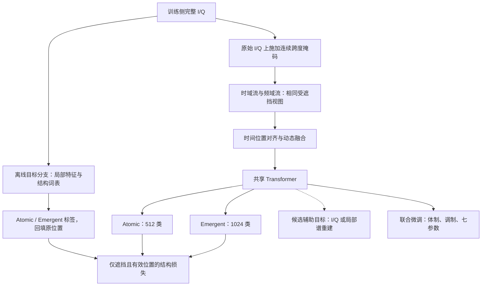

# C01 结构化预训练与时间对齐适配方案

> 依据：用户于 2026 年 11 月 10 日提供的《成果｜从观测偏差到结构学习，面向电磁信号大模型的物理时间对齐与结构化预训练方法》全文，以及本地讲座 2 原始 PPT。对应研究题目为 *Observations Drift, Structures Remain: Structural Pretraining with Time Alignment for Electromagnetic Signals*。
>
> 当前收到的是成果介绍正文，未取得论文完整方法、实验表格或作者实现。本文明确区分“介绍披露的方法”与“面向 C01 的项目设计”，不作为论文完整复现说明。项目实现已完成小规模两轮结构训练及参考词表规模短跑，见[初测报告](docs/self_test_report.md)；全量性能尚未验证。

## 1. 这项研究怎样改变当前路线

原路线将 I/Q 掩码重建作为首个预训练方案，将结构预测放在较后阶段。现在调整为：**先建立可提交的联合监督基线，再以相同共享架构比较掩码重建与结构预测；结构预测成为关键预训练对照。**

研究提出的核心问题是：接收到的波形同时包含信号结构、传播环境和采集过程的影响。优化逐点波形重建，可能使模型保留大量观测条件细节；这些细节能降低重建误差，却不一定利于跨条件分类。

对 C01，这个问题值得验证，但需要同时考虑占初赛 40 分的参数估计。**希望减少的是无益的观测依赖，仍要保留目标参数所需的频率位置、时间起点、局部边缘与尺度。** 例如，频移和时延恰好是比赛目标，不能通过统一的“不变性”约束将它们抹除。

因此，本项目采用“结构预测促进分类迁移，连续信息支持精细估计”的实验思路。它通过同一共享基座实现，不按任务训练独立编码器。

## 2. 成果介绍补充的具体信息

以下均按用户提供的成果介绍记述：

| 内容 | 介绍披露的设置 | 对 C01 的意义 |
|---|---|---|
| RoPE-fs | 根据采样率与 Patch 物理时间位置计算旋转位置坐标 | 时间对齐需要可用采样率，不能由序列长度代替 |
| Atomic 词表 | 512 个原子结构单元，由 Patch 特征聚类得到 | 作为首轮局部结构预测的参考规模 |
| Emergent 词表 | 在原子序列上执行 512 次合并，形成 1024 个预测目标 | 1024 包含原子目标及新组合目标，不是额外的 1024 个纯组合单元 |
| 组合跨度 | 最大展开为 5 个原子位置 | 限制组合长度与监督粒度，避免无限增长 |
| 结构预训练 | 连续跨度遮挡，预测被遮挡位置的 Atomic 与 Emergent 标签 | 原工作核心目标是结构身份预测，非同时恢复全部原始波形 |
| 词表优化 | 从原始 Patch 特征建词表；第一轮预训练后，用编码器特征重建词表并开展第二轮预训练 | 需要验证词表迭代是否带来额外收益，并计入教师推理与聚类成本 |
| 少样本设置 | 每个“类别—SNR 组合”50 或 100 条 | 不能直接简写为每类总共 50/100 条；C01 无 SNR 字段时不能照搬该协议 |
| 下游验证 | 介绍报告 9 个充分监督分类评测集及 8 组少样本结果 | 不能据此推断 C01 七项参数回归也改善 |

讲座 2 的[时间坐标原图](合肥讲座/讲座2/配图/原图_06.jpg)、[框架原图](合肥讲座/讲座2/配图/原图_07.jpg)及[结构单元原图](合肥讲座/讲座2/配图/原图_08.jpg)可用于交叉理解。教师特征的精确定义、聚类标准化、掩码分布细节和第二轮初始化方式仍未完整披露，下面采用的选择属于本项目设计。

## 3. Atomic 和 Emergent 在训练中各做什么

### 3.1 Atomic：预测局部模式身份

将信号按 16 点组织为 Patch。先为许多训练 Patch 提取特征，再聚类成 512 组，每个 Patch 获得一个编号。

这些编号描述“它接近哪类局部模式”，并不直接对应 512 种真实调制、符号或脉冲，也不保证天然不含采集条件信息。模型遮住一段输入后，通过上下文预测相应编号，目标是学习局部模式之间可复用的关系。

### 3.2 Emergent：预测跨 Patch 的组合

统计 Atomic 编号序列中经常相邻出现的组合，通过类似 BPE 的迭代合并形成更长的单元。例如，以下仅为解释：

```text
Atomic：     A1 A2 A3 A2 A3 A4
合并规则：   A2 A3 → E1
组合序列：   A1 E1    E1    A4
位置标签：   A1 E1 E1 E1 E1 A4
```

最后一行将组合编号回填到其覆盖的原 Patch 位置，模型仍处理原来的位置序列。Atomic 头预测局部模式，Emergent 头预测它参与了什么较长组合。

最长 5 个原子位置是组合标签的上限，并不意味着模型只看 5 个 Patch，也不等于更长时序依赖已经全部学会。以本项目 16 点 Patch 计，它最多覆盖 80 个采样点；缺少采样率时不能换算成固定微秒数。

## 4. 接入现有时频双流模型



完整 I/Q 允许用于生成离线训练目标，但不能进入学生的可见输入。学生的包络、差分相位、STFT、归一化和卷积前端都从同一受遮挡视图生成，防止通过频域或统计量暴露真实遮挡值。词表和教师固定，不从验证数据提取目标来拟合词表。

结构预测头及重建头仅用于训练，部署时移除。词表用于生成训练标签，最终推理不依赖词表检索或外挂知识库。三个下游任务继续共享同一基座、同一最终检查点。

## 5. 两轮词表优化的项目实现

### 5.1 先划分，再拟合

C01 已发现 13,129 个跨任务重复波形哈希组。先按内容哈希锁组并冻结训练/验证清单；接口样例单独隔离。词表采样、教师学习、结构标签拟合及后续训练都局限在训练侧。

构建 Patch 池时按任务、长度和可观测结构分层抽样，重复组避免因拥有多种任务标签而重复占据采样配额。不要仅因背景区域数量大，就让低信息区域占据大部分词表容量。

### 5.2 初始词表与第一轮结构训练

用训练侧归一化 I/Q Patch 的局部特征启动。原始向量、包络或局部相关特征如何组合，需要先做小规模诊断；不能将某种特征定义写成论文确切实现。

项目初值可先抽取约 20 万至 50 万个 Patch 特征做分批聚类，得到 512 个 Atomic 中心。记录特征定义、归一化和采样清单，再构造 512 次合并、总目标数 1024、最长展开 5 个原子位置的 Emergent 词表。

合并统计不跨记录、padding 或其他打包边界。回填必须能恢复原 Patch 位置；没有被合并的原子单元保留在 Emergent 预测目标中。先固定这组参考规模验证方法，再决定是否比较更小词表。

### 5.3 用第一轮编码器更新词表

冻结第一轮编码器，用训练侧完整输入提取新的 Patch 表征，重新聚类和合并，保存为第二版词表。随后开展第二轮结构预训练。

本项目可以先从第一轮共享编码器继续训练，同时重新初始化结构预测头，因为更新后的编号不保证与旧词表语义一一对应。这是项目初始化选择，成果介绍没有完整披露原文的初始化策略。

第二版词表在该轮内保持固定。先验证一次重建是否有效，再考虑更多轮；不要让教师、词表、预测头同时不断变化，导致无法定位收益来源。

## 6. 如何同时保留连续参数信息

纯结构目标使用：

\[
L_{struct}=L_{atomic}+\lambda_e L_{emergent}.
\]

两个损失仅在被遮挡的有效位置计算，按样本归一。由于同一组合标签会回填多个位置，应记录长组合占损失的比例；需要时再比较按组合长度反向加权，不能默认该加权属于原方法。

面向 C01 的混合目标候选为：

\[
L_{pre}=L_{atomic}+\lambda_e L_{emergent}+\lambda_c L_{continuous}.
\]

其中连续项从 I/Q 或局部谱重建二选一开始，不同时堆叠所有目标。**混合目标是本项目为参数估计提出的适配，不是成果介绍宣称的原方法。** 七项真实参数标签在下游联合微调阶段使用；不将带标签参数回归混称为纯自监督预训练。

输入端继续保留共用尺度归一化与能量旁路，参数头继续读取局部位置特征。结构预测使用分类损失，不意味着下游的脉宽、PRI、时延也改成离散词表输出。

如果结构目标改善分类却损伤参数估计，先比较连续项、词表粒度与损失权重；依据总体比赛面板选择模型，不强制采用纯结构预训练。

## 7. RoPE-fs 的采用条件

可获得真实采样率时，Patch 中心的物理时间可按项目约定写为：

\[
t_i=\frac{n_i+(P-1)/2}{f_s},\qquad u_i=t_i/t_{ref}.
\]

其中 \(n_i\) 为起始样点，\(P\) 为 Patch 点数，\(t_{ref}\) 为固定参考时间；将 \(u_i\) 用作 RoPE 坐标，并记录 Patch 时间跨度。

**当前 C01 输入缺少采样率。** 第一阶段仍用样点坐标，同步探索结构目标；不能把 512 点和 1024 点分别指定为两种假定采样率，也不能把全部窗口强行映射成相同物理时长。

若赛方后续提供推理时可用的采样率，再比较索引 RoPE、索引 RoPE 加采样率条件、RoPE-fs。在相同采样率信息条件下判断位置编码的独立收益。

按样点中心进行时频分支对齐现在就能实现；按秒进行跨采样率对齐需要额外元数据。这两个环节需要分别报告。

## 8. 实验与验收

保持共享骨干、分组划分、可见输入、掩码比例和微调协议一致：

| 实验 | 目标 | 回答的问题 |
|---|---|---|
| T0 | 联合监督，无预训练 | 比赛可提交基线 |
| T1 | I/Q 掩码重建 | 连续重建是否带来迁移收益 |
| T2 | Atomic 预测 | 离散局部结构目标的独立贡献 |
| T3 | Atomic + Emergent，一轮词表 | 跨 Patch 组合监督的贡献 |
| T4 | T3 加第二轮词表优化 | 表征迭代是否改善结构标签 |
| T5 | 最佳结构方案加连续辅助项 | 是否能兼顾识别与七项参数估计 |

预算有限时先在 S 模型比较 T1/T2/T3，将有收益的方案扩展到 M；两张 A100 可分别运行匹配的实验。T4 的教师推理、词表构建与两轮训练都计入成本，补相近总预算的单轮对照。

按当前全量长度分布，16 点分块约对应 6,048 万个 Patch。若保存全部 384 维 FP32 教师特征，理论数据量约 93 GB，因此采用抽样聚类和流式赋码；不默认缓存全部教师特征。这个数值是容量估算，不是实测训练成本。

验收看两类指标：

- **比赛指标**：两项分类准确率/宏平均召回、七项原单位有效 RMSE、关键长度/类别/参数区间切片、代理分排序敏感性。
- **结构诊断**：词表占用、背景与弱脉冲覆盖、组合长度分布、是否被幅度或长度主导，以及允许增强下的编号稳定性。增强编号变化只是诊断，不能不加区分地强制所有观测因素不变。

C01 没有来源/设备/SNR 字段，暂不能宣称复现了论文中的真实跨域与“类别—SNR”少样本实验。人工加噪或相位旋转属于可控压力测试。新增结构方案只有通过同一比赛验证面板，才进入最终提交候选。

## 9. 修订后的推进顺序

**分组划分与联合监督基线 → 相同架构比较重建/Atomic/Atomic+Emergent → 词表第二轮优化 → 按参数误差验证连续辅助项 → 共同微调与离线部署。**

物理时间 RoPE 作为有采样率时的扩展，谱辅助、雷达掩码和相位特征仍分别做单变量实验。结构化预训练提供新的关键研究方向，最终模型由 C01 实测结果决定。
