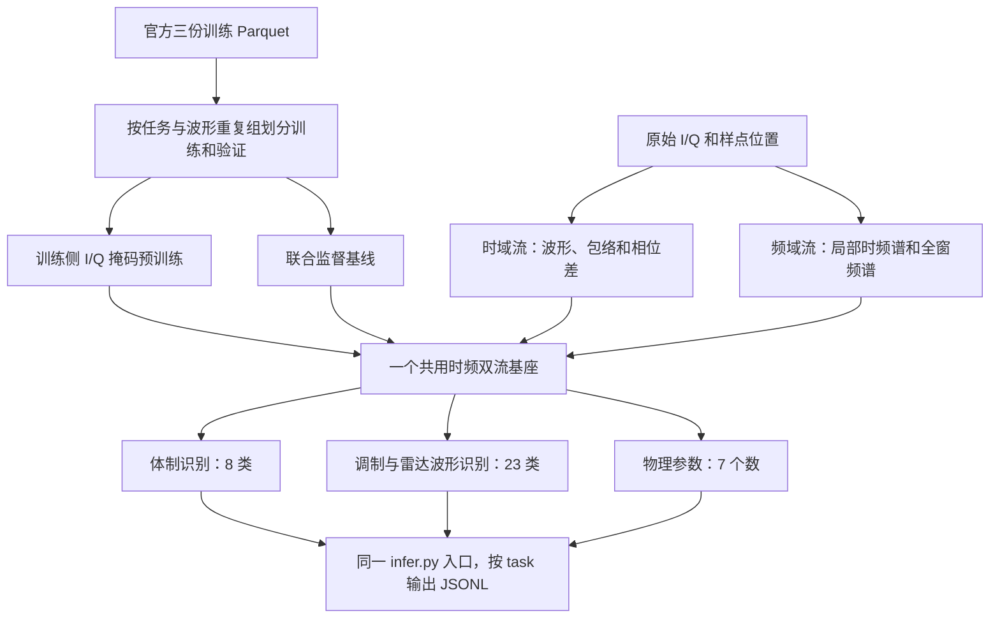

# C01 初赛电磁基座模型与多任务适配技术路线

> 中国电科“网信杯”领域模型赛道 C01「多类型电磁信号通用感知」。本文针对本地 v1.0 训练数据和样例，按赛题 PDF 第 1–8 页的任务、模型约束、接口和初赛评分制定。核对日期为 2026 年 11 月 10 日。[赛题 PDF](<C01 多类型电磁信号感知赛题任务详情描述文档.pdf>) · [官方赛题页](https://wangxinbei.taiji.com.cn/track/33)

## 1. 初赛先做什么

**做一个共用的时频双流编码器，接 8 类体制头、23 类调制与波形头、7 项参数头。** 时域流看 I/Q 波形、相位变化、脉冲和周期。频域流看能量落在哪些频带、频谱怎样随时间变化。两路特征在同一时间位置融合，三个任务都使用融合后的同一套基座权重。

用三份赛方训练数据先跑通**联合监督基线**和离线推理。随后用其中训练分区的无标注 I/Q 做掩码预训练，复用同一编码器联合微调三个头。初赛选型以两项准确率和七个参数的有效样本误差为依据。参数项占 **40 分**，优先把有效位、原始单位、分字段误差及尾部大误差算对。最后导出一个检查点，在 Linux 容器内用同一入口处理三种任务。



## 2. 先锁定比赛规则

| 赛题要求 | 初赛实现 |
|---|---|
| 时频双流编码和跨域动态融合 | 两条输入特征流和一层按时间对齐的门控融合纳入同一网络。时域单流、频域单流仅作本地消融 |
| 基座多任务适配 | 一个基座和三类轻量输出头。三个任务联合训练、共用同一检查点 |
| 参数量上限 1B，共用基座权重 **超过 80%** | 对最终导出模型统计去重后的全部参数和三个任务共用参数。以“共用参数 ÷ 全模型参数”做保守自查，设计目标 ≥90% 留余量 |
| 单一基座 | 最终提交一个模型。规则禁止按任务训练多个基座、多个小模型集成和外挂知识库 |
| 国产化迁移与效率 | 赛题总体包含国产平台适配。初赛评分表未设独立效率分。建模时优先采用可移植算子，同时留出环境和推理验证时间 |
| 架构选择 | 第 2 页允许基于开源模型构建或从零设计。首版建议从零构建小模型。公开研究用于参考结构和训练机制 |

**工程任务与评测输出各有三项。** 赛题工程任务是时频融合、基座多任务适配、国产迁移。自动评测的输出项是体制识别、调制识别、物理域参数估计。国产迁移和双流设计应在成果中可说明和复核。规则出处为 [赛题 PDF 第 1–2、5–8 页](<C01 多类型电磁信号感知赛题任务详情描述文档.pdf>)。

## 3. 本地数据实测和验证划分

### 3.1 数据覆盖和字段

三份训练 Parquet 合计 **1,179,000 条、约 5.89 GiB**，`sample_id` 全部唯一。全部三份都要读。每个分片按任务连续排列，分片号和行号与任务强相关。表中计数来自全量标量列和 Parquet 元数据。[数据使用说明](数据集/使用说明.txt) · [官方任务 Schema](数据集/rf_signal_benchmark_train_v1.0/task_schema.json)

| 训练分片 | 总行数 | `modulation` | `protocol` | `parameter` |
|---|---:|---:|---:|---:|
| part 001 | 346,264 | 207,000 | 139,264 | 0 |
| part 002 | 414,336 | 0 | 4,736 | 409,600 |
| part 003 | 418,400 | 0 | 0 | 418,400 |
| 合计 | 1,179,000 | 207,000 | 144,000 | 828,000 |

- **调制与波形。** 23 类各 9,000 条，包含 18 种通信调制和 5 类 `Radar/...` 波形。标签大小写、空格及斜杠以 Schema 为准。
- **体制。** 8 类各 18,000 条，分别为 `WiFi`、`Bluetooth`、`LoRa`、`5G`、`ZigBee`、`FM broadcast`、`Radar`、`Idle background`。
- **参数。** 414,000 条具有前三个通信参数的有效标签，414,000 条具有后四个雷达参数的有效标签。各项有效值均有限。频移有 **15,131 个有效的真零**，训练和评估都必须使用 `*_valid` 判定适用性。
- **I/Q。** 赛题规定 512 或 1024 个点。抽查的 1,296 条训练波形均为时间优先的 `[T, 2]` Float32，行内两值按 `[I,Q]` 读取。训练 Arrow 采用嵌套列表，样例输入的内层是长度 2 的固定列表。读入后转换到统一张量。批内按长度分桶，混合时传入有效位。
- **可用输入。** 官方测试接口只有 `task`、`sample_id`、`iq`。本地训练也缺少采样率、SNR、设备、会话和来源记录字段。`task` 负责选择输出头，ID 负责回填结果。数值特征全部从 I/Q 得出。

| 参数字段 | 训练有效数 | 实测有效数值范围及结构 |
|---|---:|---|
| `symbol_rate` | 414,000 | 62.5 至 2000，6 个离散取值 |
| `bandwidth` | 414,000 | 65 至 3500，21 个离散取值 |
| `frequency_shift` | 414,000 | −50 至 1000，13 个离散取值，含真零 |
| `pulse_width` | 414,000 | 约 1.0e−5 至 1.6e−5，连续 |
| `pri` | 414,000 | 约 1.7e−5 至 2.3e−5，连续 |
| `time_delay` | 414,000 | 约 1.0e−6 至 1.0e−5，连续 |
| `number_of_pulses` | 414,000 | 2 至 6，训练中以 Float32 表示整数计数 |

这些范围按文件原始数值统计。PDF 第 5 页要求预测采用原始单位，本地 Schema 未单列单位定义。输出需还原任何训练缩放，保留原始数值尺度和有符号频移。训练取值网格用于设计对照，隐藏测试是否沿用该网格仍需赛方口径或独立验证。

### 3.2 划分顺序

1. **固定六条接口样例做冒烟。** 六条样例的 `sample_id` 和完整 Float32 I/Q 均与训练记录逐元素一致。将对应记录和匹配副本排除在用于报告性能的验证集之外。首版可统一移出训练和验证，专门用于接口检查。
2. **先审计波形重复，再分层。** 以统一 Float32 字节表示和长度为原始 I/Q 做内容哈希。跨任务、跨分片的精确重复锁到同一侧，标签冲突单独检查。标量 ID 无重复只是基础检查。若能检测到同一波形的缩放或相位旋转副本，可追加稳健指纹分组。记录实际完成的重复审计范围。
3. **固定一份 90/10 初版划分。** 按组分配。分类按任务、类别和长度平衡。参数按有效字段组合、长度和关键目标区间分层，离散小类保留覆盖。保存样本 ID 清单和随机种子。所有归一化统计、离散码表和预训练仅从训练侧拟合。
4. **额外做压力切片。** 观察 512/1024 点、低幅或弱脉冲、尾部参数区间、混淆类别。做一个只用长度的本地诊断，判断模型从长度获得多少线索。缺少设备与会话元数据时，结果只能称赛方训练集内的分层留出和可观测属性压力测试。
5. **流式训练。** 用 Parquet row group 或 Arrow batch 读波形。先读标量列建立索引，再按任务混合、按长度组批。可在确认额外磁盘空间后建定长缓存。联合监督从三个任务等配额开始，参数任务内部保持通信与雷达覆盖。参数行占约 70.2%，全表均匀取样会减少两项识别在每轮训练中的覆盖。评分的 30/30/40 用于选模，训练权重根据各项损失和验证结果调整。

## 4. 可以直接实现的模型

### 4.1 共同输入与时频对齐

| 模块 | 初版设计 | 目的 |
|---|---|---|
| 波形预处理 | 保留原始 I/Q。可增加 I/Q 共用尺度的归一化副本，保留 RMS、峰均比等量作为特征 | 保留整体能量与局部变化，避免逐通道归一化改变 I/Q 关系 |
| 时域流 | 轻量 1D 卷积提取局部波形。输入联合 I/Q、包络、短滞后相关和加权差分相位候选。默认每 16 点输出一个 token | 保留相位、边缘、脉冲间隔等细节。512/1024 点分别得到 32/64 个 token |
| 频域流 | 从复 I/Q 计算双边频谱。用 64/128 点窗、16 点步长的局部 STFT 作起点。另做全窗 PSD 汇总，保留正负频率 | 局部谱捕捉扫频、突发和重复结构。全窗谱表达带宽、谱中心与占用 |
| 融合层 | 保存时域 token 和 STFT 窗的中心样点。将谱特征按中心对齐，掩码处理边界，再用通道门控把谱特征注入对应时域 token | 将同一时刻的波形与频谱结合，允许模型按样本决定两路特征贡献 |
| 共享编码器 | 6 层、宽度 256、8 头注意力、FFN 宽度 1024 作为起点。用样点位置或 patch 索引编码。预计全模型约数百万至千万参数，最终以实例计数为准 | 所有任务共用双流、融合和主干。分类可读池化向量，参数头还读带位置的局部特征 |

将 STFT 频率表达为 **cycles/sample**，将时间表达为样点位置或相对窗口位置。测试样本缺少 `fs`，因此首版采用样点坐标，RoPE-fs 留给赛方明确补充推理采样率后再比较。脉宽、PRI 和绝对频率等目标的换算由模型借助训练标签学习。只有 I/Q 且采样率变化未知时，绝对量的可辨识性依赖波形结构、训练分布和采样链路约束。应通过留出目标区间、两种长度和波形类型的误差检查模型依赖的线索。

融合可以从 `h = h_time + gate(h_time, h_freq) * project(h_freq)` 起步。序列继续由共有 Transformer 编码。给参数头保留局部 token 和样点位置，避免只用全局平均后丢失脉冲起点。与国产平台算子兼容性一并验证。若 FFT 导出受限，可比较用固定实数卷积核实现 STFT 或把前处理放进同一推理包，在平台上比对输出与耗时。

### 4.2 任务头设计

| 输出 | 推荐头 | 第一个要看的错误切片 |
|---|---|---|
| 体制 8 类 | 时频融合后的掩码感知池化，加小型 MLP 输出 8 logits | WiFi/5G 等宽带体制之间的混淆、弱信号与 Idle 的混淆。用谱占用、重复周期和局部纹理辅助区分 |
| 调制与波形 23 类 | 共享基座池化，加小型 MLP 输出 23 logits | 近邻 QAM/PSK/FSK，以及不同雷达编码和 LFM。时域看相位轨迹，频域看频移与扫频结构 |
| 通信参数 3 项 | 全局频谱与局部相关特征汇入同一参数头的速率、带宽、频移输出 | 带宽与码元速率的条件关系、频移正负和零值。保留绝对谱位置与相对频率两类表征 |
| 雷达参数 4 项 | 保留按样点排序的 token，结合包络、局部边缘和滞后相关，输出脉宽、PRI、时延、脉冲数 | 窄脉冲、低幅、波形首尾截断、较多脉冲。观察预测开始位置、重复间隔和计数的一致性 |

首版让参数头每次都产出七个数，按目标字段掩码训练。按需增加辅助的有效字段模式预测，它只辅助表征学习或软门控。评分采用主办方的真值有效标记。长度、任务标识与训练标签可用于分层和监督，禁止通过 `sample_id`、分片或文件顺序编码答案。也避免以 512/1024 点直接硬路由到两套推理模型。

用去重后的参数名清点共用与专用部分。比如共用 6.0M、三个头合计 0.6M 时，按全模型作分母的共用比例约为 90.9%。这是设计演算，实际报告应附参数清单及统计口径。全部任务都通过同一共享双流和融合骨干。

## 5. 训练与微调顺序

### 5.1 建立可提交的联合监督基线

用同一基座训练三个任务头，分类用交叉熵。对有效目标 `j`，用训练侧固定中心 `μ_j` 和尺度 `s_j` 归一化。参数损失可先用稳健 Huber 过渡，再对标准化残差做 MSE，最后用原始尺度 RMSE 选模。正值和带符号字段分别处理。每个字段独立按有效个数归一，再平均有有效样本的字段。无效标签即使为零也跳过，批内没有有效值的字段跳过该项。

$$
L_{\mathrm{reg}}=\frac{1}{|J_b|}\sum_{j\in J_b}
\frac{\sum_i m_{ij}\big((\widehat y_{ij}-y_{ij})/s_j\big)^2}
{\sum_i m_{ij}}.
$$

这里 `m_ij` 由训练真值有效位确定，`J_b` 是批内有有效标签的字段集合。分类同样以任务和对应的 `*_valid` 取样。首轮保留各头损失和各字段梯度或尺度诊断，再用验证结果调权。不要用未归一化的七项平方误差直接求和，数值范围大的字段会主导梯度。

**值得优先做的参数对照**是通信三项和脉冲数的连续回归，和“训练网格分类加概率加权的数值期望”。概率期望提供连续预测，也可加小残差留出外推空间。脉冲数应单独对照是否取整。只在有明确规则或独立验证支持时硬量化、截断或写零。模型最终以原始数值尺度导出，七个键都提供有限数字。

### 5.2 用赛方训练 I/Q 做预训练，再联合微调

1. **先跑掩码重建。** 从训练侧全部任务取 I/Q，标签暂时不用。遮住一部分连续或随机的时间小块，用同一个共享编码器和轻量解码器补齐 I/Q。基线可试 30% 和 50% 有效块遮挡。比例为项目初值。评估应查看少标签迁移和参数误差，重建损失仅用于收敛诊断。[MAE](https://arxiv.org/abs/2111.06377) · [EMind](https://arxiv.org/abs/2508.18785)
2. **避免双流互相暴露目标。** 在原始 I/Q 的时间位置先施加遮挡，再由同一受遮挡视图计算两路输入。完整 PSD 或完整 STFT 只能作为预测目标。检查卷积感受野、窗边界、标准化和相位差计算都无法把被遮挡的真实值带进可见输入。掩码可额外作为模型输入，供它区分真零与遮挡位置。
3. **联合微调。** 初始冻结基座比较只训头的能力，再从预训练权重出发，用统一较小主干学习率联合更新。初赛最终保留同一基座与三头。如果试 LoRA，用共用更新或者合并到唯一基座，并重新统计共享权重比例。任务专有层保持轻量。与相同结构、相同训练和验证清单的从零联合监督公平对照。[LoRA](https://arxiv.org/abs/2106.09685)
4. **有增益再加专项预训练。** 在训练侧雷达样本上，比较随机掩码和脉冲能量引导的混合掩码，匹配总遮挡量与计算。检验低幅波形的覆盖。对差分相位使用 I/Q 保留的辅助通道，比较不加、未加权、可靠性加权。参数任务中频移、时间平移、裁窗和伸缩都可能改变真值，只有能同步重标且可验证时才用于该头。
5. **外部数据和权重分开登记。** PDF 允许开源基座。首版使用赛方训练数据便于比较、复现和适配。额外语料、第三方权重的使用条件与来源按赛事最新规则核对，公开研究给出的分数单独引用。

### 5.3 三场讲座在 C01 的取舍

| 讲座技术 | 对初赛的取舍 |
|---|---|
| 讲座3 IQFM / KRMAE / RW-DPhase | 优先借鉴统一 I/Q 基座和任务适配。雷达混合掩码用于专项继续预训练对照。加权差分相位用于时域辅助通道。二者各自消融 |
| 讲座2 RoPE-fs / Atomic / Emergent | 缺少 `fs`，用索引或相对样点位置。若域偏差成为主要问题，可从训练侧固定词表的 Atomic 掩码预测开始，再对照 Emergent。词表需监控是否把长度和波形域当作捷径 |
| 讲座1 Mamba / MSP / APA | 官方输入 512 或 1024 点，16 点分块只需 32 或 64 个 token。首版用同一编码器和分桶处理。MSP 可作频谱或多尺度目标的后续对照。只有实测推理开销或更长输入成为瓶颈时，再评估 Mamba 或 APA |

补充研究用 EMind 的多源掩码重建作为预训练参考，用 SpectrumFM 的重建与时序预测作为目标对照。离散结构标签可参考 HuBERT 的离线聚类和遮挡预测。三类研究提供设计依据，组合收益通过 C01 留出集验证。[讲座1](合肥讲座/讲座1/讲座1_SigMA短序列预训练与长信号迁移_解析.md) · [讲座2](合肥讲座/讲座2/讲座2_异构观测下的物理时间对齐与结构化预训练_解析.md) · [讲座3](合肥讲座/讲座3/讲座3_电磁信号大模型构建技术及应用展望_解析.md) · [SpectrumFM](https://arxiv.org/abs/2505.06256) · [HuBERT](https://arxiv.org/abs/2106.07447)

## 6. 按初赛评分做验证和选模

依据 PDF 第 7–8 页，体制和调制按准确率计分，准确率一致时考虑宏平均召回率。参数项以误差相对固定参考尺度换算。用 0 到 1 的准确率和精度项表示，原始总分可写为

$$
S_0=30\,A_{\mathrm{protocol}}+30\,A_{\mathrm{modulation}}+40\,P_{\mathrm{param}},
\qquad
P_{\mathrm{param}}=\frac{1}{1+\mathrm{RMSE}/s_{\mathrm{official}}}.
$$

第 7 页表格的参数说明写“样本方差”，第 8 页具体计算式写 RMSE，本路线按公式设计本地训练与验证。PDF 未公布固定参考尺度的数值、七字段聚合细节或复测换算方式。初赛最终成绩还结合复测。本地分数应标注为代理分，收到官方评测程序或更详细口径后再对齐。[赛题 PDF 第 7–8 页](<C01 多类型电磁信号感知赛题任务详情描述文档.pdf>) · [官方赛题页](https://wangxinbei.taiji.com.cn/track/33)

| 每次跑完记录 | 用途 |
|---|---|
| 两个准确率、宏平均召回、各类召回、混淆矩阵 | 分别定位体制和调制的掉分，不把两项合成一个 Accuracy |
| 七项有效 RMSE、MAE、样本数、误差分位和异常预测数 | 使用原始单位和 `*_valid`。逐项发现时延、符号率、频移等误差。看尾部大误差能否复测稳定 |
| 统一的代理选模表 | 用训练侧固定的正尺度计算各字段归一化 RMSE。先对七项归一化 RMSE 等权取平均得到 R，再用 1/(1+R) 作为本地参数代理，按 30/30/40 计算参考分。另试不同尺度倍率和归并口径，观察排名是否反转 |
| 复测 | 固定验证清单和版本，用至少两次独立训练或重跑确认重要差异。记录统一模型的各项得分和推理时间，提交同一份检查点 |

第一轮实验建议依次完成以下对照。每一步都保留此前通过格式检查的统一模型版本。

| 实验 | 与谁比 | 决策 |
|---|---|---|
| B0 双流联合监督 | 时域单流、频域单流，仅作消融 | 证明融合是否对协议、调制、参数分别有增益 |
| B1 参数头设计 | 连续回归、网格概率期望、有无残差 | 以七项有效原尺度 RMSE 和尾部误差决定 |
| P0 掩码预训练后联合微调 | 同结构 B0，使用相同监督数据和验证划分 | 判断预训练能否提高赛题分数，尤其少标注与跨长度切片 |
| P1 脉冲混合掩码 / 相位辅助 | 依次单变量改变，保持共同起点和训练预算 | 看脉冲参数误差、雷达波形召回和通信项是否同时稳定 |
| F0 最终候选离线复测 | B0 或最高的可复现单检查点 | 比较两项准确率、七项 RMSE、代理分敏感性、格式及容器复测 |

验证阶段可先使用同一份全量标签分区做主选型，再按固定少标签子集估算预训练贡献。避免只用训练重建损失、少量样例结果或一项准确率决定是否提交。

## 7. 输出接口与交付

### 7.1 用本地六条样例验收推理

样例输入 Parquet 只有 `task/sample_id/iq`，样例的 `truth` 和 `expected_output` 用于核对格式。读取时保留输入原顺序。对每行使用 `task` 选择输出。两类分类的 `prediction` 是 Schema 原字符串。参数的 `prediction` 是含下列七个键的数字对象，统一还原到原始尺度，由组织方按保留的真值有效位评分。

```text
symbol_rate, bandwidth, frequency_shift, pulse_width, pri, time_delay, number_of_pulses
```

序列化采用 UTF-8 JSONL，一行一条，对应原输入的 `task` 和 `sample_id`。检查条数、ID、顺序、类名、字段全集和有限值。输出不带 `*_valid`。样例中的不适用项为 0，生产推理只接收公开输入，不从真值文件决定哪些项清零。先通过样例检查结构与路由，再在自留验证集检查真实推理结果。[样例输入](数据集/rf_signal_sample_io_v1.0/rf_signal_sample_io_input_v1.0.parquet) · [样例输出 JSONL](数据集/rf_signal_sample_io_v1.0/rf_signal_sample_io_expected_output_v1.0.jsonl) · [样例真值](数据集/rf_signal_sample_io_v1.0/rf_signal_sample_io_truth_v1.0.json)

正式交付是组织方读取并运行的**模型代码、权重与推理包**。JSONL 是推理产出。按组织方实际调用方式完成 `code/infer.py`，参数名与入口签名以赛方评测程序或后续通知为准。

### 7.2 按 PDF 第 5–6 页整理成果

| 位置 | 初赛应备内容 |
|---|---|
| `README.md`、`code/infer.py` | 运行说明与统一推理入口，记录输入列、归一化、批处理和输出校验 |
| `code/models/`、`code/training/`、`code/utils/`、`code/configs/` | 模型、训练及处理源码。固定随机种子、数据版本、切分、预训练和微调配置 |
| `weights/config.json`、`weights/model.safetensors` | 标签顺序、参数逆变换、分块与时频配置。仅一个最终模型权重 |
| `datasets/readme.txt`、`environment/` | 训练数据及来源说明、依赖锁定、环境配置。按官方提交渠道核对数据交付方式 |
| `logs/`、`docs/technical_report.doc`、`docs/self_test_report.md` | 训练、推理与调试日志，技术方案、消融与误差分析，参数共享比例与本地资源报告 |
| `docker/llm_docker.tar` | Linux 镜像，预装全部推理依赖、代码和所需权重。不声明匿名 VOLUME，不依赖运行时下载 |

基线环境按赛题 PDF 为 Ubuntu 22.04 LTS、CUDA 12.x、PyTorch。训练框架可按规则选择。尽早在 Linux 容器断网运行样例，验证可复现输出。先核对 CPU 或普通算子路径的正确性，再记录指定硬件上的时延、显存及国产平台实测结果。成果文件和目录按规则采用英文、数字与下划线并用 UTF-8，外层包名按平台要求组织。

## 8. 初赛执行顺序

1. **读数据和打通接口。** 读取三份 Parquet，固定分组与验证清单，检查 512/1024 点混合批和 6 条样例。先让同一个 `infer.py` 能输出三类 JSONL。
2. **完成一版合规模型。** 上线本地时频双流、共享骨干和三类任务头，跑联合监督和参数头对照。保存一版完整镜像和同一权重的自测结果。
3. **验证预训练增益。** 只用赛方训练侧做 I/Q 掩码预训练，再联合微调。按两项准确率和七项有效 RMSE 比较，优先攻关跌分最明显的参数或类别。
4. **追加有明确假设的改进。** 从物理特征、差分相位、关键区掩码中每次只改一项。记录每次收益与成本。长序列结构改动排在实测需要之后。
5. **冻结并复测提交候选。** 核对单基座和参数统计、JSONL、日志、依赖、报告与镜像。确认官方参考尺度、七字段聚合、调用签名和赛题最新提交要求。如缺细节，按正式通知补齐。官网 C01 页面列出作品提交截止为 **2026 年 12 月 15 日**，后续调整以赛题页公告为准。[官方 C01 赛题页](https://wangxinbei.taiji.com.cn/track/33) · [大赛官网](https://wangxinbei.taiji.com.cn/)
