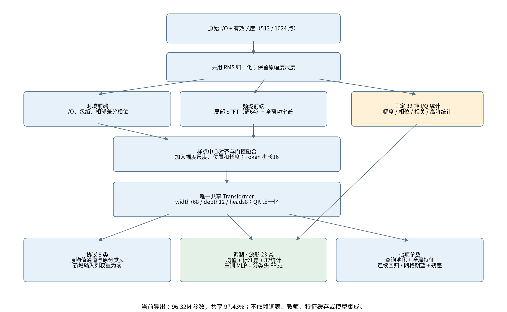
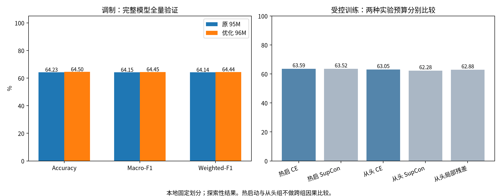

# 阅读说明与核心判断

本文用于与研究和工程同事讨论，汇总当前项目中可核验的数据审计、模型方案、工程验证、训练诊断、控制实验及负结果。内容来自本地代码、配置、日志、指标 JSON 和既有报告；本次整理没有启动新的训练。它是阶段复盘，不是已经完成正式环境验收的比赛提交报告。

读者可先看本节、模型方案、验证总账和阶段结论，再按证据索引复核。文中的“体制”和“协议”均指赛题的 protocol 任务；“调制”包含五类雷达波形编码。约 17M / 95M / 96M 是简称，后文列出精确参数量。

**当前结论：**

1. 一个共享时频基座、两项分类和七参数输出的训练—评估—导出—推理流程已可执行；代码层检查、单卡与合法双卡、恢复和接口测试已通过。
2. 早期大模型确有注意力饱和和非活动头被 AdamW 修改的问题，已定位、修复并通过真实数据对照验证。修复后的严重过拟合是后续另一阶段的问题，不能混为一谈。
3. 原 95.71M 监督模型训练调制准确率近 100%，验证约 64.23%。冻结后重训线性/MLP 头仍约 64.28%，主要瓶颈已进入共享编码器对新记录的特征泛化。
4. 最新保留原基座、增加统计读出并重训调制头，得到 96.32M 单模型；调制 Accuracy=64.5008%、Macro-F1=64.4523%。相比原模型仅提升约 0.27 个百分点，协议与参数误差完全一致，未解决主要泛化瓶颈。
5. 相位/平移增强、标签平滑、SupCon、局部残差前端均未在已执行设置中给出明确、稳定的优势；负结果也完整保留，未默认叠加这些候选。
6. 结构化预训练、两轮词表和物理时间位置编码属于实现/研究路线。结构预训练只完成短程流程验证；当前正式模型没有使用全量结构预训练权重。C01 无真实采样率，当前使用样点 RoPE，没有复现 RoPE-fs 跨采样率实验。



# 赛题要求与评价口径

## 任务与提交约束

依据仓库原始赛题 PDF 第 1–9 页：三项工程任务为时频双流编码与融合、统一基座多任务适配、国产平台迁移和效率提升。自动评测输出为 23 类调制/波形、8 类体制、7 个物理参数。

| 约束 | 当前实现 / 状态 |
|---|---|
| 最终模型不超过 1B；任务间共用基座权重超过 80% | 最新 96,321,869 参数；共享 93,849,216，占 97.4329% |
| 不得按任务训练多个基座、不得多个小模型集成、不得外挂知识库 | 最终为一个基座和轻量输出头，无模型集成，无外部检索 |
| 输入仅 task / sample_id / iq | task 选择结果类型；ID 仅回填，不作为数值特征；推理不读取真值有效位 |
| JSONL 按输入记录输出 | 分类返回 Schema 原字符串；参数全部七键、有限数值、原始数值尺度，不输出有效位 |
| code/infer.py、weights/config.json、model.safetensors 等目录规范 | 核心目录与接口已有；Docker 和正式目标环境尚未完成 |
| Linux 离线依赖、CUDA 12.x 基线与国产适配 | 本机验证是 CUDA 13；目标环境、镜像和国产硬件尚待验收 |

初赛体制、调制、参数权重分别为 30 / 30 / 40。准确率相同时参考宏平均召回。参数精度公式涉及 RMSE 与固定参考尺度，但本地材料未提供尺度数值及七字段聚合细节，因此代码使用训练侧尺度建立本地代理分。**本文所有 proxy_score 都不是官方比赛成绩。** Macro/Weighted-F1 是额外诊断指标，不是赛题所列的独立计分项。

复赛还考察计算效率，自动评测与专家评审占 70% / 30%。目前没有国产平台延迟排名或官方成绩，不能把六条样例的冷启动耗时当作正式吞吐结果。

# 数据组织、处理目的与已完成审计

## 数据规模与实际划分

原始目录：`/mnt/disk1/wangxinbei_contest_dataset/C01`。三份训练 Parquet 共 1,179,000 条，约 5.89 GiB；调制 207,000、体制 144,000、参数 828,000。调制 23 类各 9,000 条，体制 8 类各 18,000 条。移除六条接口样例后，缓存为 1,178,994 条。

| 任务 | 训练记录 | 验证记录 |
| --- | --- | --- |
| modulation | 186,113 | 20,885 |
| protocol | 129,487 | 14,511 |
| parameter | 745,212 | 82,786 |
| 合计 | 1,060,812 | 118,182 |

缓存 `artifacts/data_full` 由 iq.npy、metadata.npz、dataset.json、split_manifest.parquet 组成。I/Q 保留 Float32，最长 1024 点，读取时按真实长度裁切并组批；缓存没有重采样或改变原始波形，原数据文件未修改。manifest 是带源文件/行号、内容哈希、标签等的审计索引，用于可追溯划分和定位，不是模型输入，也不是官方评测所需文件。

划分实际为确定性内容哈希阈值、近似 90/10，不是严格按类别配额的精确分层。数据指纹为 `fbe00e89211c3234ce5bd3041a5b8bc179ce27e0e8346ff2a08e5f010389fd45`。同一指纹贯穿主要模型、词表和对照实验。

## 审计发现及落实的处理

| 审计项 | 发现 | 处理与结论 |
|---|---|---|
| 全量 I/Q 与标签检查 | 未见非有限 I/Q、空/零能量信号、异常长度、未知标签和有效参数非有限值 | 没有发现明显的读取/标签损坏证据，不等于排除了隐含生成问题 |
| 精确波形重复 | 13,129 个重复组，全部跨任务；无同任务标签冲突 | 以长度与原始 Float32 内容哈希锁组，同组只在一侧；跨 split 哈希重叠=0 |
| 六条官方接口样例 | 均在训练数据中找到完全相同波形 | 六组从训练/验证隔离，仅做接口测试，不作为独立精度证据 |
| 任务分布 | 参数记录约占 70.2% | 使用任务均衡采样，而不是全表均匀取样 |
| 长度与标签 | 五类调制雷达均 512 点，18 类通信均 1024 点 | 长度可用于组批但存在捷径风险；不按长度训练/硬路由两个基座 |
| 幅度分布 | 不同任务 RMS 差异显著 | 共用 RMS 归一化并保留原尺度旁路；后续需检验分类是否不当依赖旁路 |
| 参数结构 | 码元率/带宽/频移为 6/21/13 个取值；计数为 2–6；雷达时间字段连续 | 前三项和脉冲数支持网格期望+残差；三项时间字段保持连续 |
| 有效参数真零 | 频移有 15,131 个有效零 | 按 *_valid 计算损失与指标，不能用数值为零判无效 |

训练目标标准化、参数网格、词表聚类与 BPE 均仅在训练侧拟合。验证保留原始记录计分；`merge_paired` 只允许合并训练侧同波形真实标签，当前正式主配置为 false。配对合并通过流程检查，但尚无完整质量对照证明收益。

**审计边界：**精确哈希不覆盖加噪、缩放、旋转或裁窗后的近重复，也未实现设备、会话、共同干净父波形隔离。缺少这些元数据，不能宣称真实跨设备或跨采集场景泛化；参数元组相同也不能直接判同源。

# 当前模型方案及研究来源

## 共享时频编码器

1. 共用输入处理：有效 I/Q 共用复 RMS，提取归一化 I/Q、包络、可靠性加权的相邻差分相位实虚部。原始尺度取 log 后通过小投影回注，归一化不代表模型完全幅度不变。
2. 时域流：核 5 的卷积、GELU、核与步长 16 的 Patch 卷积。512 / 1024 点对应 32 / 64 个 Token。
3. 频域流：窗长 64、步长 16 的局部双边 STFT 功率，通过 log1p 与卷积编码；全窗 1024 点功率谱经 MLP 提供频率位置参考。
4. 对齐与融合：两路在样点中心对齐，门控融合。加入尺度、绝对样点位置与长度；绝对位置对时延估计有意义。
5. 共享 Transformer：宽 768、12 层、8 heads、MLP 倍率 4、Dropout/Attention Dropout 0.1、RoPE base=10000、QK 单位 RMS 归一化、固定 QK scale=1。

局部 STFT 使用固定实数 DFT 卷积核；全局 FFT 可切为实数矩阵乘，并已测试数值一致性。这是可移植性准备，不能替代目标国产平台实测。

## 三任务输出与最新统计读出

两分类原本均为有效 Token 均值加 MLP。最新模型构造“均值 + 标准差 + 32 项 I/Q 统计”，仅重训调制 MLP；隐藏层宽 384，输出 23 类。协议头新增列权重补零，保持原预测。32 项统计来自幅度分布、高阶矩/累积量、复相关、相位谐波等，无可训练参数，无额外采样率/SNR 元数据。

| 模型版本 | 宽 / 层 / heads | 最终参数 | 共享参数 | 共享比例 |
|---|---|---|---|---|
| 原小模型 | 384 / 8 / 6 | 17,089,229 | 16,602,432 | 97.1514% |
| 修复后原大模型 | 768 / 12 / 8 | 95,707,469 | 93,849,216 | 98.0584% |
| 当前统计读出 | 768 / 12 / 8 | 96,321,869 | 93,849,216 | 97.4329% |

七参数头使用七个可学习查询汇总局部 Token，再与全局特征结合。对码元率、带宽、频移、脉冲数，可用训练网格概率期望加有界残差；脉宽、PRI、时延保持连续回归。输出始终是七个原始尺度数值，真值有效位只在训练与本地评价使用。

统计读出的训练侧特征均值/标准差已折入首层权重，折叠最大 logit 差约 6.68e-6。分类头与统计量使用 FP32，基座仍支持 BF16。导出无离线特征缓存、词表或教师依赖。

## 当前实际训练与预训练路线必须区分

| 路线 | 实现内容 | 证据状态 |
|---|---|---|
| 联合监督 | 一个基座，三任务均衡抽样，分类 CE，参数标准化 MSE 与网格辅助 CE | 已有全量训练与验证，是当前正式基座来源 |
| I/Q 掩码重建 | 原始输入先遮挡，学生两流和 RMS 都由受遮挡视图生成，完整 I/Q 只作目标 | 已通过短程流程和防泄漏检查；未证明全量迁移收益 |
| Atomic / Emergent 结构预测 | 训练 Patch 聚类、Atomic 序列 BPE、遮挡位置预测、第二轮教师特征重建词表 | 两轮小规模流程通过；512 原子+512 合并+最大5跨度参考规模短跑通过；全量质量未验证 |
| 物理时间 RoPE-fs | 模型 API 支持在已知真实采样率时使用物理时间坐标 | C01 无采样率，正式配置 position=samples；未做跨采样率质量验证 |
| SupCon | 同类不同记录正样本；重复采到同一行排除；训练辅助投影，导出剔除 | 热启动与从头受控实验未胜过 CE，默认权重 0 |

结构路线参考用户提供的 *Observations Drift, Structures Remain: Structural Pretraining with Time Alignment for Electromagnetic Signals* 成果介绍。已知思想包括观测偏置、RoPE-fs、原子/涌现结构、迭代词表。本项目未取得完整论文方法与作者实现，聚类标准化、教师特征、标签回填等是项目选择，不称为完整论文复现。

讲座3主要借鉴统一 I/Q 基座、任务适配、可靠性加权差分相位及雷达混合掩码候选；重建不再被视为天然能带来下游收益的结论。讲座2提供结构与时间对齐方向；讲座1的长序列/Mamba方向尚未进入当前模型。**当前从零监督大模型的过拟合，不能归因于它没有实际执行过的波形重建预训练。**

## 训练配方、batch 与可复现性

主入口仍为 `code/configs/main.json`，支持结构化 JSON 配置和注释，实际启动配置保存在运行目录。当前设置为 AdamW LR=1e-4、weight_decay=0.01、基座 LR 倍率 1、梯度裁剪 1、cosine 预热 500 更新、最低 LR 比例 0.01、BF16 训练与 FP32 验证。80 epochs 是后续联合训练预算配置，不是已证实的最优停止点；主配置也不等于本次两阶段统计读出的精确复现配方。

`data.batch_size=256` 指每卡微批次，不是每类或全部数据。当前每个 batch 为同一任务、同一长度的多条独立记录，采用有放回抽样。全局有效 batch=每卡 batch×卡数×梯度累积数。单卡为256，双卡每卡256为512；改变卡数会改变优化配方，不能直接视作等条件复现。

实际严重过拟合的 44 轮运行是 world_size=1、全局 batch256、每轮4144更新、计划80轮 cosine。每轮约1.9倍调制训练集曝光，44轮约84倍；曝光不是新增独立样本。当前最终模型则是“原44轮监督基座 + 冻结基座重训读出20轮”，不是又完成了80轮新训练。

分类用 CE；参数先按训练侧尺度标准化，再对有效字段平均 MSE，网格项权重0.1。SupCon默认0、标签平滑0、相位/平移增强默认0、局部残差前端关闭，保留QK归一化与非活动头保护。

# 验证总账：问题、设置、结果与边界

## V01–V05：数据、流程、配置与训练可观测性

| 编号 | 完成的验证 | 结果与用途 |
|---|---|---|
| V01 数据全量审计 | 所有标量列与每条训练 I/Q；重复组、长度、参数有效位和接口匹配 | 发现跨任务重复和长度/任务关联，落实分组划分与有效位处理；没有发现明显数值损坏 |
| V02 原始/缓存一致性 | 缓存再次核对源波形内容哈希；固定分组；仅训练侧拟合 | 跨split精确哈希重叠0；无波形改写与目标统计泄漏证据 |
| V03 端到端初测 | 592条小缓存，296训练/296验证；监督3步→续训6步、重建、两轮词表/结构训练、微调、评价、导出、CPU/GPU与JSONL、双卡 | 首轮及配置、时间戳、稳定性更新后的4套流程均各17阶段通过；只证明执行性，不证明竞赛精度 |
| V04 配置与cosine | 3微批次累积；连续6更新 vs 2更新中断后恢复；不同基座LR；调度端点和CLI覆盖 | 最终模型逐张量一致、调度状态相同；最后头/基座LR=3e-5 / 3e-6；合法双卡累积通过 |
| V05 显示、日志与存盘 | 总览、逐epoch step进度、损失/LR、关闭进度条、时间戳重复启动、续训目录和DDP单目录 | 通过；最新train.log为可读文本，events.jsonl为机器事件，逐类指标完整。历史“train.log是JSON”的报告仅描述旧状态 |

源状态位于 `artifacts/full_pipeline_smoke/`、`config_v2_pipeline/`、`timestamp_pipeline/`、`attention_repair/pipeline_smoke/`；数值一致性位于 `config_v2_checks/result.json`，显示和时间戳位于 `training_display_smoke/result.json`、`timestamp_repeat_check/result.json`。

## V06：第一次扩参退化与配方混杂

两次均单卡有效batch256、相同数据指纹。17M计划30轮，原95M计划200轮，峰值LR均3e-4，所以两者cosine进度不同，不是严格“只改参数量”的实验。

| 模型与阶段 | 调制Accuracy | 体制Accuracy | 本地代理分 |
|---|---|---|---|
| 17M，第5轮 | 61.66% | 93.37% | 75.12 |
| 原95M，第5轮 | 50.78% | 90.71% | 69.86 |
| 原95M，第8轮当时最佳 | 54.47% | 92.58% | 71.88 |
| 原95M，第16轮 | 45.05% | 79.26% | 63.27 |

95M第16轮梯度裁剪前P95约293，训练损失也升高。这一阶段首先是优化退化，不能只解释为典型过拟合。原200轮计划在第16轮仍接近峰值LR；已准备的30轮/长预热配置不等于各自都完成了全量质量验证。

## V07–V09：稳定性定位与受控修复

原95M末层注意力logit绝对值约7万–17万，归一化熵约0.006–0.007，近95%注意力接近单点。Pre-LN没有限制Q/K投影幅度。修复逐头FP32单位RMS Q/K后，固定诊断批次logit约8.5、熵约0.53–0.62，近单点比例0。该统计是固定批次，不是全分布证明。

另通过单元回归确认：为DDP保留的零梯度连接会让无标签头被AdamW历史动量/衰减修改。修复在更新前将不活动头grad设为None；活动集合按累积微批次和DDP rank并集处理。

**V07短程探索：**以下均为600更新、固定8064条验证子集末点，不能与全量分直接混用。`fixed`同时启用多项稳定化，包含融合归一化；不等于后来的最终修复。

| 探索组 | 调制Accuracy | 本地代理分 | 梯度P95 |
|---|---|---|---|
| control | 54.7894% | 71.9423 | 9.5132 |
| fixed（多项同时调整） | 53.4307% | 71.3659 | 1.9163 |
| qk_only | 55.1970% | 72.4402 | 1.3611 |
| fusion_only | 38.3152% | 63.7499 | 15.6328 |

直接给旧权重打开融合归一化明显损害结果，故正式保持false。该结果不等于从头使用融合归一化必然无效。

**V08完整2400更新控制实验：**同一95M起点，两边均重置优化器，batch256、LR3e-4、相同采样流；一边原实现，一边QK归一化+非活动头保护。

| 指标 | 原实现继续训练 | 修复 |
|---|---|---|
| 全量调制Accuracy | 52.26% | 57.30% |
| 全量体制Accuracy | 89.70% | 93.59% |
| 全量本地代理分 | 70.03 | 73.58 |
| 最后400更新梯度P95 | 12.51 | 1.29 |

七项RMSE均下降。该对照支持组合修复有效，但没有单独分离两项修复的全部精度贡献；两边均重置优化器，也不能把重置本身当作独立收益。

**V09精调和温度校准：**相同起点额外1200更新，固定子集LR3e-4为73.63分、LR1e-4为74.47分；低LR全量约74.58分。后续候选全量调制59.83%、体制94.08%、代理74.6765，仍低于当时17M代理75.1197。QK scale 0.75/1/1.25/1.5/2在8064子集上的代理分为74.0457/74.6489/74.5700/74.3020/74.0388，保留1。补充训练不能全归因于首轮修复。

## V10–V12：修复后重训的过拟合、扰动和增强

**V10真实95M重训：**确认QK归一化、非活动头保护及1e-4已加载；从零监督，无预训练初始化。第44轮全量调制64.2279%、体制94.4180%、代理76.8684。第8→44轮训练调制CE从0.716降到0.00845，验证仅63.706%→64.228%。冻结全训练调制特征上的原头Accuracy=99.94%；单独2944条训练抽样为100%，对应2944条验证约64.91%、CE3.56、平均置信度93.26%。

**V11相位压力测试：**对同一固定样本整窗90°相位旋转，训练100%→72.49%，验证64.91%→53.02%。它确认相位敏感，不能独立证明原分布下全部误差由相位引起。

四组同一44轮起点、各2400更新、batch256；以下为8064固定验证子集末点，起点调制63.7568%、代理77.1452。

| 组 | LR | 相位概率 / 平滑 | 调制Accuracy | 本地代理分 |
|---|---|---|---|---|
| control | 4e-5 | 0 / 0 | 63.1114% | 76.8733 |
| phase | 4e-5 | 1 / 0 | 62.7038% | 76.6002 |
| smoothing | 1e-4 | 0 / 0.05 | 63.5190% | 76.6960 |
| smoothing_phase | 1e-4 | 0.25 / 0.05 | 63.3832% | 76.7134 |

只能在前一对、后一对内比较相位增强；跨两对同时改LR与平滑，不能单独归因平滑。平滑候选全量调制64.3476%、代理76.6463、CE1.5067，调制仅+0.12个百分点且无重复种子，不视为明确收益。

追加17M第5轮热启动4800更新、LR3e-4，纯调制记录相位旋转+循环平移概率均1，对照不增强；协议/参数/带其他标签记录不移动。按调制选择检查点后，全量对照63.3852%、增强62.2169%，候选未胜出。短程热启动负结果不能否定从头增强或更合适的条件设计。

**V12特征及梯度定位：**修复后的固定诊断批次Q/K RMS=1、logit最大约7.75、熵约0.69、近单点0；时间/全局频谱分支RMS约2.43/2.71，时序变化比例约0.63。未见原先爆炸或明显时序塌缩；任务梯度余弦未提供强冲突证据。样本规模有限，不能据此排除所有后期任务干扰。

## V13：同调制曝光的单任务/联合任务

17M从同一随机共享权重开始，QK归一化开启。相同4800调制更新、batch256、1228800调制曝光、同调制批次流及逐cycle LR；联合组额外穿插协议/参数，总14400 AdamW更新，单任务4800更新。

| 方式 | 调制Accuracy | Macro-F1 | Weighted-F1 | 体制Accuracy |
|---|---|---|---|---|
| 联合 | 63.0500% | 62.7636% | 62.7264% | 94.4594% |
| 仅调制 | 60.7230% | 60.1241% | 60.09% | 未训练头，不作为能力比较 |

联合调制高约2.33个百分点。不支持“多任务负迁移是当前主要原因”。但这是17M单种子、有限预算、增加辅助更新后的净效应，优化器状态和总更新次数不同；不能说已经隔离梯度冲突，也不能排除95M后期干扰。

## V14：冻结基座，重新训练读出头

原17M取第5轮，原95M取第44轮；基座冻结并逐张量检查。FP32提特征，两个新头均用同一训练侧标准化、20轮、两个种子2026/2027、相同预算与批次，报告固定末轮均值，不按验证选轮。

| 基座 / 头 | 训练Accuracy | 验证Accuracy | Macro-F1 | Weighted-F1 |
|---|---|---|---|---|
| 17M原头 | 65.29% | 61.68% | 61.81% | 61.78% |
| 17M新Linear | 67.44% | 63.21% | 62.95% | 62.93% |
| 17M新MLP | 69.74% | 63.73% | 63.42% | 63.40% |
| 95M原头 | 99.94% | 64.24% | 64.17% | 64.16% |
| 95M新Linear | 100.00% | 64.28% | 64.22% | 64.20% |
| 95M新MLP | 100.00% | 64.29% | 64.25% | 64.24% |

小模型重新拟合头有约2点收益，原始5轮模型也没有大模型那样大的训练/验证差距。大模型换Linear也无明显验证提升，主要瓶颈位于共享特征对新记录的泛化。原头用原特征、新头用标准化特征，比较包含重新拟合与标准化的组合效应；不能推广为任意读出都无效。

## V15–V16：监督对比与局部前端控制实验

| 实验 | 调制Accuracy | Macro-F1 | Weighted-F1 |
| --- | --- | --- | --- |
| ce_control | 63.5911% | 63.2540% | 63.2064% |
| supcon | 63.5241% | 63.1878% | 63.1388% |
| joint_control | 63.0500% | 62.7636% | 62.7264% |
| scratch_supcon | 62.2839% | 61.8560% | 61.8185% |
| scratch_local | 62.8777% | 62.6116% | 62.5644% |

V15热启动两组：同一个17M联合诊断检查点，初始权重哈希和完整全任务采样流哈希相同；两边均有相同训练辅助投影；6000更新、batch256、seed2027、LR1e-4 cosine、全局相位概率0.1，SupCon权重0 vs 0.1、温度0.1。最后CE略高，未启用SupCon。

V16从头两组：与V13联合基线相同参考共享初始化哈希和调制批次流，seed2026、4800调制更新/14400总更新、无增强、匹配cycle cosine。分别仅增加SupCon权重0.3或局部残差卷积；两者最终均未胜过原联合基线。局部前端早期领先未持续，不能只报告早期优势。这是单种子有限预算结果，不代表这些方法普遍无效。

## V17：统计读出全部比较

原共享基座固定，读出固定20轮、batch1024、AdamW1e-3、weight_decay0.01、cosine最低比例0.05，两个种子；标准化只用训练特征。mean=均值，statistics=均值+标准差，physical=均值+32统计，combined=均值+标准差+32统计。

| 基座 | 特征 | 头 | Accuracy均值 | 两个种子Accuracy |
| --- | --- | --- | --- | --- |
| small | mean | linear | 63.2056% | 63.1745% / 63.2368% |
| small | mean | mlp | 63.7347% | 63.6102% / 63.8592% |
| small | statistics | linear | 63.2966% | 63.3277% / 63.2655% |
| small | statistics | mlp | 63.4762% | 63.5001% / 63.4522% |
| small | physical | linear | 63.2918% | 63.2894% / 63.2942% |
| small | physical | mlp | 63.9861% | 64.0795% / 63.8927% |
| small | combined | linear | 63.4091% | 63.3613% / 63.4570% |
| small | combined | mlp | 63.6438% | 63.7491% / 63.5384% |
| large | mean | linear | 64.2806% | 64.2662% / 64.2949% |
| large | mean | mlp | 64.2854% | 64.2758% / 64.2949% |
| large | statistics | linear | 64.4147% | 64.4530% / 64.3763% |
| large | statistics | mlp | 64.4865% | 64.4530% / 64.5200% |
| large | physical | linear | 64.2830% | 64.3141% / 64.2519% |
| large | physical | mlp | 64.4506% | 64.4051% / 64.4960% |
| large | combined | linear | 64.4530% | 64.4434% / 64.4625% |
| large | combined | mlp | 64.5104% | 64.4817% / 64.5391% |

combined在CPU训练，其余主要在GPU，设备随机排列及浮点路径不同，跨组属探索性比较。最终导出预定seed2026的combined单模型，未选更高的seed2027，也未集成。缓存读出与完整模型评估存在极小分批差异，以最终全模型FP32评估为准。

## V18：观测结构分层及错误集中度

按每类训练侧一阶复相关幅度四分位设置阈值，原模型验证四组Accuracy约46.14% / 50.94% / 71.78% / 87.86%。阈值来自训练、分层用真实类别，仅用于离线诊断；该相关量不是SNR，不是噪声上限，不进入推理。

从原全量混淆矩阵复核：前14类OOK至AQPSK共12735条、Accuracy48.3706%，贡献88.01%的全部调制错误；14–17类共3556条、Accuracy91.0855%；五类雷达4594条、Accuracy87.3966%。前14类所有预测均落在该14类内，说明主要问题是组内细分，而非完全无法分辨大组。长度关联能帮助分大组，但前14类都是1024点，单靠长度不能解释它们之间的区分。

## V19–V21：最终模型与最新工程验收

V19在全部118182验证记录、FP32、batch256下重评原模型与合并模型，调制20885条、体制14511条。两模型除调制读出外保留相同权重；原与最终参数全部误差、协议全部指标完全一致。

| 任务 | 指标 | 原95M | 最新96M |
| --- | --- | --- | --- |
| 调制 / 波形 | Accuracy / Micro-F1 | 64.2279% | 64.5008% |
| 调制 / 波形 | Macro-Recall | 64.2515% | 64.5171% |
| 调制 / 波形 | Macro-F1 | 64.1477% | 64.4523% |
| 调制 / 波形 | Weighted-F1 | 64.1415% | 64.4381% |
| 体制 / 协议 | Accuracy / Micro-F1 | 94.4180% | 94.4180% |
| 体制 / 协议 | Macro-Recall | 94.3866% | 94.3866% |
| 体制 / 协议 | Macro-F1 | 94.3896% | 94.3896% |
| 体制 / 协议 | Weighted-F1 | 94.4207% | 94.4207% |

本地代理分：76.868361 → 76.950238。下表七字段数值在两模型中完全相同，未擅自补写Hz/秒等未独立确认的单位定义。

| 字段 | RMSE原数值尺度 | MAE | 绝对误差P95 | 有效验证数 |
| --- | --- | --- | --- | --- |
| symbol_rate | 202.62904 | 40.490084 | 32.605998 | 41,520 |
| bandwidth | 270.31292 | 80.357732 | 463.48156 | 41,520 |
| frequency_shift | 16.446776 | 7.6672468 | 31.418662 | 41,520 |
| pulse_width | 9.8057779e-07 | 5.7292824e-07 | 2.3766412e-06 | 41,266 |
| pri | 7.4398276e-07 | 3.753371e-07 | 1.7253255e-06 | 41,266 |
| time_delay | 1.1043403e-06 | 5.6633941e-07 | 2.5463089e-06 | 41,266 |
| number_of_pulses | 0.59128249 | 0.22991661 | 1.4296894 | 41,266 |



V20最近35项回归检查全部通过。CPU双进程SupCon梯度与全batch参考比较，含不均匀有效锚点和一个rank没有正样本，最大误差小于3e-6。合法GPU2/3上NCCL跨卡对比、梯度累积、训练3步与恢复至6步通过。正式96M模型BF16热启动3步，确认出现非零LR实际权重变化且全部张量有限。

V21导出逐张量safetensors往返一致；最终权重与已做全量验证的权重逐张量一致。官方六条样例CPU FP32、GPU FP32、GPU BF16推理和JSONL Schema检查通过；这是接口验收，不是六条样例精度评估，也不是BF16全量精度等价证明。main.json结构与默认weights配置逐字段匹配。默认权重已备份后更新，避免继续误用旧17M权重。

本机双卡限制为0/1、2/3、4/5。默认NCCL cuMem主机路径曾崩溃，训练进程设置NCCL_CUMEM_HOST_ENABLE=0后通信通过，保留P2P，未改系统配置。PyArrow19读样例失败、25成功，未重写赛方文件。上述均是本机兼容性证据，不代表CUDA12或国产平台验收通过。

# 对大模型过拟合原因的综合判断

| 判断 | 证据强度 | 支持材料与边界 |
|---|---|---|
| 修复后大模型严重过拟合、过度自信 | 强 | 训练近100%、验证约64%；第8→44轮训练CE急降而验证停滞 |
| 当前主要瓶颈已进入共享编码器特征泛化 | 较强 | 冻结后Linear/MLP训练100%、验证均约64.28%；不能定位编码器内部唯一机制 |
| 反复曝光与较大容量放大拟合训练细节 | 较强关联 | 18.61万调制记录、44轮约84倍曝光；还缺同预算多规模多种子因果实验 |
| 固定尺度前端和观测信息旁路可能形成捷径 | 待检验 | 样点尺度固定、尺度回注、绝对位置、全局谱；相位敏感且组内难分，但未独立消融 |
| 均值池化遗漏部分信息 | 弱到中等 | 统计读出仅约+0.27点，且重复使用同一验证集；不足以称主要瓶颈已解决 |
| 多任务负迁移是主要原因 | 当前不支持 | 17M联合比单任务高2.33点；仍不能排除大模型后期干扰 |
| 分类头容量不足是主要原因 | 当前不支持 | 重训Linear/MLP几乎相同；小模型头拟合不足则有证据 |
| 数据缓存、有效位或标签读取错误是主因 | 未见支持证据 | 全量审计、源哈希、有效真零/NaN测试通过；未覆盖近重复和隐含数据谱系 |
| 浅层波形重建导致本次大模型失败 | 不适用于当前运行 | 当前基座从零监督，未用该预训练；结构路线下游收益尚待验证 |

现有证据符合“细粒度类别结构对新记录泛化不足，新增容量充分拟合有限训练记录，后期更新进一步提高训练置信度”的解释，但这仍是一条由多项结果支持的工作假设链，不是已经分离所有变量的因果证明。不能据此认定Transformer无效、Patch16必然丢失信息，或64%是数据可达上限。

应区分分类希望弱化的相位、采集幅度等变化，与参数估计需要保留的频率位置和时间起点。不能把整个共享基座强制做所有因素不变，也不能直接移除对时延有用的位置特征；需要在共同基座内以适当特征路径和训练目标做受控比较。

# 下一阶段建议与讨论议题

| 优先级 | 建议实验 | 需要控制 | 判定依据 |
|---|---|---|---|
| P0 | 难14类错误切片与观测条件检查 | 固定划分和样本；阈值只从训练拟合；不把代理相关量当SNR | 组内混淆、各类Recall、条件切片与可信输入检查 |
| P1 | 分类对原始尺度/全局谱/位置的依赖消融 | 单因素、从头匹配初始化/曝光；参数任务保持连续信息通路 | 调制泛化提升且协议/七参数无不可接受退化 |
| P1 | 多尺度/相对相位或符号尺度相关前端 | 同规模、同调制曝光、同预算，至少两个种子；Patch改动不混入参数扩增 | 难类Accuracy、冻结Linear迁移、扰动一致性 |
| P2 | Atomic vs Atomic+Emergent vs重建 vs无预训练 | 同一基座与数据；计入教师/词表成本；统一下游微调预算 | 三任务全量下游指标，而非仅预训练损失 |
| P2 | 停止时机与从头正则配方 | 区分校准与判别；cosine周期与有效曝光保持可比 | 提前轮次的验证CE/Accuracy与迁移结果 |
| P3 | 再做容量扩展 | 先验证有效表征配方；匹配全局batch、曝光、更新及规模各自调参 | 多种子收益与精度/延迟/共享比例共同评估 |

建议讨论时先回答：难14类是否来自不同生成机制或参数范围？有没有可获得的采样率/信道/父记录元数据？分类不变性如何与参数等变/敏感信息共存？预训练的离散目标是否仍按采集条件聚类？哪些比较需新增一个锁定评估集？国产平台算子和容器验收何时开始？

目前多次使用同一验证集选择候选，最新0.27点属于探索性本地收益；没有独立测试集确认。不应在讨论或汇报中将它写成已证实的隐藏测试提升、基座规模化成功或结构预训练成功。后续新增确认集需从训练侧重新规划并避免已见权重污染；不能简单把旧模型见过的训练子集更名为独立测试集。

# 当前可用产物与复核方法

| 产物 | 项目根相对路径 | 说明 |
|---|---|---|
| 当前推理权重 | weights/config.json + weights/model.safetensors | 唯一96.32M单模型，直接infer.py使用 |
| 当前完整合并权重 | artifacts/representation_optimization/20261111_122154_915261/selected/model.pt | 保留全部任务头；无读出优化器状态，用warmstart，不用resume |
| 原95M基座 | logs/supervised_main/20261110_233950_782228/best.pt | 44轮监督模型，严重过拟合诊断来源 |
| 原17M基线 | artifacts/supervised_main/20261110_185257_762257/best.pt | 第5轮监督基线 |
| 主训练配置 | code/configs/main.json | 唯一日常主入口；不是全部历史实验配方 |
| 代码说明 | README.md、code/configs/README.md | 训练、推理、导出及配置说明 |
| 原数据审计 | artifacts/c01_data_audit/data_audit.json | 数据覆盖、重复、参数与异常统计 |

环境：Python3.13、PyTorch2.13+cu130、NumPy2.5.1、PyArrow25；用户计划资源为2张A10080GB、12月底提交。前述部分真实训练实际使用单卡，匹配的双组实验在2/3卡分别运行。未为本报告安装新依赖或修改环境。源数据未改动，当前文档生成不修改训练代码或权重。

```bash
# 当前模型全量复核；选择自己获分配的单卡
CUDA_VISIBLE_DEVICES=2 /home/yangqilin/anaconda3/envs/py313/bin/python code/training/evaluate.py \
  --data artifacts/data_full \
  --checkpoint artifacts/representation_optimization/20261111_122154_915261/selected/model.pt \
  --output artifacts/recheck_selected_fp32.json --precision fp32 --batch-size 256

# 查看最新回归检查；这是执行检查，不会训练正式模型
/home/yangqilin/anaconda3/envs/py313/bin/python -m unittest discover -s code/training -p 'test_*.py'
```

所有新训练按上海时区自动建立时间戳目录。`--resume`要求原配方、原优化器及相同划分；`--warmstart-checkpoint`加载全模型并重置优化器；`--init-checkpoint`只加载基座，会重建任务头。修改main.json不会改变已启动进程，也不会自动更新导出权重。

本报告附的CSV中，比例采用0–1数值，正文表采用百分数；Accuracy差值“0.27个百分点”不是相对提升27%。逐类识别准确率定义为Recall，避免一对多Accuracy被大量真负样本抬高。Micro-F1在单标签多分类中等于Accuracy。

# 附录A：当前模型全部逐类指标

| 任务 | 类别 | Support | Precision | Recall | F1 |
| --- | --- | --- | --- | --- | --- |
| 调制 | OOK | 924 | 62.4874% | 66.8831% | 64.6106% |
| 调制 | BPSK | 866 | 51.9630% | 51.9630% | 51.9630% |
| 调制 | QPSK | 882 | 38.7234% | 41.2698% | 39.9561% |
| 调制 | 8PSK | 946 | 44.8157% | 41.1205% | 42.8886% |
| 调制 | 16QAM | 913 | 45.8537% | 41.1829% | 43.3930% |
| 调制 | 32QAM | 912 | 45.6117% | 37.6096% | 41.2260% |
| 调制 | 64QAM | 899 | 41.9389% | 44.2714% | 43.0736% |
| 调制 | 256QAM | 937 | 48.1871% | 43.9701% | 45.9821% |
| 调制 | OQPSK | 868 | 40.6445% | 45.0461% | 42.7322% |
| 调制 | 2FSK | 943 | 52.0354% | 62.3542% | 56.7294% |
| 调制 | 4FSK | 927 | 44.8551% | 48.4358% | 46.5768% |
| 调制 | MSK | 944 | 51.3200% | 51.4831% | 51.4014% |
| 调制 | 128QAM | 913 | 63.2708% | 51.6977% | 56.9017% |
| 调制 | AQPSK | 861 | 50.6104% | 52.9617% | 51.7594% |
| 调制 | CSS | 896 | 91.6213% | 93.9732% | 92.7824% |
| 调制 | GFSK | 913 | 90.0332% | 89.0471% | 89.5374% |
| 调制 | pi_4DQPSK | 876 | 89.4209% | 91.6667% | 90.5299% |
| 调制 | FM | 871 | 95.2438% | 91.9633% | 93.5748% |
| 调制 | Radar/Coherent Pulse Train | 949 | 94.3925% | 95.7850% | 95.0837% |
| 调制 | Radar/Barker Code | 918 | 89.8790% | 88.9978% | 89.4362% |
| 调制 | Radar/Polyphase Barker Code | 896 | 81.0901% | 81.3616% | 81.2256% |
| 调制 | Radar/Frank Code | 897 | 84.8519% | 83.0546% | 83.9437% |
| 调制 | Radar/LFM | 934 | 86.4067% | 87.7944% | 87.0951% |
| 体制 | WiFi | 1792 | 89.7672% | 92.5223% | 91.1239% |
| 体制 | Bluetooth | 1792 | 93.8843% | 95.0893% | 94.4829% |
| 体制 | LoRa | 1810 | 88.7969% | 88.8950% | 88.8459% |
| 体制 | 5G | 1836 | 99.1337% | 99.7277% | 99.4298% |
| 体制 | ZigBee | 1797 | 93.4932% | 91.1519% | 92.3077% |
| 体制 | FM broadcast | 1781 | 95.1890% | 93.3184% | 94.2444% |
| 体制 | Radar | 1861 | 96.5647% | 96.6685% | 96.6165% |
| 体制 | Idle background | 1842 | 98.4144% | 97.7199% | 98.0659% |

另附 `review_20261111/classification_per_class.csv`，含原95M与最新96M逐类对照，方便重新筛选难类；对照诊断全部逐类结果另见原诊断CSV。

# 附录B：当前35项回归检查

| 文件 | 检查内容 | 最近结果 |
| --- | --- | --- |
| test_config.py | 全部随附实验配置可解析 | 通过 |
| test_config.py | 配置注释不破坏字符串与转义 | 通过 |
| test_config.py | 未知及冲突配置及时报错 | 通过 |
| test_config.py | 旧配置保留模型和损失语义 | 通过 |
| test_config.py | cosine端点、分组LR及恢复一致 | 通过 |
| test_config.py | 比例预热与无预热设置 | 通过 |
| test_config.py | 衰减排除与模型倍率接入 | 通过 |
| test_config.py | 字段权重与Huber阈值实际生效 | 通过 |
| test_contrastive.py | 同类对齐特征具有较低对比损失 | 通过 |
| test_contrastive.py | 重复记录排除与无正样本数值安全 | 通过 |
| test_contrastive.py | 训练投影增补与导出预测保持 | 通过 |
| test_contrastive.py | 增补标准差通道时保持原预测 | 通过 |
| test_contrastive.py | 统计量有限、相位旋转与补齐安全 | 通过 |
| test_contrastive.py | 局部残差保持原初始化和预测 | 通过 |
| test_contrastive.py | 特征布局热启动及掩码不泄漏 | 通过 |
| test_contrastive.py | 无有效正样本时投影动量跳过 | 通过 |
| test_contrastive.py | 混合精度中分类头保持FP32 | 通过 |
| test_core.py | 两条输入流均不泄漏掩码真值 | 通过 |
| test_core.py | 忽略无效NaN、有效真零参与评分 | 通过 |
| test_core.py | BPE合并及回填符合有序参考 | 通过 |
| test_core.py | 标准safetensors形状与字节往返 | 通过 |
| test_core.py | FFT和可移植实数矩阵乘一致 | 通过 |
| test_core.py | 小数据不错误量化时间参数 | 通过 |
| test_core.py | 能量掩码预算准确且保留上下文 | 通过 |
| test_core.py | 拒绝不支持的跨组GPU组合 | 通过 |
| test_core.py | 短epoch不遗漏参数任务 | 通过 |
| test_reporting.py | F1正确计入误报与样本权重 | 通过 |
| test_reporting.py | 可读日志、旧JSON迁移与进度重绘清理 | 通过 |
| test_reporting.py | 单/联合任务调制批次流一致 | 通过 |
| test_stability.py | QK投影增长后logit仍有界 | 通过 |
| test_stability.py | 相位增强保持功率谱与时间位置 | 通过 |
| test_stability.py | 调制平移不修改其他任务及配对记录 | 通过 |
| test_stability.py | 融合归一化抑制分支尺度增长 | 通过 |
| test_stability.py | AdamW动量不改变非活动头 | 通过 |
| test_stability.py | 稳定性开关不引入掩码目标泄漏 | 通过 |

这些检查覆盖防掩码泄漏、无效NaN与有效真零、BPE回填、safetensors、FFT替代、时间字段连续性、掩码预算、卡组限制、短epoch任务轮转、配置和调度、AdamW活动头、统计特征、投影、日志/F1、温度与精度路径等。最新通过记录为 `artifacts/representation_optimization/20261111_122154_915261/tests.log`。35是当前检查数，包含并替代了早期9/16/22项统计，不能把各历史数字相加当独立验证次数。

# 附录C：报告与证据索引

| 材料 | 项目根相对路径 | 阅读用途 |
|---|---|---|
| 原赛题 | C01 多类型电磁信号感知赛题任务详情描述文档.pdf | 任务、规则、接口及评分口径 |
| 初始路线 | C01初赛_电磁基座模型与多任务适配技术路线.md | 方案来源；部分为历史设计，状态以本报告为准 |
| 数据修订 | C01_数据核验与路线修订.md | 全量审计与参数头、划分调整 |
| 结构预训练适配 | C01_结构化预训练与时间对齐_适配方案.md | 用户成果介绍与项目实现的边界 |
| 初步全流程 | docs/self_test_report.md | 小模型17阶段执行检查，非最终精度 |
| 配置与可观测性 | docs/config_v2_test_report.md | cosine、恢复、显示、时间戳；JSON日志描述为历史状态 |
| 最初扩参诊断 | docs/model_scale_diagnosis_20261110.md | 不稳定阶段与周期混杂 |
| 稳定性修复 | docs/attention_repair_report.md | QK/活动头与受控修复 |
| 修复后泛化 | docs/generalization_20261111.md | 44轮过拟合、增强与梯度 |
| 单多任务与冻结读出 | artifacts/diagnostics/20261111_110649_079619/report.md | 定位表征、头、多任务问题 |
| 最新优化 | artifacts/representation_optimization/20261111_122154_915261/report.md | SupCon、前端、统计读出与最终接口 |

历史报告内的“当前默认模型”“尚未全量训练”等描述只对写作时点有效；**本报告及根目录weights/config.json代表此快照的当前状态**。旧汇报PPT亦未自动同步，不应用它代替本次结果。

`review_20261111/experiment_inventory.csv` 列出保存的探索历史与冻结读出汇总，明确全量/子集/任务专用评价范围；它不是所有训练step展开。若有full_validation.json，CSV采用该完整评价的指标，可能是从过程中选出的检查点，不一定是history末步；history_last_step仅记录历史预算，metric_source给出指标原件。`regression_checks.csv`列出35项当前检查。`evidence_index.json`记录随讨论包附带的原始报告、JSON、配置、检查日志和关键源码的相对路径、大小与SHA256。讨论包不包含原始波形、特征缓存、模型大权重或完整逐step日志；复现训练需在项目环境读取相应数据和检查点。
