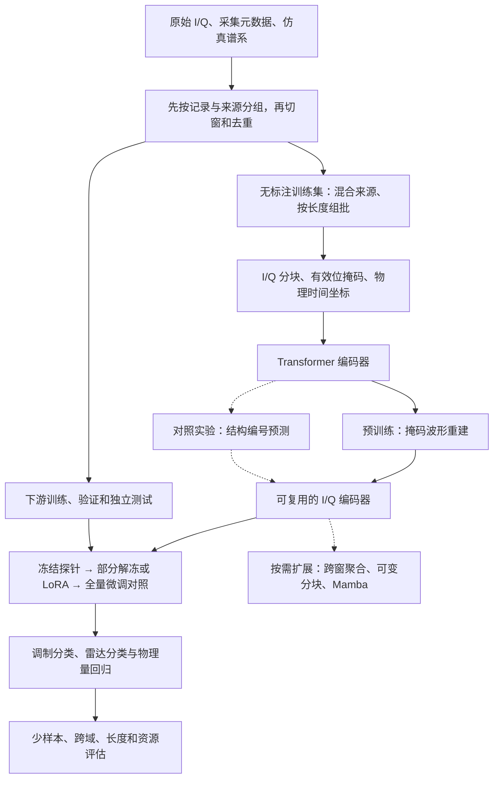

# 电磁信号基座模型预训练与下游适配技术路线

> 综合合肥三场讲座及截至 2026 年 11 月 10 日查阅的公开研究。路线面向接收机采集的复基带 I/Q 波形，首期验证通信调制识别和雷达波形分类、参数估计。文中的网络规模、训练设置和验收方法是项目起点，实际取值由采集条件、计算预算和任务要求决定。

## 1. 先把路线讲清楚

**先用不同来源的无标注 I/Q 训练一个共用编码器，再用少量带标签的样本教它完成具体任务。** 训练时把一段波形切成小块，藏起一部分，让模型根据其余波形补齐。模型经过许多这样的练习，逐步学会描述局部形状、脉冲、周期和前后关系。下游任务复用这些特征，分类头输出类别，回归头输出带单位的参数。

首版从**小型 Transformer 加掩码重建**起步，安排三类独立实验。更换采样率时，让模型按真实时间比较波形。更换设备或信道时，比较“补原始波形”和“猜波形结构编号”学出的特征。观测变长时，先保持局部分辨率、按窗汇总，再比较可变分块和 Mamba。雷达脉冲掩码与可靠性加权差分相位分别接在预训练和任务适配环节。

首期交付包括数据与划分清单、一个基座检查点、通信和雷达任务头、可复现的对照实验报告。多天线、频谱图、CSI 或 CIR 可在应用需要时增加独立输入接口。本路线的首期评价以单路 I/Q 为主。

## 2. 三场讲座怎样接到同一条路线

| 材料 | 讲座给出的技术 | 在本路线中的位置与使用条件 |
|---|---|---|
| 讲座1 | SigMA 用 Mamba 组织序列、多尺度预测 MSP 学不同时间范围的结构、APA 改变分块并尝试复用嵌入权重 | 三者分别对应骨干、训练目标和输入适配。长窗口效果或资源遇到瓶颈时逐项对照。由短训练片段迁移到长任务的结果需结合其微调设置理解。[讲座1解析](讲座1/讲座1_SigMA短序列预训练与长信号迁移_解析.md) |
| 讲座2 | RoPE-fs 按采样率对齐位置。Atomic 聚类为局部片段编号，Emergent 合并常见邻接组合并将标签回填到片段位置 | 用于异构采样和跨域表征实验。位置坐标与训练目标分别比较。结构词表只用训练侧数据拟合，检查编号是否被设备或采样率主导。[讲座2解析](讲座2/讲座2_异构观测下的物理时间对齐与结构化预训练_解析.md) |
| 讲座3 | IQFM 展示统一 I/Q 预训练与任务微调。KRMAE 改掩码选点，RW-DPhase 改任务输入 | 基座沿用“预训练编码器加任务头”。脉冲掩码在雷达域用等预算验证，差分相位在下游用同一检查点比较。报告中的少标注增益随 SNR 和标签量变化。[讲座3解析](讲座3/讲座3_电磁信号大模型构建技术及应用展望_解析.md) |

会场材料的模块级结果来自各自实验。本文组合、默认设置与验收条件由此推导，整体路线有待项目实验验证。公开论文中 Mashaal 和 Abou-Zeid 的 IQFM 使用空口多天线 I/Q 和任务感知的对比学习。它与讲座3的同名重建式模型是两项工作，结果分别引用。[公开 IQFM 原论文](https://arxiv.org/abs/2506.06718)

## 3. 数据先行

### 3.1 原始记录、训练窗口和标签分开保存

原始记录保留复数采样与设备采集元数据。训练窗口用索引指回原始记录，增强和重采样也保留父记录。这样既能重建任何一条训练样本，也能查出测试集是否与训练集共享来源。原始数据和录制元数据可参考 SigMF，项目划分和标签另存清单。[SigMF 规范](https://sigmf.org/)

| 层次 | 建议字段 | 作用 |
|---|---|---|
| 原始记录 | `record_id`、`source_id`、数据版本、来源与使用条件、`sample_rate_hz`、中心频率、I/Q 顺序、量化格式、样点数、校准信息 | 恢复实际时间和量纲。采样率、功率标定等未知时保留缺失标记 |
| 分组与谱系 | 发射机、接收机、会话、日期、站点、实体、仿真配置与干净波形父 ID | 分组切分、独立测试、定位采集偏差。敏感标识可用内部匿名 ID |
| 派生窗口 | `parent_id`、起始样点、窗口长度、有效长度、重采样与增强版本、处理后采样率 | 追踪窗口、判断重叠，反算预测的事件时间 |
| 任务标签 | 类别、参数值及单位、标注来源、参数有效掩码、SNR 及其来源 | 区分真值、估计值与缺失值。回归指标在真实单位上计算 |
| 审计字段 | `split`、分组键、文件哈希、近重复标记、数据清单版本 | 能从清单重建每次训练和评测 |

模型可见输入和审计元数据应有明确边界。常规模型输入是 I/Q、有效位和可用的物理坐标。发射机 ID、站点和文件名用于分组审计。采样率、中心频率等条件只有在实际推理时可获得且符合任务定义时才加入。估计 SNR、带宽等参数的任务把相应真值留在监督侧。

### 3.2 按数据来源安排训练和评测

| 数据 | 第一轮用途 | 评价边界 |
|---|---|---|
| 经核对使用条件的公开调制数据，如 RadioML 2018.01A | 验证 I/Q 输入、调制分类和分 SNR 评估流程 | 复核可用的采样率和分组信息。原始记录或谱系缺失时，作为开发基准，域外结论由独立采集数据支持。[DeepSig 数据页](https://www.deepsig.ai/datasets/) |
| RadChar 或独立生成的雷达数据 | 检验波形分类、脉宽、PRI 等参数回归和低 SNR 条件 | RadChar 提供合成分类与参数任务。合成效果应在独立采集记录上补充检验。[RadChar 论文](https://arxiv.org/abs/2306.13105) · [作者仓库](https://github.com/xiaojingoo/RadarCharacteristic) |
| 自采空口 I/Q，或任务匹配的 WiSig 子集 | 验证接收机、日期、场地变化。WiSig 可用于 Wi-Fi 射频指纹扩展 | 按接收机和会话留出。使用官方子集时先确认彼此是否共享原始包。真实数据的覆盖范围取决于台架和采集计划。[WiSig 论文](https://arxiv.org/abs/2112.15363) |
| 有谱系记录的内部仿真 | 可控地改变采样率、信道、频偏、SNR、调制参数与脉冲结构 | 同一干净波形的噪声、多径、采样率和切窗派生样本归入同一集合。记录生成器版本和配置，便于检查仿真捷径 |

切分顺序为**先确定独立组和留出域，再切窗、增强、重采样与生成词表**。同一段长记录、同步采集的副本和同一干净波形的变体不得跨集合。预训练语料也要排除下游严格测试记录及派生样本。审计先比较文件哈希和父 ID，再对有疑似重叠的窗口做近重复检查。预训练见过同源无标注数据的试验应单列为同域或目标域适配。外部权重的语料交集未知时，标注“预训练重叠未知”。

混合来源时，同时按来源、真实与合成比例、物理时长、采样率和可用 SNR 层监控覆盖。用原始记录组抽样，避免单段长记录因切窗多而占据大量更新。变长样本先按长度分桶，再用 token 上限和长度预算组批。跨记录打包时隔离注意力、位置、遮挡及损失边界。先运行分桶加 padding 的简单版本，再测打包收益。[EMind 原论文](https://arxiv.org/html/2508.18785v1) · [Radio-FM 原论文](https://arxiv.org/abs/2608.05793)

## 4. 基座输入与网络

### 4.1 I/Q 分块与时间坐标

第一版每个采样点存为两个实数 `[I,Q]`。把相邻的点切成不重叠小块，对每个块使用共享线性投影，得到一串 token。短记录尾部可填充，注意力、池化和损失使用有效位。每条记录保留原始尺度和处理参数。对分类可用 I/Q 共用的幅度尺度做归一化，对依赖功率或绝对幅值的任务保留经标定的测量通道。掩码预训练的归一化统计来自训练集或可见区域，避免被遮挡区域的信息通过统计量进入输入。

采样率为 `fs` 时，设第 `i` 个块在当前窗口的起始样点为 `n_i`，有效点数为 `p_i`。中心位置可定义为

$$
t_i = \frac{n_i+(p_i-1)/2}{f_s},\qquad u_i=\frac{t_i}{t_{\mathrm{ref}}}.
$$

`t_ref` 是固定的参考时间单位，用训练数据确定并写入配置。Transformer 的 RoPE 在注意力的查询和键上使用 `u_i`。同时保留块的物理跨度 `p_i/fs`。对不重叠的 16 点块，1 MHz 和 2 MHz 下相邻块的间隔分别为 16 μs 和 8 μs。位置索引在两种情况下都加一，时间坐标能区分实际间隔。若需改变块长、步长或重采样，按新样点坐标重算中心和跨度。该式是面向本项目的通用坐标写法。[讲座2时间对齐](讲座2/讲座2_异构观测下的物理时间对齐与结构化预训练_解析.md) · [RoFormer 原论文](https://arxiv.org/abs/2104.09864)

时间坐标只描述“何时采到”。采样率差异仍会改变每块所见内容，也可能带来频带截断与混叠。比较时同时记录实际带宽和观察时长。采样率未知的记录可走索引位置并带缺失标记，或留在单独分支。需要重采样时，按目标带宽做抗混叠处理，同时保留原始数据。

### 4.2 可启动的参考配置

| 项目 | 第一轮配置 | 调整依据 |
|---|---|---|
| 输入 | 单路复基带 I/Q，512 至 4096 点窗口，块长与步长均为 16 点 | 约 32 至 256 个 token。以最短目标事件、符号周期或脉冲宽度检查是否需更细分块 |
| 编码器 | 6 层双向 Transformer，宽度 256，8 个注意力头，FFN 宽度 1024 | 编码器约 5M 参数量级。记录实测显存、吞吐和跨域质量后再扩规模 |
| 位置 | 同一骨干比较索引 RoPE 与物理时间 RoPE | 在留出采样率、真实采集和固定时长重采样测试上决策 |
| 掩码 | I/Q 成对遮挡。随机块作基线，连续跨度作对照，先试 30% 和 50% | 按有效位置抽取。在相同遮挡比例下测可见上下文够不够，脉冲任务另测关键区比例 |
| 训练输出 | 每块特征加可选的掩码感知池化。预训练用轻量解码器，下游换任务头 | 分类使用全局或窗级聚合，事件检测和时间参数保留局部 token |
| 批次和选择 | 以 token 预算装批，记录已见原始时长、训练 token 和 GPU 小时 | 训练用无标注验证损失观察收敛，用固定的下游验证探针选择检查点 |

以上数字是开发起点。低速采样的长观测、高速窄脉冲和宽带连续录制会形成不同的分辨率及计算需求。按任务的物理时间尺度决定窗口与分块后，再解释模型性能。

## 5. 预训练按顺序做

### 5.1 先跑通原始 I/Q 掩码重建

训练时编码器读取可见块及其原始位置。轻量解码器放回被遮挡位置，估计该处 I/Q。用被遮挡且有效的样点计算重建误差。可从复数平方误差开始，即同一位置的 I、Q 误差平方相加。先按每条记录的有效目标数归一，再按批次汇总。保存编码器和预处理配置。带标签数据用于下游验证和微调。

视觉 MAE 提供了可见块编码、轻量解码的实现思路。EMind 将波形掩码重建与多源变长数据组织用于电磁信号。Radio-FM 还比较了 I、Q 分支与独立遮挡。本路线首版采用成对遮挡，以便控制可见信息。独立遮挡作为独立对照，额外检查模型能否只根据同一时刻另一路完成重建。[MAE 原论文](https://arxiv.org/abs/2111.06377) · [EMind 原论文](https://arxiv.org/abs/2508.18785) · [Radio-FM 原论文](https://arxiv.org/abs/2608.05793)

训练时保留全链路边界。改变成重叠分块或有感受野的卷积前端时，先在原始时间区间遮挡，再提取可见特征，或检查输入感受野没有覆盖目标。派生特征和重采样滤波同样可能跨越遮挡边界。给定不同长度的样本时，检查 padding 位置从注意力到损失均被排除。

### 5.2 试结构目标，测它能否改善跨域

1. 用基线编码器或固定特征提取器，为训练侧的局部块提取表征。在按来源均衡采样的训练子集上拟合聚类，给每个块分配 **Atomic** 编号。冻结词表、特征标准化和教师版本。
2. 统计同一记录内常见的相邻编号，迭代合并得到 **Emergent** 组合，再将组合编号回填到覆盖的各块。限制组合跨越的实际时长，避免跨记录与填充边界。长组合回填会重复出现，需监控它的损失权重。
3. 在被遮挡位置预测编号。最先比较原波形重建与 Atomic 预测，再加入 Emergent。为便于复用首版骨干，结构标签可由独立的掩码位置查询头预测，保持相同可见上下文。若要同时训练重建和结构预测，单独记录各损失权重并加入组合对照。
4. 检查词表占用率、跨设备同类样本的编号一致性、编号对来源的可预测性，以及短脉冲与低 SNR 样本的覆盖。若词表主要按采样率或设备聚类，先修正训练样本、教师特征和时间尺度。

讲座2使用两级离散结构目标。语音 HuBERT 提供了离线聚类和掩码预测的先例，WirelessJEPA 提供直接预测连续潜在特征的无线多天线对照。项目可在两级词表收益不稳定时试连续目标。结构预测与重建的组合在本路线中作为待验设置。[讲座2结构目标](讲座2/讲座2_异构观测下的物理时间对齐与结构化预训练_解析.md) · [HuBERT 原论文](https://arxiv.org/abs/2106.07447) · [WirelessJEPA 原论文](https://arxiv.org/abs/2601.20190)

### 5.3 脉冲先验和多尺度预测各做一条对照

- **雷达关键区掩码。** 用训练记录的能量包络给可能的脉冲区打分。比较随机遮挡、偏向关键区、关键区与随机混合三组，总遮挡量相同。记录在低 SNR 或强背景下的候选区覆盖和误选。按雷达分类、脉宽与 PRI 误差决定是否在雷达继续预训练中采用。[讲座3 KRMAE 实验](讲座3/讲座3_电磁信号大模型构建技术及应用展望_解析.md)
- **连续多尺度预测。** 需要长时预测或突发节律表征时，在同一架构上增加单独的因果预训练实验。规定预测起点、可见历史和以秒计的预测跨度。先比较单尺度和多尺度，再评估动态调权。MSP 的具体尺度构造和加权规则在会场材料中未完整呈现，项目版本须明确自己的目标定义。预测头只能看到起点前允许使用的输入。SpectrumFM 的下一时隙预测是相近的监督思想，属于另一套实现。[讲座1 MSP 说明](讲座1/讲座1_SigMA短序列预训练与长信号迁移_解析.md) · [SpectrumFM 原论文](https://arxiv.org/abs/2505.06256)

### 5.4 长信号适配从固定分辨率开始

| 顺序 | 方法 | 要验证的收益和代价 |
|---|---|---|
| L0 | 截断或固定块长的滑窗编码，再按窗口时间聚合 | 先测任务需要多少观测时间。比较均值池化与可学习跨窗聚合。事件检测按时间合并重叠窗的重复输出 |
| L1 | 可变分块，训练时覆盖多个合法块长，或用 APA 思路映射已有嵌入 | 与固定块长、随机初始化新嵌入比较。重算时间中心和跨度。细粒度分支继续保留给窄脉冲任务。权重映射可参考 FlexiViT 的伪逆思想，I/Q 分块的权重重映射需重新验证。[FlexiViT 原论文](https://openaccess.thecvf.com/content/CVPR2023/html/Beyer_FlexiViT_One_Model_for_All_Patch_Sizes_CVPR_2023_paper.html) |
| L2 | Mamba 或分层编码，单独训练长序列骨干 | 使用同样原始观察时长，报告性能、实际 token、吞吐、峰值显存和延迟。双向上下文任务与因果流式任务分别设计。纯 Mamba 缺少 RoPE 所用的注意力 Q/K 接口，可将物理时间作为输入条件，并另行验证其有效性。[Mamba 原论文](https://arxiv.org/abs/2312.00752) |

每条长信号试验都同时测两种场景。固定采样率延长观测，看模型能否使用远处事件。固定观察时长改变采样率，看模型能否处理更密或更疏的采样。只增大块长会同时改变特征粒度，需用窄脉冲、事件边界和相位敏感任务衡量信息损失。

## 6. 下游适配和微调

### 6.1 先诊断基座，再决定训练多少参数

| 阶段 | 训练参数 | 应用方式 |
|---|---|---|
| 随机初始化对照 | 同骨干和同任务头从头训练 | 测预训练本身的增益。保持相同下游训练数据、标签预算和验证机会 |
| 冻结探针 | 冻结编码器，仅训练线性分类或回归头 | 测现成特征可用程度。定位数据问题和表征问题 |
| 轻量适配 | 训练任务头，解冻最后几层，或为 Transformer 加 LoRA | 少标签、多任务和版本管理场景优先比较。LoRA 可先在注意力投影上试小秩，记录可训练参数、内存和性能。[LoRA 原论文](https://arxiv.org/abs/2106.09685) |
| 全量微调 | 更新编码器和任务头，给编码器较小的学习率 | 作为有标签预算下的对照。域差异较大时，另设使用目标训练侧无标注数据继续预训练的一组 |

少样本优先按独立记录或会话抽取，再控制每类窗口数量。把冻结、轻量适配和全量微调放在相同的训练、验证、测试清单上。选择最终方式时同时看独立测试表现、训练成本与部署需要。

### 6.2 按任务选输出头与物理约束

| 任务 | 编码特征及任务头 | 训练与测试重点 |
|---|---|---|
| 通信调制分类 | 全局池化加分类头 | 交叉熵。评估 Macro-F1、混淆矩阵和按 SNR、接收机分组的准确率 |
| 雷达波形分类与参数估计 | 共享编码器，分类头与各参数回归头并行。时间参数可用局部 token 或窗内时间线 | 对缺失参数屏蔽损失。脉宽、PRI、带宽、SNR 等各自标准化训练，推理时逆变换并按物理单位报告误差。对比传统检测或估计与从头训练。[RadChar 原论文](https://arxiv.org/abs/2306.13105) |
| 频谱或事件检测 | 局部 token 加时域检测头，保留事件起止位置 | 依据任务报告事件级精确率、召回率、固定虚警下的检测率和时间定位误差 |
| 射频指纹与精细分类 | 全局特征，必要时加入相位辅助输入 | 已知设备识别按接收机和会话留出。未知发射机识别需要另设开放集协议和拒识指标 |

相位相关任务可从复乘积 $z[n]\overline{z[n-k]}$ 取相位差，用正弦与余弦表达圆周变化，并用幅度或质量分数降低低幅位置的贡献。跨采样率比较时统一物理滞后或按采样率解释差分。建议作为保留原 I/Q 的小型旁路，与幅度、未加权差分、加权差分三组作对照。权重公式和旁路是项目候选实现。频偏、缺样和低幅噪声需独立验证。[讲座3可靠性加权差分相位](讲座3/讲座3_电磁信号大模型构建技术及应用展望_解析.md)

增强要按任务定规则。全局相位旋转可能适用于某些调制分类条件。频偏增强会改变频偏标签，时间缩放会改变脉宽和 PRI，多天线独立相位扰动会影响相干关系。保持类别不变的增强需要验证。回归和定位同时更新标签、时间和频率坐标。

## 7. 第一轮实验与验收

### 7.1 用小矩阵分清收益来自哪里

| 编号 | 实验 | 比较对象 |
|---|---|---|
| B0 | 传统信号特征或轻量 CNN 监督训练 | 业务与低成本基线 |
| B1 | 同 Transformer 随机初始化，按下游标签训练 | 对照预训练的收益 |
| B2（可选） | 在输入条件匹配时，用公开 EMind 权重做冻结探针和微调 | 衡量复用已有模型的收益。单列权重版本、预训练数据重叠及输入差异。[EMind 作者仓库](https://github.com/GabrielleTse/EMind) |
| P0 | 随机掩码重建加索引 RoPE | 通用预训练基线 |
| P1 | P0 只更换为物理时间 RoPE | 采样率对齐的独立收益 |
| P2 | 在 P1 的输入与骨干上换 Atomic 预测 | 离散目标相对波形重建的收益 |
| P3 | P2 加 Emergent | 跨块结构监督的额外收益 |
| R1 | 在同一雷达训练起点与预算下改掩码分布 | KRMAE 启发的掩码是否改善少样本和低 SNR |
| L0–L2 | 通过首期验收后比较滑窗、分块适配、长骨干 | 长观察带来的精度收益和资源开销 |

P0 和 P1 固定骨干、训练记录、掩码分布和训练预算。在采样率已知的相同样本集合上比较两组。预算允许时加一组“索引 RoPE 加采样率条件”，区分提供采样率信息和调整位置刻度带来的收益。P1 至 P3 保持可见信息和下游协议一致，记录词表生成和目标头差异带来的额外计算。若 P3 有收益，再补“索引 RoPE 加同一结构目标”，形成位置与目标的交叉对照。R1 和相位输入适配各自在组内使用相同起始检查点，后续联合实验再测交互。

### 7.2 测试面板

| 测试切片 | 设计 | 主要指标 |
|---|---|---|
| 域内与少样本 | 独立记录组，按每类独立组及窗口数量定义标签预算 | Macro-F1、误差、不同标签预算下的学习曲线 |
| 采样率外推 | 固定观察时长，分开报告配对重采样压力测试与真实未见采样率采集 | 性能随倍率变化，报告带宽及目标任务是否仍可观察 |
| 长时间外推 | 固定采样率，使用多种观察时长，保留截断与滑窗基线 | 事件指标或参数误差、时延、峰值显存 |
| 观测域外 | 分开留出接收机、日期、站点、信道或仿真配置 | 各域指标、最差组结果、分 SNR 曲线 |
| 开销与稳定性 | 固定硬件、输入时长、批量和推理精度，覆盖冷启动与稳态 | 参数量、GPU 小时、吞吐、峰值显存、端到端 P95 时延 |

首轮为关键模型跑至少 3 个随机种子，复用成对的下游抽样清单。按独立记录或会话做配对重采样估计区间，避免把相邻窗口当作独立证据。模型选择只看验证集。冻结最终方案与阈值后评估独立测试。

验收门槛由业务指标和可用资源确定。当前缺少这些约束，可先用以下定性门槛启动：

1. **数据可审计。** 测试记录、增强副本和同父样本可追溯，已知的分组重叠为零。真实域外切片独立于预训练、词表拟合和微调。
2. **预训练有迁移价值。** 在至少一个首期任务的少样本设置稳定优于同骨干从头训练，另一个任务的退化处于预先定义的容忍范围。结果需同时对照轻量基线。
3. **改动对应实测收益。** 时间编码由留出采样率决定，结构目标由跨域与参数任务决定，长信号扩展由长时测试和部署预算共同决定。保留每个可采用的模块及其适用任务。

## 8. 实施顺序与交付

| 里程碑 | 工作 | 交付物 |
|---|---|---|
| M0 数据与基准 | 清点可用 I/Q、标签、采集条件与分组，冻结通信与雷达两个验证任务 | 数据字典、来源清单、固定切分、评估指标与资源预算 |
| M1 打通预训练和微调 | 完成 B0、B1、P0，输出冻结探针和微调结果 | 基座检查点、训练配置、任务头、基线报告 |
| M2 扩展跨域能力 | 做 P1–P3，在目标雷达任务单独比较 R1 和差分相位输入 | 时间与目标消融、域外评测、任务适配配置 |
| M3 面向长输入与部署 | 选定所需观测时长，比较 L0–L2，实测端到端资源 | 长信号模型或窗口聚合器、可复现的性能与资源曲线 |

起步时先把**一套多来源无标注预训练集、一个调制分类头、一个雷达分类与回归头、一个独立采集留出集**跑通。基座检查点应绑定输入布局、分块与时间尺度、训练清单、归一化、代码版本和适用任务。若真实跨域数据暂时缺少，先报告仿真和公开集结果，现场性能留待补采验证。

## 9. 公开研究对路线的补充

| 研究 | 可借鉴的技术 | 本路线如何使用 |
|---|---|---|
| EMind（2025） | 多源原始 I/Q、掩码重建、采样率条件和变长数据打包 | 主要工程参考。对齐论文、仓库、权重及数据版本，记录公开权重的训练覆盖范围。[论文](https://arxiv.org/html/2508.18785v1) · [作者仓库](https://github.com/GabrielleTse/EMind) |
| SpectrumFM（2025） | 掩码恢复与下一时隙预测 | 为额外预测目标提供参照。使用代码复现时记录分支与训练目标，论文与代码实验配置可能不同。[论文](https://arxiv.org/abs/2505.06256) · [作者仓库](https://github.com/ChunyuLiu188/SpectrumFM) |
| Radio-FM（2026 预印本） | I/Q 分支、跨通道交互、独立遮挡、按 token 预算组批 | 采用组批思路。I/Q 分支与遮挡策略作为独立实验，按数据交集和划分报告复现结果。[原论文](https://arxiv.org/abs/2608.05793) |
| WirelessJEPA（2026 预印本） | 对真实多天线 I/Q 的遮挡区域预测潜在特征，使用天线和时间结构组织掩码 | 后续多天线或连续目标候选。需要同一任务和数据协议与重建比较。[原论文](https://arxiv.org/abs/2601.20190) |
| RFShape（2026 预印本） | 在合成 I/Q 上预训练，通过调整输入表示复用编码器，覆盖 I/Q 和 CIR 等下游输入 | 为后续专用输入接口提供参考。先分别验证每种输入和每个任务的迁移。[原论文](https://arxiv.org/abs/2611.03947) |
| 视觉 MAE、语音 HuBERT | 对遮挡区域做重建或预测聚类编号 | 分别支撑首版波形目标和结构目标对照。训练比例和词表粒度由电磁任务重新验证。[MAE](https://arxiv.org/abs/2111.06377) · [HuBERT](https://arxiv.org/abs/2106.07447) |
| 通用时序 MOMENT（2024） | 汇集多个数据集预训练，再用不同任务和有限标签评估迁移 | 借鉴数据组织和少样本评测。电磁输入保留联合 I/Q、实际时间和任务所需的幅度尺度。[原论文](https://arxiv.org/abs/2402.03885) |
| FlexiViT、Mamba、LoRA | 灵活分块与嵌入映射、选择性状态空间、低秩微调 | 分别对应输入适配、长序列骨干、参数高效微调。按同一信号任务的精度和实测开销选择。[FlexiViT](https://arxiv.org/abs/2212.08013) · [Mamba](https://arxiv.org/abs/2312.00752) · [LoRA](https://arxiv.org/abs/2106.09685) |
