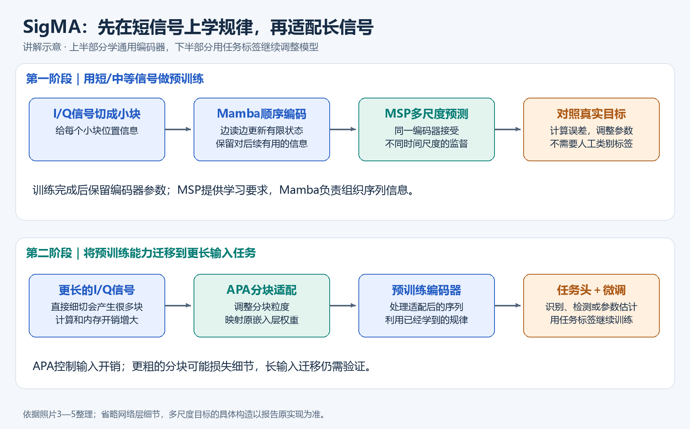
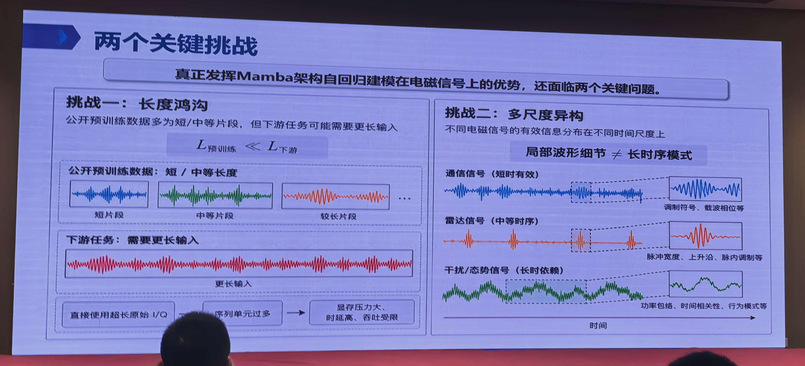
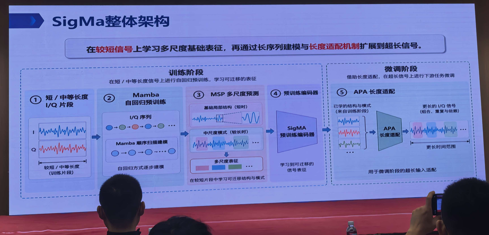
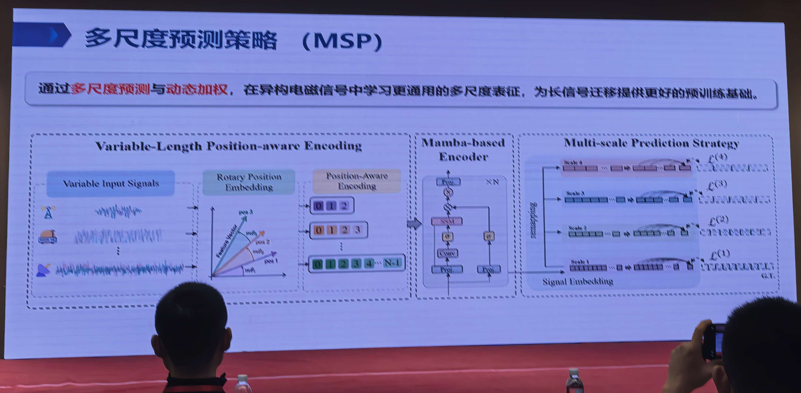
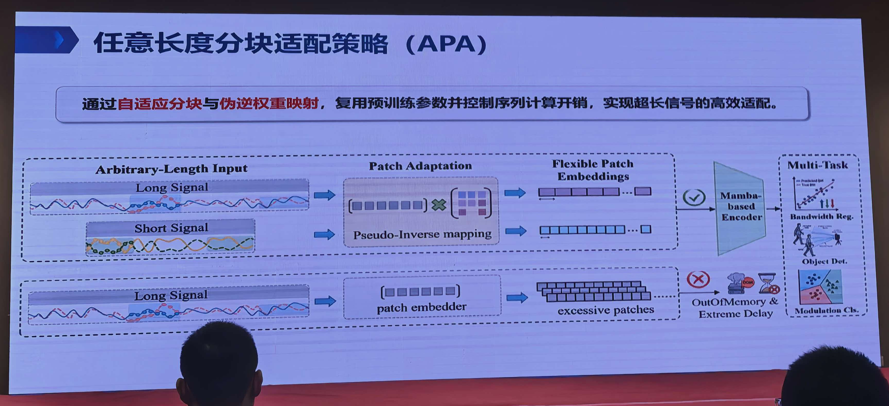
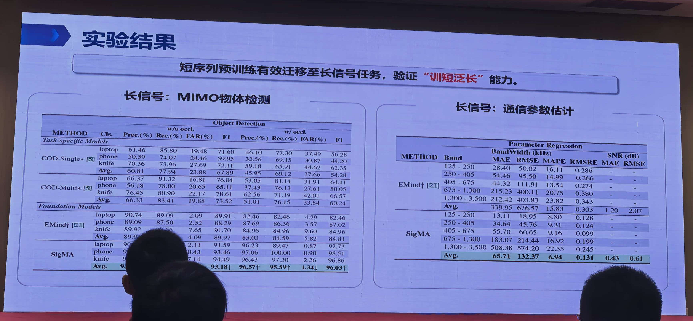
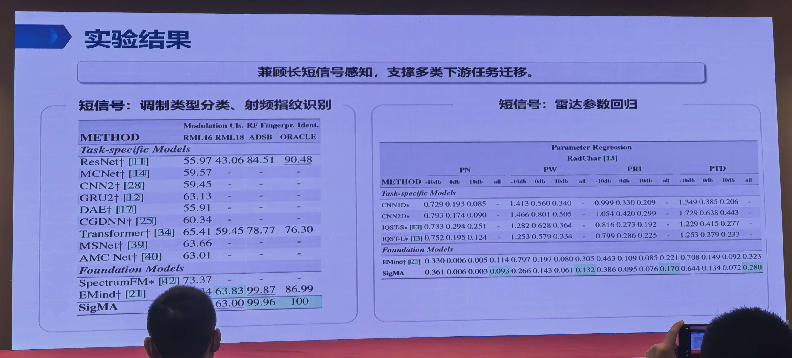

# 讲座1：SigMA——短序列预训练、多尺度表征与长信号迁移

## 先用大白话把方法讲明白

**这场讲座要做的事，就是先用手头大量的短信号教模型认识波形规律，再让这个模型适应实际任务中的长信号。** 它用三个办法配合完成：Mamba负责沿着信号往下读，MSP负责教它同时注意细节和较大范围的规律，APA负责让更长的信号以合适的分块方式进入模型。

### 先弄清楚：模型吃进去的到底是什么

这里的输入是一段按时间排列的I/Q数字。可以先把它想成两条同时记录的波形：每个时刻都有一对数，这一对数共同保存信号的幅度和相位信息。模型接收的是这些数字，不是PPT里的波形照片。

模型通常不会把每个采样点都当成一个独立处理单位，而是把相邻的一小段数字分成一块。**原始小块叫patch，把这一块转换成模型能处理的一组特征数字，就得到一个token。** “嵌入层”就是做这个转换的入口。这样，几十万个采样点就可以组织成数量更少的信号块，再交给后面的网络处理。

“预训练”和“微调”也很好区分：预训练先让模型利用大量信号本身学习规律，比如根据已读到的内容预测后续内容，不必先给每条信号人工标好类别；微调再提供具体任务的样本和答案，让已经有基础的模型学习分类、检测或参数估计。**前者学通用本领，后者学怎样完成手头这道题。**



*图：根据照片整理的讲解示意，并非原作者网络结构图。上半部分先学规律，下半部分把学到的编码器用于长输入任务；MSP提供训练监督，APA处理输入分块，两者分工不同。原PPT架构图嵌在后文第4节。*

### 方法一：Mamba——一边读新内容，一边更新“重点笔记”

可以把Mamba理解成一个沿时间顺序读信号的处理器：读到一块新信号，就把“这一块的信息”和“前面保留下来的状态”合在一起，更新一份重点笔记，再继续读下一块。模型学习决定什么信息值得留下、什么信息可以减弱。这份不断更新的内部状态，是它把前后内容联系起来的重要方式。

为什么适合长信号？因为它用状态传递信息，不需要为所有信号块都建立一张两两比较的大表。随着输入变长，它的核心计算量增长相对平缓，因而是长序列建模的一个合适候选。

但这份笔记是**容量有限的压缩记录**，不是把前面所有波形原封不动存下来。很久以前的细节可能被弱化，所以“能运行很长的输入”和“长输入里的每个细节都记得准确”是两回事。Mamba提供的是处理长序列的骨干能力，还需要合适的训练目标教它保留有用信息。

### 方法二：MSP多尺度预测——同时考细节和较大范围的规律

如果训练时只问“紧接着会出现什么”，模型有时只靠局部平滑性就能答得不错。例如，刚才的波形正在上升，猜下一个点继续上升，可能就能降低误差；但这不代表它理解了一组脉冲怎样重复、包络怎样变化。

MSP的思路是：**同一段信号，从不止一个时间尺度提出预测要求。** 既要求模型关注短时变化，也要求它保留较大范围的模式，再把各个尺度的预测误差合起来训练。这样，编码器只顾眼前几处细节就不够了，还需要提取能够用于其他任务的结构。

可以用一个解释用的例子理解：一段信号里既有很快的振荡，又有较慢重复的脉冲组。只盯着几次振荡，可能看不出脉冲组的组织；只看整体趋势，又可能丢掉局部差别。多尺度监督就是同时给这两类信息学习机会。**这只是帮助理解的例子，不是报告公布的尺度设置。** 照片没有完整说明各尺度究竟用不同跨度、不同分块还是其他方式实现，不能直接认定它就是把信号降采样几次。

“动态加权”就是在合并误差时调整不同尺度的重要程度，避免某个尺度独占训练方向。照片没有给出具体调权规则。MSP也不能凭空教会模型从未见过的所有长期规律；它的价值是，让有限训练片段尽可能提供更丰富的监督。

### 方法三：APA任意长度分块适配——输入变长后，先把“怎么分块”调好

实际输入变长时，如果每块仍保持原来的点数，块数也会跟着增加，处理起来就更费内存和时间。APA做的是根据输入调整分块，并让新的分块仍能接上已经训练好的模型入口。

看一个**纯示意、并非报告参数**的例子：原来1000个点，每100个点一块，共10块；现在输入变成10000个点，照旧切就有100块。如果为了控制块数，把每块改成1000个点，就又变成10块。但这时一个块里的数字变多了，原来“把100个点转换成特征”的嵌入层，不能直接照搬来处理1000个点。

这就需要照片中提到的“伪逆权重映射”。直白说，**它试着把旧入口已经学会的转换规则，折算成适合新分块的转换规则**，让模型尽量接着用过去学到的能力。伪逆是一种求近似对应关系的数学工具；它不是替长信号补出新知识，也不是把整个模型重新训练一遍。

块变大也有代价：每块压缩的信息更多，短暂事件、窄脉冲或细微相位变化可能更难保留。因此APA是在输入分辨率与计算开销之间做适配，不保证无损。实际块长怎样选择、权重怎样映射，仍要看完整实现和任务需求。

### 把三件事连起来，就能读懂这套方法

| 模块 | 最直白的分工 | 它主要改变什么 |
|---|---|---|
| Mamba | 按顺序读，并把有用上下文保留到状态里 | 模型怎样处理序列 |
| MSP | 训练时同时考多个尺度，督促模型保留不同范围的规律 | 模型被要求学什么 |
| APA | 长信号到来时调整分块，并迁移入口参数 | 信号怎样进入模型 |

三者配合后，预训练编码器再接上具体任务的输出层，并通过微调学习任务答案。**这里的“训短泛长”是短信号预训练后能适配长信号任务，不代表完全不微调就能处理任何长度、任何场景。** 后文保留逐页解析、公式说明、实验结果和证据边界，便于继续深入。

---

## 以下为逐页与技术详解

> 根据本目录 `1.jpg—7.jpg` 共7张现场照片整理。照片编号是文件顺序，不等同于原PPT页码。本组没有封面，本文标题是根据内容拟定的整理标题；报告人、单位、正式报告名称均无法从现有照片确认。PPT中模型写作 SigMa / SigMA，本文统一写作 SigMA。
>
> **阅读约定**：“照片内容”表示直接可见的信息；“技术解析”表示对机制的解释；“建议/待核实”表示整理者的判断，不视为报告人的原话。未提供训练代码与完整实验协议，本文不是复现说明书。

## 1. 先抓住报告的主线

这组材料讨论的是一个很具体、也很实际的问题：**公开数据大多只有短/中等长度I/Q片段，而实际下游任务可能需要更长的连续观测；如何用有限长度的预训练，得到能够迁移到长信号的通用编码器？**

报告的回答包含三个相互配合的部分：

1. 用Mamba作为顺序建模骨干，学习I/Q序列的上下文关系。
2. 用MSP多尺度预测，让较短训练片段同时提供不同时间尺度的监督。
3. 在下游微调时用APA任意长度分块适配，调整输入分块并重映射预训练嵌入参数，以控制长输入的token数量和计算开销。

因此，SigMA的贡献应理解为“骨干＋预训练目标＋输入适配”的组合。只把Transformer换成Mamba，并不能自动解决训练长度与下游长度不一致的问题。

## 2. 逐页梳理

| 照片 | 可见标题/主题 | 主要内容 | 在论证中的作用 |
|---|---|---|---|
| [1](1.jpg) | 两个关键挑战 | 长度鸿沟；不同电磁信号的多尺度异构性 | 说明长序列效率和表征学习都要解决 |
| [2](2.jpg) | 核心问题 | 有限长度预训练能否兼顾多时间尺度并扩展到更长输入 | 提出研究目标 |
| [3](3.jpg) | SigMa整体架构 | 短/中等长度I/Q→Mamba自回归预训练→MSP→预训练编码器；下游加入APA | 给出整体方案 |
| [4](4.jpg) | 多尺度预测策略（MSP） | 变长位置感知编码、Mamba编码器、多尺度预测与动态加权 | 解释预训练如何学习多尺度规律 |
| [5](5.jpg) | 任意长度分块适配策略（APA） | 自适应分块、伪逆权重映射、灵活patch嵌入 | 解释如何控制长输入计算量并复用参数 |
| [6](6.jpg) | 实验结果 | 长信号：MIMO物体检测、通信参数估计 | 检验“训短泛长”的任务迁移 |
| [7](7.jpg) | 实验结果 | 短信号：调制分类、射频指纹识别、雷达参数回归 | 检验是否兼顾短信号和多种任务 |

## 3. 为什么存在两个关键挑战



*来源：[照片1](1.jpg)。左侧指出预训练片段与实际输入的长度差异，右侧指出不同信号需要关注的时间尺度不同。*

### 3.1 长度鸿沟：点数差异背后是观测范围差异

照片1明确给出预训练长度远小于下游长度的关系。短片段可能足够描述局部调制纹理，却无法覆盖完整的脉冲周期、突发间隔或慢变化趋势。

**技术解析：** 对复基带序列，可以写作

\[
x[n]=I[n]+jQ[n],\quad n=0,\ldots,N-1.
\]

采样率为 \(f_s\) 时，观测时长约为 \(T=N/f_s\)。因此，“更长”至少有两种情况：同采样率下观测时间更长；同观测时长下采样率更高。两者对模型的要求不同，照片没有证明SigMA已分别解决这两种变化。

把长信号简单裁成短窗，会降低单次开销，但可能丢失跨窗关系；把所有短窗直接拼接输入，则会增加token数量。这就是预训练知识迁移与计算预算之间的矛盾。

### 3.2 多尺度异构：不同任务需要不同时间范围的信息

照片1用通信、雷达、干扰/态势信号展示短时、中等时序和长时依赖的差异。这应理解为典型侧重点，而不是三个领域严格对应互斥的时间尺度。

| 信息尺度 | 可能对应的结构（技术解释） | 只看单一尺度的风险 |
|---|---|---|
| 局部 | 瞬时波形、局部相位变化、调制纹理 | 容易忽略周期和长期关系 |
| 中等 | 脉冲组、重复片段、突发模式 | 可能遗漏细节或更慢变化 |
| 较长 | 多周期组织、场景演化、慢变化背景 | 压缩过强可能损失短时判别特征 |

报告希望较短训练片段也能产生多个尺度的学习信号，为后续长序列任务提供基础。

## 4. 整体架构怎么理解



*来源：[照片3](3.jpg)。按左到右读：短/中等长度I/Q先通过Mamba和MSP学习表征；右侧再通过APA适配长输入并微调。图中的“预训练编码器”是两个阶段之间迁移的核心。*

```text
短/中等长度I/Q片段
        ↓
分块与位置感知编码
        ↓
Mamba编码器＋多尺度自回归预测（MSP）
        ↓
可迁移的预训练编码器
        ↓
下游输入 → APA分块/嵌入适配 → 编码器 → 任务头 → 有监督微调
```

照片3的右侧明确写的是“微调阶段”。所以实验支持的是预训练后在长输入任务上进行适配，**不能据此说模型完全不训练就能零样本处理任意长输入**。

Mamba通过选择性状态空间机制组织序列信息，其基础设计支持随序列长度近似线性增长的计算。这解释了报告选择它处理长序列的动机；基础背景见[Mamba原论文](https://arxiv.org/abs/2312.00752)。但骨干的复杂度优势并不等于端到端运行时间恒定，嵌入、任务头、训练中间状态也会消耗资源。

## 5. MSP：让监督覆盖多个时间尺度



*来源：[照片4](4.jpg)。左侧负责输入表示，中间负责序列建模，右侧用多个尺度的预测误差提供训练监督。图示没有完整给出各尺度的构造和动态权重更新规则。*

### 5.1 照片中可以确认的机制

照片4包含三个模块：

- **Variable-Length Position-aware Encoding**：变长输入信号经过旋转位置编码，形成带位置信息的嵌入。
- **Mamba-based Encoder**：对序列进行上下文建模。
- **Multi-scale Prediction Strategy**：多个尺度分别产生预测损失，并进行动态加权。

照片3对监督含义的解释是：在较短片段中同时学习“基础局部结构”和“中尺度模式”。

### 5.2 为什么比单尺度预测更有意义

如果只要求模型预测紧邻的采样点，模型可能大量依靠局部平滑性或短期相关性完成任务，而没有充分学习周期、包络和重复组织。多尺度预测提供不同粒度的约束，促使同一个编码器保留多种可迁移信息。

为了表达这种思想，可以使用如下**示意公式，非照片中的完整实现公式**：

\[
\mathcal L_{\mathrm{MSP}}=\sum_{s\in\mathcal S}\lambda_s\mathcal L_s,
\qquad \lambda_s\geq0.
\]

其中 \(\mathcal S\) 是尺度集合，\(\mathcal L_s\) 是相应尺度的预测误差。动态权重的目的可理解为平衡不同尺度的学习贡献，但照片不足以确定权重是否依赖训练轮次、损失值或可学习参数。

### 5.3 不能从照片直接补出的细节

预测尺度究竟通过下采样、聚合、不同patch大小，还是不同预测跨度生成？每个尺度预测原始I/Q还是其他表征？损失函数、尺度个数、因果约束和权重更新规则是什么？照片4的小字和图示不足以唯一确定这些实现，不宜自行补成某一种方案。

**核心边界：** 在短片段中学习到多尺度规律，并不意味着能够学习超过训练观测范围的所有真实长期依赖。它提供迁移的基础，效果仍依赖信号规律能否跨时长复用。

## 6. APA：改变分块时，怎样保留预训练嵌入能力



*来源：[照片5](5.jpg)。上方是调整分块并映射嵌入参数后再进入编码器；下方是固定分块直接处理长信号，因patch数量增加而产生更大资源开销的对照。*

### 6.1 它解决的是输入适配与资源问题

照片5明确写出：通过“自适应分块与伪逆权重映射”复用预训练参数，并控制序列计算开销。下方对照图说明固定patch在长信号上会产生过多patch，导致内存不足或明显延迟。

设序列长为 \(N\)、patch长为 \(P\)，不重叠分块的token数约为

\[
M\approx\left\lceil N/P\right\rceil.
\]

这解释了为什么增大patch可以压缩token数量。但patch变大后，每个token所承载的时间范围也改变，预训练时的嵌入层参数不能总是原样套用。

### 6.2 伪逆映射的数学直觉

下面仅用于理解“伪逆权重映射”，不是SigMA的确切代码：设旧patch向量 \(x\in\mathbb R^{d_o}\)，嵌入权重 \(W_o\in\mathbb R^{d\times d_o}\)；新patch为 \(x'\in\mathbb R^{d_n}\)。若有近似关系 \(x'\approx R x\)，则可考虑

\[
W_n=W_oR^+,\qquad W_nx'\approx W_ox.
\]

这里 \(R^+\) 是伪逆。含义是：改变输入分块维度后，尽量把新输入映射到与旧嵌入相容的空间，而不是把嵌入层全部重新随机初始化。实际实现的矩阵方向取决于行/列向量约定；照片未给出 \(R\) 的构造。

### 6.3 需要付出的代价

更大patch可能压缩掉窄脉冲、短暂事件或精细相位变化；伪逆也不能恢复因压缩而失去的信息。APA应被看作计算量与分辨率之间的适配机制，而不是无损的无限上下文扩展。

此外，照片4的普通RoPE不能直接等同于讲座2按采样率归一化的RoPE-fs；两者处理的问题并不完全相同。

## 7. 实验结果：哪些结论有证据

### 7.1 长信号任务（照片6）



*来源：[照片6](6.jpg)。左表比较检测指标，右表比较带宽和SNR估计误差。下文整理可辨识的平均结果；人物遮挡和小字号使部分单项不能可靠抄录。*

MIMO物体检测表区分无遮挡和有遮挡条件，展示precision、recall、FAR和F1。可辨识的平均F1如下：

| 方法 | 无遮挡平均F1 | 有遮挡平均F1 |
|---|---:|---:|
| EMind | 89.97 | 84.81 |
| SigMA | 93.18 | 96.03 |
| 差值，百分点 | +3.21 | +11.22 |

有遮挡F1高于无遮挡并非可以直接解释为“遮挡帮助识别”，因为两组样本构成、难度、数量及训练协议未展示。需要先查看完整实验设置。

通信参数估计中的可读平均指标为：

| 预测目标/指标 | EMind | SigMA | 越优方向 |
|---|---:|---:|---|
| 带宽MAE，kHz | 339.95 | 65.71 | 越低越好 |
| 带宽RMSE，kHz | 676.57 | 132.37 | 越低越好 |
| 带宽MAPE | 15.83 | 6.94 | 越低越好 |
| 带宽RMSRE | 0.303 | 0.131 | 越低越好 |
| SNR MAE，dB | 1.20 | 0.43 | 越低越好 |
| SNR RMSE，dB | 2.07 | 0.61 | 越低越好 |

按表中数字计算，平均带宽MAE约下降80.7%，SNR MAE约下降64.2%。这些是相对误差降幅，不能写成准确率提高80.7个百分点。带宽的各频段并非全部指标都更好，例如最高带宽段的绝对MAE/RMSE仍需单独关注；总体平均可能受平均方式影响。

### 7.2 短信号任务（照片7）



*来源：[照片7](7.jpg)。该页用于检查长信号适配之外的多任务迁移表现；不同列对应不同任务，不能只凭某一项最高值概括所有任务均领先。*

左表能明确看到SigMA在RML18为63.00，EMind为63.83；在ADSB为99.96，ORACLE为100。RML16列被人物遮挡，不抄录不确定数字。

因此该页支持“兼顾多任务迁移”，却不支持“所有调制识别数据集均第一”。射频指纹指标很高，也需要核对是否按设备、采集会话、时间段或信道条件隔离测试。

右表为RadChar雷达参数回归，列包括PN、PW、PRI、PTD及多个SNR。无需把含义不完整的小数逐个照抄，真正需要关注的是：同一预训练骨干可迁移到连续参数估计；优势随参数和SNR变化。PN、PTD的精确定义、误差归一化方式与单位在照片中没有说明，保留缩写。

### 7.3 当前证据缺口

照片没有展示训练/测试长度、长度倍数、模型参数量、预训练数据量、硬件、显存、端到端延迟、重复实验误差，也没有给出MSP和APA的完整消融。因此可以认可所列任务结果，但无法独立量化“长多少”“省多少资源”，也无法判断各模块分别贡献多少。

## 8. 对电磁大模型构建的启发与验证建议

以下是基于报告的研究建议。

| 设计环节 | 可借鉴思路 | 建议验证方式 |
|---|---|---|
| 数据组织 | 记录点数和物理时长，不只统一序列长度 | 分开测试同采样率延长观测与同观测时长改变采样率 |
| 预训练任务 | 用多尺度监督避免只学局部平滑性 | 同预算比较单尺度和多尺度；报告各类任务的变化 |
| 长输入适配 | 调整patch并复用嵌入权重 | 比较裁窗池化、固定patch、随机初始化新嵌入、伪逆映射 |
| 骨干选择 | Mamba可作为长序列候选 | 在同token数和相近参数量下比较精度、显存与延迟 |
| 评估划分 | 防止相邻窗口泄漏 | 按原始记录/设备/会话分组，再切窗 |

建议最先做一个小规模、等预算的消融：固定数据和骨干，对比“单尺度”“MSP”“MSP＋APA”；在1倍、2倍、4倍、8倍训练长度上测分类/回归质量、峰值显存和吞吐。同时保留窄脉冲等对局部分辨率敏感的样本，检验扩大patch是否损害关键细节。

## 9. 值得向报告人确认的问题

1. 预训练输入长度、采样率、patch大小分别是多少？长任务的长度增长了多少倍？
2. MSP预测目标和动态权重如何定义？是否有只改骨干、只加MSP、只加APA的消融？
3. APA的patch大小如何选择？伪逆映射是否加正则化，是否继续训练嵌入层？
4. 所有任务是否共享同一个预训练检查点，还是各任务分别预训练？
5. 长信号结果对应全量微调、冻结编码器还是参数高效微调？
6. 带宽“Avg.”如何加权？表中†、*的含义是什么？

## 10. 本场讲座最值得记住的判断

SigMA最有价值的思路，是把“在短数据上学到什么”和“长输入怎样经济地进入模型”分别处理，再通过微调连接起来。对项目选型而言，应把多尺度目标和分块适配作为可单独评估的模块；现有照片不足以支持无限长度泛化、零样本长输入或所有任务全面领先等更强结论。

### 来源与补充阅读

- 主要依据：本目录[照片1](1.jpg)、[照片2](2.jpg)、[照片3](3.jpg)、[照片4](4.jpg)、[照片5](5.jpg)、[照片6](6.jpg)、[照片7](7.jpg)。实验数字来自照片6、7。
- [Mamba原论文](https://arxiv.org/abs/2312.00752)：仅用于核对选择性状态空间与长序列复杂度背景，不作为SigMA实验的独立证据。
- [RoFormer / RoPE原论文](https://arxiv.org/abs/2104.09864)：用于位置编码背景；不能据此补出SigMA的具体编码实现。
