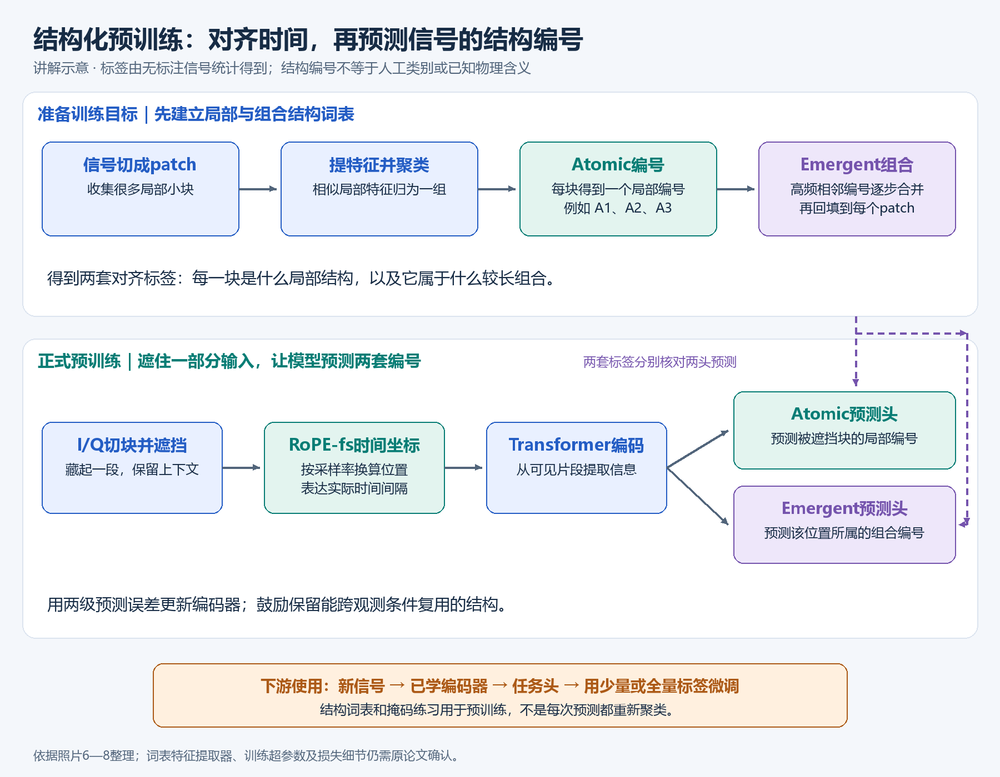
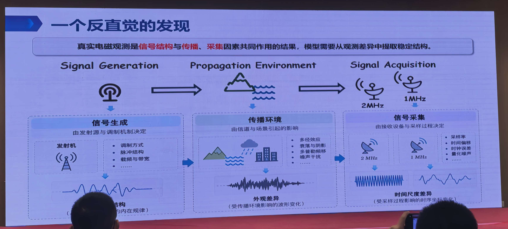
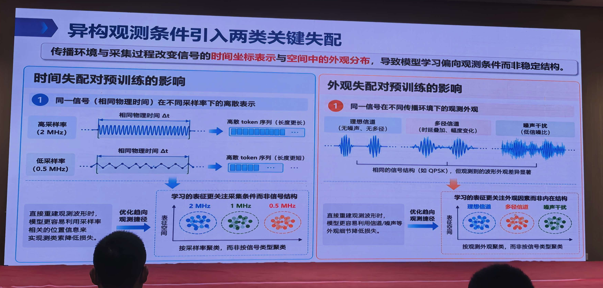
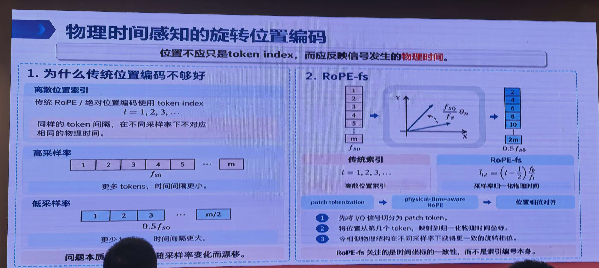
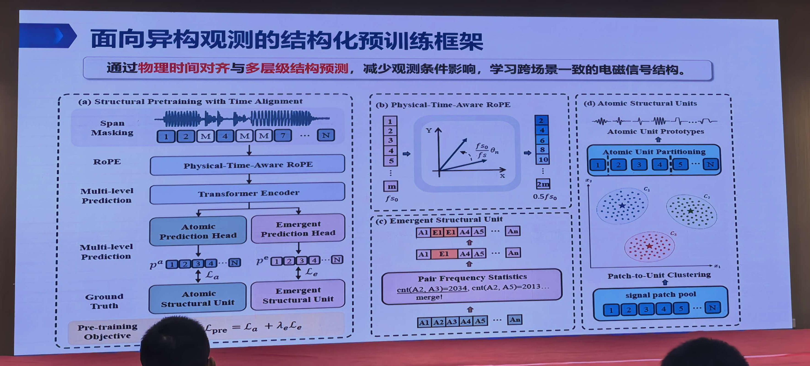
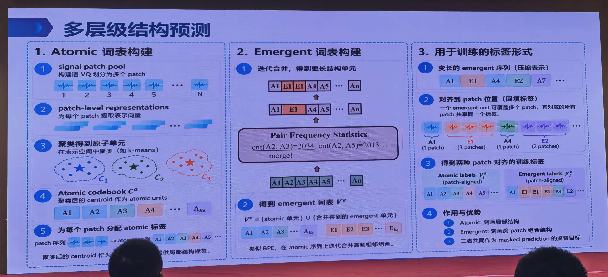
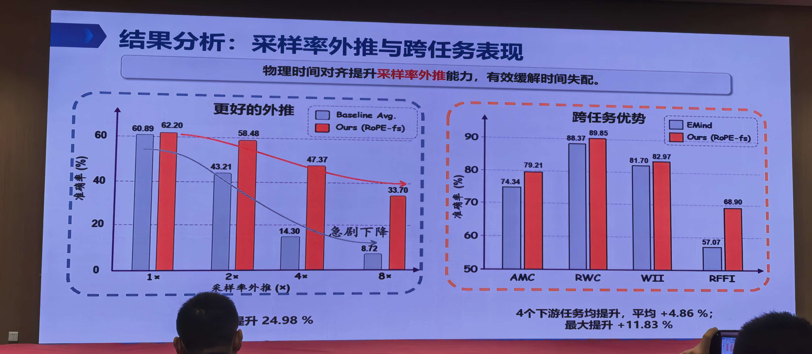
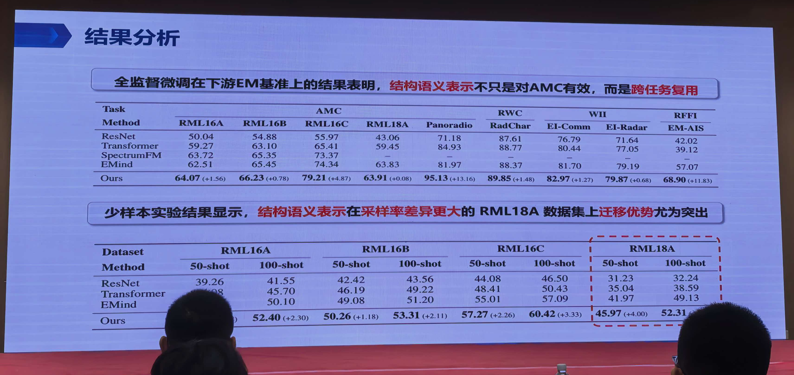

# 讲座2：异构观测下的物理时间对齐与结构化预训练

## 先用大白话，把整个方法走一遍

**这场讲座要解决的是：同一种信号，换一台设备、换一个采样率、换一种传播环境，记录出来的波形就可能变样。模型怎样抓住其中可重复利用的规律？** 它做了两件事：先把时间位置标对，再把训练题目从“照着原波形画回去”改成“判断被遮住的地方属于什么结构”。

### 先认清输入和输出，后面就容易理解了

输入是I/Q信号，可以先把它看成按时间排列的两列数字。I、Q合起来描述同一个信号，里面同时带有幅度和相位信息。模型通常不会把整条记录当成一个不可拆分的大块，而是先切成许多小段，每一段叫 **patch**；再把每段变成一组模型能处理的数字，作为一个 **token**。

训练结束后，主要留下一个“信号特征提取器”，也就是编码器。它把输入变成便于分类、识别等任务使用的特征。做具体任务时，再接一个负责输出类别的“小模块”，用少量有标签数据一起调整，这一步叫微调。

### 方法一：RoPE-fs——别只记“第几段”，要记“过了多长时间”

先看一个**教学例子，数字不是报告的训练设置**：每个patch放100个采样点。采样率为2 MHz时，100点覆盖50微秒；采样率为0.5 MHz时，同样100点却覆盖200微秒。

如果两种记录都只标“第1段、第2段、第3段”，模型就可能把两个实际时间跨度不同的序列当成一样。相反，同一个发生在400微秒附近的事件，在两种记录中又会出现在不同编号附近。

RoPE-fs的做法很直接：**结合采样率，把“小段编号”换成与实际时间对应的位置，再交给模型。** RoPE可以简单理解为“通过转动特征向量来标记位置”；本方法按时间而不是纯编号决定怎么转。这样，同样相隔100微秒的两段信号，就更容易获得一致的时间关系表示。

它有效的原因是先纠正了坐标：模型比较两段信号时，不必把采样快慢误当成信号规律变化。但它只是对齐时间刻度，不能补回已经漏采的信息，也不等于自动完成设备时钟同步。

### 方法二的起点：为什么不直接让模型恢复原波形？

常见的训练方式是遮住一部分波形，让模型把它补回来。问题在于，记录里不仅有信号本身，也有传播环境、噪声、采样方式和设备留下的痕迹。如果评分只看“画得像不像原记录”，模型可能把这些痕迹也记得很熟，换一种采集条件就不好用了。

本场报告因此改了“考题”：**不要求每个采样值都还原得一模一样，而是要求模型猜出被遮住的小段属于哪一种结构。** 这里的“结构”不是人工标注的调制类别，而是从无标签数据中先整理出的模式编号。

### 方法二的第一层：Atomic——先给局部模式分组、编号

做法是先收集很多小段，为每段提取特征，再把特征相近的小段聚成一组。每组给一个编号，例如A1、A2、A3。以后遇到一段信号，就可以用它所属的组号来描述它。

可以把这理解成建立一本“局部模式字典”：原来每小段是一堆连续数值，现在多了一个便于预测的编号。**先提取特征、再聚类分组**很重要，并不是只按波峰高低直接给波形命名。

它的作用是让训练关注“这段属于哪类局部模式”。但A1不一定就是某种真实物理符号，A2也不一定就是某种脉冲；这些编号首先只是数据分组的结果。

### 方法二的第二层：Emergent——再把经常连在一起的模式合成“大块”

只看单个小段还不够，因为某些规律要连续看几段才能发现。于是，再统计哪些编号经常相邻出现，把常见组合合成一个新编号；这个过程可以继续进行，得到覆盖更长范围的组合。

例如，**以下只是教学例子**：

```text
原来的小段编号： A1 A2 A3 A2 A3 A4
发现A2、A3经常连在一起，于是把它们合成E1。
组合表示：       A1 E1    E1    A4
回填到每个小段： A1 E1 E1 E1 E1 A4
```

最后一行解释了“回填”：E1覆盖两个小段，这两个位置都标E1。这样不必改变模型输入的小段数量，就能让它同时学习局部模式和跨小段组合。它的内在原理是：**短单元描述局部，长组合描述组织关系，两种监督一起约束同一个特征提取器。**

这里的emergent指统计合并产生的新单元，不能仅凭这个词就理解成模型获得了高层推理能力。

### 真正训练时，这几步怎样接起来？

先在允许使用的训练数据上准备好两套结构编号；再遮住连续的一些patch，把遮挡后的序列连同各位置的物理时间信息送入Transformer。Transformer可以先理解为“让各小段互相参考上下文的网络”。它根据可见上下文预测被遮住位置的编号，后面接两个预测头：一个猜atomic编号，一个猜emergent编号。预测错误就调整网络参数，反复训练。



*上图为依据照片6—8重新整理的讲解示意图，不是原作者的逐层网络复刻。先看上方怎样准备监督标签，再看下方模型怎样利用这些标签训练。*

训练好以后，用这个编码器处理完整信号，再针对调制分类、雷达波形分类等实际任务微调。**训练时猜的是结构编号，实际使用时输出的可以是业务类别，两者通过同一个编码器连接。**

### 为什么这两个方法要一起用？

RoPE-fs解决“时间坐标不一致”，两级结构预测解决“训练目标过于追着观测外观走”。一个改坐标，一个改考题。配合起来，目标是让模型在观测方式变化时仍保留有用的信号规律。

但结构编号也可能带有采样率或环境偏差，所以并不能保证完全不受观测条件影响；而且环境识别、射频指纹识别本身就可能需要环境或硬件信息，也不能一概删掉。应保留哪些信息，最终仍要看任务和跨条件测试结果。

---

## 以下为完整的逐页梳理、技术详解与实验核对

> 根据本目录 `1.jpg—10.jpg` 共10张照片整理。未拍到报告封面，正式题名、报告人和单位待确认，本文标题为内容概括。下文的“照片内容”“技术解析”“研究建议”分别对应现场材料、机制解释和整理者建议；示意公式会单独说明。

## 1. 核心观点

这场报告追问的是：**把不同来源、不同采样率、不同信道条件的I/Q数据放在一起做波形重建，是否一定能学到最适合迁移的表征？**

报告指出，模型可能先学会识别“怎样被观测”，而不是“信号具有怎样的稳定结构”。其解决方案包含两条线：

- 对时间坐标，用RoPE-fs把token位置映射到采样率归一化的物理时间。
- 对监督目标，用atomic与emergent两级离散结构标签的掩码预测，替代对观测波形外观的直接依赖。

一句话概括：**时间坐标要有物理意义，预训练目标要鼓励学习跨观测条件可复用的结构。**

## 2. 照片与论证顺序

| 照片 | 标题/主题 | 内容及作用 |
|---|---|---|
| [1](1.jpg) | 统一重建式预训练是否仍能学到最优表征 | 提出对重建目标的质疑 |
| [2](2.jpg) | 一个反直觉的发现 | 信号生成→传播环境→信号采集；观测是多种因素共同作用的结果 |
| [3](3.jpg) | 一个反直觉的发现 | 表征可按数据来源、采样率聚类，提示观测偏差 |
| [4](4.jpg) | 异构观测条件引入两类关键失配 | 时间失配与外观失配 |
| [5](5.jpg) | 核心问题 | 不同采样尺度、传播环境下能否学习一致信号结构 |
| [6](6.jpg) | 物理时间感知的旋转位置编码 | RoPE-fs的位置归一化方法 |
| [7](7.jpg) | 面向异构观测的结构化预训练框架 | 时间对齐＋Transformer＋双结构预测头 |
| [8](8.jpg) | 多层级结构预测 | atomic聚类词表、emergent迭代合并、patch标签回填 |
| [9](9.jpg) | 采样率外推与跨任务表现 | 外推曲线及四类任务比较 |
| [10](10.jpg) | 结果分析 | 全监督微调、50-shot/100-shot结果 |

## 3. 先区分信号本体和观测方式

### 3.1 为什么同一个信号会有很多种“外观”

照片2把接收数据分解为三个环节：生成机制决定内在规律；传播环境改变接收外观；采集过程决定采样坐标及其他观测条件。



*读图顺序：从左到右看“生成—传播—采集”。模型拿到的是最右边的记录，因此有可能同时记住信号规律和观测方式。来源：[照片2](2.jpg)。*

为便于理解，可写一个**技术解析用的简化模型，非PPT原公式**：

\[
y[n]=a\,e^{j(2\pi\Delta f n/f_s+\phi_0)}(h*s)(n/f_s)+\eta[n].
\]

这里 \(s\) 表示发射信号，\(h\) 表示信道，\(f_s\) 是采样率，其他项示意增益、频偏、初相和噪声。真实系统还会有接收机非理想和时间偏移。

这个式子说明：模型看到的接收波形，同时包含任务相关结构和观测条件。重建越精确，不一定表示这些因素分得越清楚。

### 3.2 照片3的聚类图能说明什么

照片3左侧按数据集来源着色，右侧按采样率着色。报告据此提出“重建预训练容易学习观测方式”的判断。

**技术解析：** 如果相同任务语义因采样率不同而分开，不同任务语义却因同一来源而靠近，这提示表征中存在域信息或捷径。不过，二维降维图只是诊断线索：数据来源也可能与类别、SNR、设备等因素相关，不能仅凭图证明因果。

进一步验证应在控制信号类别和SNR的条件下，检查来源/采样率的可预测性，以及跨域任务性能；这属于研究建议，不是照片中已经完成的实验。

## 4. 两类失配分别是什么



*左边看“同样时长为何变成不同token数”，右边看“同一信号为何呈现不同波形”。后面的两个方法分别回应这两个问题。来源：[照片4](4.jpg)。*

| 类型 | 照片中的问题 | 为什么可能干扰预训练 | 方案对应 |
|---|---|---|---|
| 时间失配 | 相同物理时长在不同采样率下对应不同点数/token数 | 同一token距离被赋予不同实际时间意义 | RoPE-fs |
| 外观失配 | 同一信号在多径、衰落、噪声、干扰下呈现不同波形 | 重建目标可能鼓励学习环境纹理和数据来源特征 | 两级结构单元预测 |

需要注意，报告希望减少的是**对当前任务无益的观测偏差**，并不意味着所有信道、硬件或环境信息都应删除。例如做环境识别时，环境就是目标；做射频指纹识别时，硬件差异可能正是有效信息。通用表征需要保留可供任务头选择的信息，不能简单追求把所有域差异抹平。

## 5. RoPE-fs：让位置表达物理时间



*先比较左侧高、低采样率的序列，再看右侧编号如何按采样率换算。重点是保持时间刻度一致。来源：[照片6](6.jpg)。*

### 5.1 普通索引的局限

照片6指出，传统RoPE或绝对位置编码通常使用 \(l=1,2,3,\ldots\) 作为位置。同样相隔一个token，在高采样率和低采样率下并不表示同样的时间间隔。

基础RoPE通过旋转变换引入位置和相对位置依赖，背景见[RoFormer原论文](https://arxiv.org/abs/2104.09864)。本报告的改进重点是旋转所用坐标如何随采样率变化，而不是简单增加一种位置编号。

### 5.2 照片6的可辨公式

按照片中的含义，归一化位置可整理为

\[
\widetilde l_{i,l}=\left(l-\frac12\right)\frac{f_0}{f_i}.
\]

其中 \(f_i\) 为当前样本采样率，\(f_0\) 为参考采样率，\(l\) 为patch索引；半个patch的偏移对应使用patch中心的直觉。图中低采样率 \(0.5f_{s0}\) 对应更大的归一化位置间距。

**技术解析：** 若patch长度固定为 \(P\) 个采样点，其中心物理时间约为

\[
t_{i,l}=\frac{(l-1/2)P}{f_i}.
\]

两式在固定patch长度下只差一个共同尺度常数。若patch长度也随样本变化，则必须显式考虑 \(P_i/f_i\)，只使用采样率比例未必足够。这是实现时需要核对的条件。

### 5.3 一个直观例子

假定patch为100点：在2 MHz时每个patch覆盖50 μs，在0.5 MHz时覆盖200 μs。同一物理事件位于400 μs附近时，在两条序列中会落在不同patch编号附近。位置编码应表达400 μs这一事实，而不是要求编号相同。

### 5.4 它没有自动解决的问题

位置对齐不会让不同采样率下的patch内容天然相同，也不会恢复降采样丢失的高频信息；更不能独立校正采集起始时刻、时钟漂移或接收机频偏。RoPE-fs需要真实或可信的采样率元数据，参考采样率及旋转频率设置也需要验证。

## 6. 结构化预训练：把“恢复波形”改为“预测结构单元”

### 6.1 总体框架（照片7）



*左侧是模型训练主流程，右侧是结构单元的构建。两套标签回到左侧，分别监督两个预测头。来源：[照片7](7.jpg)。*

```text
无标注I/Q信号 → 分块 → Span Masking → 物理时间RoPE → Transformer
                                                    ├→ Atomic预测头
                                                    └→ Emergent预测头

离线/预处理分支：patch表征 → 聚类得到atomic标签
                           → 高频相邻单元合并 → emergent标签
```

照片7显示预训练目标为两级损失的组合，可辨为 \(\mathcal L_{pre}=\mathcal L_a+\lambda_e\mathcal L_e\)。这与“同时保留原始波形重建损失”的方案不同：现有框架图突出的是结构预测，未明确展示额外的波形重建分支。

### 6.2 Atomic：建立局部结构的离散词表



*从左到右看：先给单个patch分组，再合并高频相邻组合，最后把组合标签对齐回各patch位置。下面第6.2—6.4节逐步展开。来源：[照片8](8.jpg)。*

照片8左栏给出以下步骤：

1. 汇集信号patch，形成patch pool。
2. 为每个patch提取表征向量。
3. 在表征空间聚类，例如k-means。
4. 用聚类中心形成atomic codebook。
5. 为各patch分配atomic标签，形成离散序列。

其直觉类似把局部波形模式整理为一组“结构字母”。但聚类单元并不天然等于符号、脉冲或物理原语；如果提取的patch表征本身带有采样率/环境偏差，词表也可能继承偏差。

照片没有给出patch表征提取器的来源、是否冻结、聚类前如何归一化、词表大小及跨数据集采样权重，这些都是影响效果的关键参数。

### 6.3 Emergent：通过组合表达跨patch模式

照片8中栏展示类似BPE的过程：统计相邻atomic单元对的频率，迭代合并高频组合，构成更长结构单元。其词表包含atomic单元和新合并的emergent单元。

例如，以下是**解释用例，并非PPT的真实信号序列**：

```text
Atomic序列： A1 A2 A3 A2 A3 A4
合并规则：   A2 A3 → E1
压缩后：     A1 E1 E1 A4
```

这使监督不只关注单个固定patch，还能表达跨patch的高频组合模式。这里的“emergent”是由统计合并产生的结构单元，不宜直接解释为大模型出现了高层推理能力。

### 6.4 标签回填：训练仍与原patch位置对齐

照片8右栏特别重要：一个emergent单元可覆盖多个patch，训练时其覆盖位置共享该标签。例如 \(E1\) 覆盖3个patch，就会回填为 `E1 E1 E1`。

这样，输入仍是patch序列，两级预测头分别输出局部atomic标签和跨patch组合标签，不必强迫模型直接生成变长压缩序列。

可用下列**示意损失**理解：

\[
\mathcal L=\frac{1}{|\mathcal M|}\sum_{l\in\mathcal M}
\left[\mathrm{CE}(p_l^a,y_l^a)+\lambda_e\mathrm{CE}(p_l^e,y_l^e)\right].
\]

\(\mathcal M\) 为被遮挡位置。照片未明确交叉熵的归一化和权重细节，上式只是对双标签预测的常见表达。回填还意味着长单元可能得到更多位置权重，是否平衡需要查看实现。

## 7. 实验结果与数值核对

### 7.1 采样率外推（照片9左）



*左图看外推倍数增加后两组方法如何退化，右图看各任务的差异。下方表格重新整理数字，避免只凭柱子高度判断。来源：[照片9](9.jpg)。*

| 外推倍数 | Baseline Avg.准确率 | RoPE-fs方法准确率 | 差值，百分点 |
|---|---:|---:|---:|
| 1× | 60.89 | 62.20 | +1.31 |
| 2× | 43.21 | 58.48 | +15.27 |
| 4× | 14.30 | 47.37 | +33.07 |
| 8× | 8.72 | 33.70 | +24.98 |

最有力的观察是：外推越远，基线退化很明显，而本方法保留了更多性能。但本方法也从62.20降到33.70，说明失配被缓解，不能说完全解决。

照片底部的“提升24.98%”按柱状图实际对应8×条件下的**24.98个百分点**；相对增幅约为286.5%。此外，图中4×差值33.07个百分点大于8×差值，不能把24.98说成这张图全部条件中的最大差值。

图例只写“Baseline Avg.”，基线构成、采样率改变方向、是否保持物理时长和重采样滤波方式均未给出，需要进一步确认。

### 7.2 四类任务对比（照片9右）

| 任务缩写 | EMind | 本方法 | 差值，百分点 |
|---|---:|---:|---:|
| AMC | 74.34 | 79.21 | +4.87 |
| RWC | 88.37 | 89.85 | +1.48 |
| WII | 81.70 | 82.97 | +1.27 |
| RFFI | 57.07 | 68.90 | +11.83 |

按四项等权计算，平均差值为4.8625个百分点，与PPT的“平均＋4.86%”相符，但建议规范写作“平均提升4.86个百分点”。按通常术语，AMC为自动调制分类、RWC为雷达波形分类、WII为无线干扰识别、RFFI为射频指纹识别；照片没有完整展开缩写，最终名称以原论文为准。

### 7.3 全监督微调（照片10上表）



*上表对应全监督微调，下表对应少样本微调；两种条件分别判断，不能混为一个总体提升。来源：[照片10](10.jpg)。*

下表摘录本方法与EMind的可读结果，均为准确率：

| 数据集 | EMind | 本方法 | 差值，百分点 |
|---|---:|---:|---:|
| RML16A | 62.51 | 64.07 | +1.56 |
| RML16B | 65.45 | 66.23 | +0.78 |
| RML16C | 74.34 | 79.21 | +4.87 |
| RML18A | 63.83 | 63.91 | +0.08 |
| Panoradio | 81.97 | 95.13 | +13.16 |
| RadChar | 88.37 | 89.85 | +1.48 |
| EI-Comm | 81.70 | 82.97 | +1.27 |
| EI-Radar | 79.19 | 79.87 | +0.68 |
| EM-AIS | 57.07 | 68.90 | +11.83 |

必须分清“相对EMind有提升”和“相对全部基线最优”。例如RML18A的提升只有0.08个百分点，没有误差条时无法判断其稳定性；Panoradio还需要与表中Transformer的84.93比较，差值为10.20个百分点。

### 7.4 少样本（照片10下表）

RML18A中，EMind的50-shot/100-shot为41.97/49.13，本方法为45.97/52.31，分别增加4.00/3.18个百分点。对照全监督仅增加0.08个百分点，可以看出该数据集上的收益更集中于少标注条件。

但“50-shot”究竟是每类50条还是总共50条、重复抽样次数、方差和类别平衡，照片未说明。不能把跨数据集少样本结果简单归因于采样率，其他域差异也可能参与。

## 8. 这套方案的价值与局限

真正值得借鉴的是：**异构数据预训练之前，应先问模型会利用什么捷径，再决定时间坐标和监督目标。** 数据量扩大不能自动消除元数据缺失、来源偏差和训练目标不匹配。

同时有四点需要保持审慎：

1. 离散结构标签是由数据统计得到的，并没有被证明完全不受信道影响。
2. 高频组合可能偏向多数数据来源或多数类别；稀有事件未必形成emergent单元。
3. 用全体数据建词表可能造成评估泄漏，严格实验应只用允许的预训练/训练数据拟合词表与统计量。
4. 对识别有益的离散化可能损失精细连续量，参数回归、重建类任务需要独立验证。

## 9. 面向自己的项目，怎样落地验证

以下为研究建议。

| 实验问题 | 最小对照 | 主要评价 |
|---|---|---|
| 物理时间坐标有没有独立收益 | 同骨干、同目标，普通RoPE vs RoPE-fs | 未见采样率准确率；已见采样率性能 |
| 结构目标是否优于波形重建 | 固定骨干和训练预算，重建 vs atomic预测 | 跨会话/跨设备/跨信道迁移 |
| emergent是否必要 | atomic单头 vs atomic＋emergent | 长模式任务、少样本任务及稀有类别召回 |
| 收益是否由算力差异造成 | 记录词表生成和训练总成本 | GPU时长、token数、内存和端到端延迟 |

优先补齐采样率、中心频率、带宽、设备、会话、时间、SNR等元数据。数据划分先按原始记录和设备/会话隔离，再切窗；分别设计“只变采样率”和“只变信道”的测试，最后再验证两者同时变化。

## 10. 后续最值得问的问题

- patch特征提取器如何获得？是否与最终编码器共享，是否在词表构建时冻结？
- 词表大小、聚类样本采样策略、BPE停止条件、span masking比例是多少？
- RoPE-fs对采样率误差和可变patch是否稳健？
- 是否有时间对齐与双级结构目标的完整2×2消融？
- 各任务使用同一个预训练检查点吗？预训练集与下游测试集之间如何去重？
- 为什么某些数据集收益很大，而RML18A全监督收益很小？是否有多随机种子结果？

## 11. 与另外两场讲座的关系

讲座1主要处理输入时长与多尺度建模，讲座2处理异构观测下的坐标和监督偏差；讲座3展示统一I/Q基座及任务适配。三者可以形成设计上的互补，但不能假定将模块直接拼接就能叠加收益。尤其讲座1的MSP与本场的双级结构预测，其输出目标不同，联合训练的兼容性需要实验。

### 来源与补充阅读

- 所有报告主张和数值均以本目录[照片1](1.jpg)、[2](2.jpg)、[3](3.jpg)、[4](4.jpg)、[5](5.jpg)、[6](6.jpg)、[7](7.jpg)、[8](8.jpg)、[9](9.jpg)、[10](10.jpg)为依据。
- [RoFormer原论文](https://arxiv.org/abs/2104.09864)：仅补充RoPE基础机制。
- [MAE原论文](https://arxiv.org/abs/2111.06377)：仅补充掩码重建预训练背景。MAE在视觉上的结果不能直接证明本报告在电磁数据上的主张。
- 本次公开检索未可靠确认与本组照片对应的作者原论文入口，未将同名或相近工作的网络内容混入讲座事实。
