# 讲座3：电磁信号大模型构建技术及应用展望

## 先用大白话把三个方法讲明白

**这场讲座的核心做法是：先让模型从大量没有标签的电磁波形里学会找规律；具体做任务时，再根据任务特点，改变练习方式，或者把输入信号整理成更容易利用的形式。**

其中三个名称各管一件事：**IQFM是可复用的模型基座，KRMAE是选择“遮住哪里让模型练习”的训练方法，RW-DPhase是整理相位信息的输入方法。** 它们不是三个同级模型，也不能把所有实验理解成三者始终串在同一条流水线上。下面的图是为了讲清各自位置而重新整理的示意，不是原作者完整实现图；现场PPT原图放在后文对应章节。

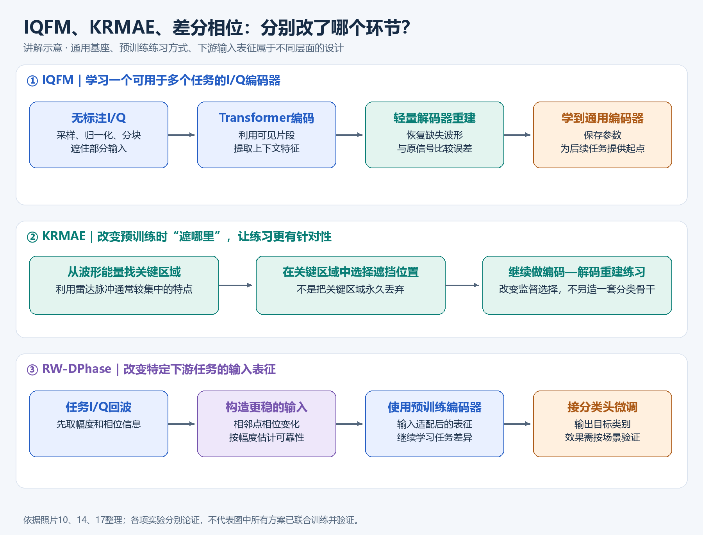

### 先把几个会反复出现的词翻译成人话

**I/Q是什么？** 接收设备把电磁信号记录成两路随时间变化的数字，叫I和Q。两路合在一起，能表达信号在每个时刻的幅度和相位。幅度可以粗略理解成“有多强”，相位可以理解成“波动走到了一圈中的哪个位置”。模型读入的是这些数值，不是把PPT里的波形截图当照片看。

**patch/token是什么？** 很长的一串数字不一定逐点送进网络，而是先切成许多小段。每小段叫一个patch；经过数值转换后成为网络处理的一个单元，可以叫token。这里的token并不是汉字或单词。

**编码器和解码器是什么？** 编码器负责把输入小段整理成有用的特征，并结合前后关系；解码器负责根据这些特征还原被遮住的波形。可以把前者理解成“读懂并整理信息的部分”，后者理解成“根据理解把缺失部分补出来的部分”。这只是功能解释，不表示模型已经像人一样理解了电磁知识。

**预训练与微调是什么？** 预训练先用大量波形练习通用能力，不要求每条都有人工类别标签；微调再拿具体任务的带标签样本，教模型把学到的特征用于指定输出。分类任务通常接上一个分类头，它相当于“根据特征给出类别答案”的最后一段网络。

### 方法一：IQFM——先做大量“补波形”练习，再学具体任务

**它要解决的问题是：每来一个任务，就从头训练一个模型，既浪费已有波形数据，也可能需要很多人工标签。** IQFM希望先学一个多个任务都能利用的编码器。

它的基本过程可以顺着数据走：

1. 收集大量没有人工类别标签的I/Q波形，做采样、归一化和分块。
2. 遮住其中一部分，让编码器处理剩下的信息，并利用位置编码保留各段的先后关系。
3. Transformer让不同位置交换信息。例如，一个位置的解释可能需要参考附近的波形，或者更远处出现的类似片段。
4. 解码器尝试把被遮住的波形补出来，拿预测值和原始记录比较。补错了就调整网络参数，反复练习。
5. 做具体任务时，复用预训练编码器，接上任务头，用带标签的数据微调。

**为什么没有人工标签也能训练？** 因为完整波形本来就在手里，只是训练时人为遮住一部分。原始记录就是“正确答案”，不用先请专家告诉模型这条是什么类别。

**为什么补波形可能帮助分类？** 要补得好，模型可能需要利用波形的重复方式、局部变化和前后关系；这些规律也可能帮助后来的识别任务。预训练相当于先积累可复用的信号特征，微调再把特征与类别联系起来。但“补得准”并不保证“分类一定好”，模型也可能学到噪声或采集设备特征，所以仍要用真正独立的下游测试验证。

报告里约1100万条无标注样本用于这一类预训练；具体分类再使用标签。这里的“通用”表示尝试跨任务复用，不能理解成任何新任务都不用训练就能直接完成。

### 方法二：KRMAE——别把练习机会大量花在无关背景上

**它改的是练习题怎么出。** 雷达记录中，有些时间段有明显脉冲，有些时间段主要是背景。如果完全随机遮挡，模型可能花很多力气补背景，而对真正有辨识价值的脉冲练得不够。

KRMAE先看波形的能量分布，找出脉冲等关键区域，再从这些区域选择要遮挡、要恢复的位置。后面仍然是编码器读取可见部分、解码器补缺失部分、和原始波形比较。

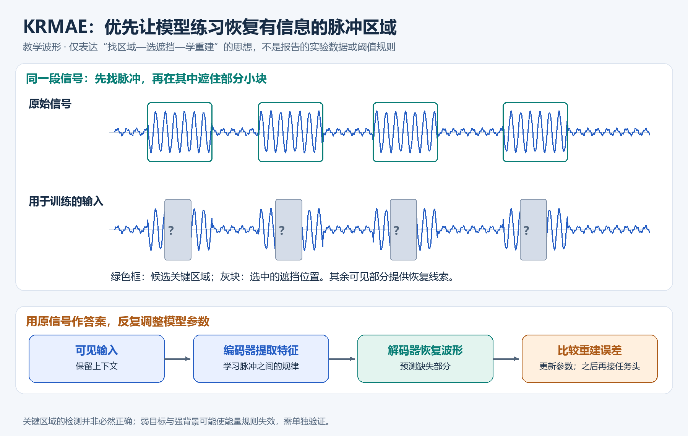

用一个**仅为讲解而设的例子**：假设一段记录有100个小段，其中20段包含主要脉冲，其余大多是背景。普通随机遮挡可能抽到不少背景；KRMAE则利用能量先验，把练习更多地安排到脉冲附近。这个100和20不是报告参数，也不表示实际方法一定遮掉全部脉冲。

**为什么可能有效？** 每一次预测都更有机会逼模型学习与脉冲有关的结构，相同数量的训练样本可能提供更有价值的监督。因此，它尤其适合检验“人工标签很少时，能否更高效地利用无标签数据”。

**关键区域不是直接保留、其余全部删掉。** “掩码”是在训练时让一部分位置暂时不可见，要求模型恢复它们，原始信号仍然用于给出正确答案。关键区域也不等于“能量越高越有用”：弱目标可能能量低，强背景可能能量高，区域选择错了就会选错练习题。

这也是为什么不能说它处处胜过随机MAE。报告中少标签时优势明显，但满量标签、低SNR的一项结果反而略低；完整表格在后文第6节。

### 方法三：RW-DPhase——看相位怎样变化，并减少不可靠位置的影响

**它改的是送给模型的信息形式。** 既然I/Q本来包含相位，为什么还要单独整理？因为“原始数据里有”不等于“网络容易学会用”。

先看绝对相位的麻烦。相位像钟面，转完一圈会回到起点。用角度数字记录时，可能从179°跳到−179°，但实际只走过了很小的角度；如果只看数字，会误以为突然大变。另外，波形幅度很低、噪声占主导的位置，算出来的相位可能很不稳定。

报告的办法分两步：先取相邻采样点之间的相位变化，再根据幅度给这次变化一个可靠性权重。幅度与相位变化一起送入模型，微调预训练编码器完成具体分类。

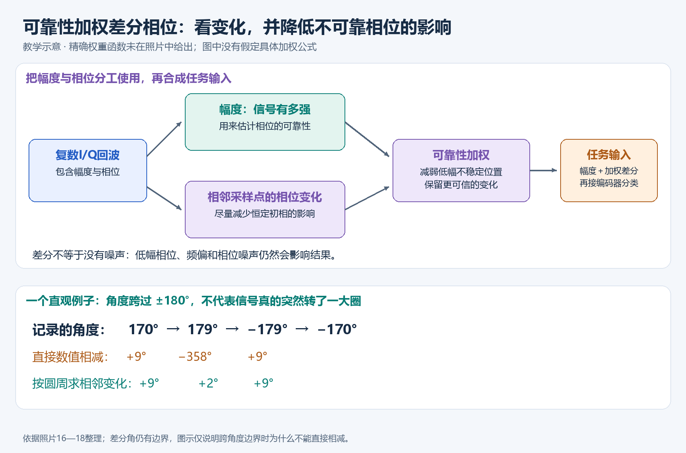

**为什么先看变化？** 相邻点的相位差更直接描述波形如何变化，也能消去整条信号共同带有的恒定初相。上面的179°到−179°，应该按绕圈后的微小变化处理，不能直接作普通数字减法得到−358°。这不代表所有偏差都消失，频偏、相位噪声等仍会影响差分结果。

**为什么还要加权？** 如果某个位置几乎只剩噪声，那里的“相位变化很大”未必有意义。根据幅度降低这类位置的影响，可以让模型少被不稳定相位带偏。权重怎么计算，照片没有给出，不能把“根据幅度加权”补写成某个确定公式。

最终不是只看幅度，也不是不分好坏地把相位全部加入，而是结合“强弱”和“相邻变化”，让有效相位信息更容易被利用。它在报告所示X波段六类分类实验中与IQFM配合达到99.25%，适用范围仍取决于数据和测试条件。

### 把三者的位置记住，就不会混淆

| 名称 | 最直白的理解 | 主要改变什么 | 使用时机 |
|---|---|---|---|
| IQFM | 先从大量波形里练出一个可复用编码器 | 模型基座与预训练/微调路线 | 先预训练，再适配具体任务 |
| KRMAE | 把重建练习安排到更值得学的位置 | 预训练的掩码位置选择 | 出“补波形”练习题时 |
| RW-DPhase | 把相位整理成相邻变化，并降低不可靠位置影响 | 输入特征的表达 | 面向相位相关任务做输入适配和微调时 |

**理解后续原图时，始终问三件事：箭头前后是什么数据，哪一步在训练，哪一步最终负责输出答案。** 下面保留完整的逐页内容、公式解释、实验数字和结论边界，便于从通俗理解继续深入。

---

## 原始资料说明与完整技术分析

> **正式题名**：电磁信号大模型构建技术及应用展望。  
> **封面单位**：中国电科智能科技研究院。  
> **封面日期**：2026年11月。  
> **材料**：本目录 `1.jpg—21.jpg` 共21张现场照片。报告人姓名没有在封面中显示，不根据人物外貌或现场桌签推定。照片不是完整PPT，存在章节跳页。
>
> 本文将“照片事实”“技术解析”和“研究建议”分开。实验数值来自可辨识的照片；未展示的训练参数、数据划分和公式实现不自行补全。

## 1. 全场主线：统一基座与任务先验共同发挥作用

报告并不只是介绍一个网络，而是从应用需求、已有方法边界，讲到基础模型、专用预训练策略、输入表征和部署体系。

可以把核心逻辑整理为：

```text
复杂电磁观测＋少标注数据＋跨领域迁移需求
                    ↓
          以复数I/Q为共同输入基础
                    ↓
       IQFM：跨领域自监督预训练基座
                    ↓
   ┌────────────────┴─────────────────┐
雷达脉冲先验：KRMAE关键区域掩码     相位先验：可靠性加权差分相位
   └────────────────┬─────────────────┘
                 任务微调
                    ↓
       能力封装、硬件适配、评估与持续迭代
```

最重要的判断是：**大模型不是对传统处理链的一次整体替换。应先明确具体任务中现有方法的性能边界，再引入可迁移表征和有物理意义的任务适配。** 这是照片7直接强调的工程定位。

上面的总览将本场研究方向放在同一张逻辑图中；KRMAE实际改变预训练的掩码策略，差分相位实际改变任务输入表征，不能据此认定它们在每组实验中都按图中顺序串联。

## 2. 逐页梳理：21张照片分别讲了什么

| 照片 | 所属部分 | 主要信息 | 应如何理解 |
|---|---|---|---|
| [1](1.jpg) | 封面 | 正式题名、单位、日期 | 报告身份信息 |
| [2](2.jpg) | 概念内涵·场景需求 | 信号密度增加、手段多样、环境复杂 | 解释为什么需要更强适应性 |
| [3](3.jpg) | 现有局限 | 分布式观测、六类干扰示例、相关性/独立性先验 | 展示领域结构与挑战 |
| [4](4.jpg) | 现有局限 | 多节点输入、残差模块、掩码、脉冲压缩及信干噪比约束 | 已有任务网络并非没有物理先验 |
| [5](5.jpg) | 现有局限 | 多组曲线与时频结果 | 展示处理结果，但不足以独立恢复全部指标 |
| [6](6.jpg) | 现有局限 | 未见类型、目标位置变化、更强干扰下的失效 | 强调分布外泛化问题 |
| [7](7.jpg) | 赋能定位 | 判断传统算法边界，优先从信号处理任务切入 | 明确工程方法论 |
| [8](8.jpg) | 概念内涵 | I/Q为本、多域输入、通用基座、敏捷适配 | 给出电磁信号大模型定义 |
| [9](9.jpg) | 技术探索·需求一 | 跨域迁移；7个数据集、4类领域、9种规模 | 给出IQFM研究范围 |
| [10](10.jpg) | 解决方案一 | IQFM预训练和微调流程，1100万无标注样本 | 给出基础模型训练路线 |
| [11](11.jpg) | 实验效果 | 参数规模与预训练损失 | 初步规模效应证据 |
| [12](12.jpg) | 实验效果 | 预训练损失与四领域下游性能关系 | 规模收益因任务而异 |
| [13](13.jpg) | 需求二 | 雷达少样本、普通随机掩码效率问题 | 引出任务专用预训练 |
| [14](14.jpg) | 解决方案二 | KRMAE关键区域掩码 | 通过脉冲能量先验选择监督位置 |
| [15](15.jpg) | 实验效果 | 收敛、少样本、低SNR比较 | 优势主要集中于有限标注条件 |
| [16](16.jpg) | 需求三 | I/Q之外如何利用幅值、相位；绝对相位不连续和低幅噪声 | 引出输入表征改进 |
| [17](17.jpg) | 解决方案三 | 可靠性加权差分相位，幅度辅助评估可靠性 | 给出细粒度分类表征思路 |
| [18](18.jpg) | 实验效果 | 三种骨干、四类表征、六类无人机分类 | 检验表征与骨干的配合 |
| [19](19.jpg) | 阶段成果 | 模型开发、统一适配、算力、业务应用 | 介绍部署管理体系 |
| [20](20.jpg) | 应用展望 | 数据与知识底座、表征、多头任务、推理执行、双闭环 | 属于未来架构规划 |
| [21](21.jpg) | 应用展望 | 多类型电磁信号通用感知赛题及数据 | 展示评测/数据生态入口 |

## 3. 概念与定位：这里的“大模型”具体指什么

### 3.1 核心输入是复数电磁信号

照片8定义的是面向I/Q复数域的通用基础模型，输入不仅关注时域，也强调空、时、频、能等特征，能力包括感知、生成、推理、迁移。

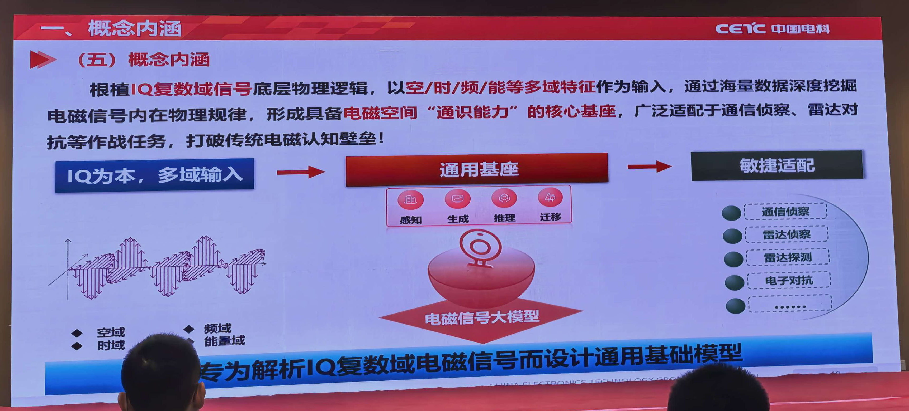

*原PPT图，来源：[照片8](8.jpg)。从左向右看：多域输入进入通用基座，再适配各类任务。图中列出的是能力定位，是否完成验证还要看后面的具体实验。*

**技术解析：** I/Q信号通常写为

\[
z[n]=I[n]+jQ[n]=A[n]e^{j\phi[n]}.
\]

保留I/Q使模型有机会利用幅度与相位的联合结构，但“包含信息”不等于网络必然会学会使用它。后续差分相位的研究恰好说明：输入信息完整与信息被有效利用是两件事。

本报告展示的具体实验主要是自监督表征、识别与分类迁移；封面和概念页中“生成、推理”的愿景，不能据此视为已经完成的通用推理验证。

### 3.2 先判断哪里适合使用学习方法

照片7将物理传播/收发链、信号处理、业务应用分层，强调先评估传统算法和小模型的性能局限。机理清晰、已有方法稳定可靠的部分，未必需要换成神经网络；近似估计和复杂模式识别等环节更适合验证学习方法。

对项目设计而言，应该先明确模型接口：接收什么数据、输出什么量、允许多大误差和时延，再决定是否需要统一预训练基座，而不是先确定参数规模。

## 4. 照片3—6：为什么有先验的专用网络仍可能泛化不足

照片3展示了多节点分布式观测，以及梳状谱、密集假目标、间歇转发、噪声调频、窄带脉冲、智能噪声干扰等六类示例。报告强调利用“干扰信号相关、目标信号相互独立”的领域经验，并结合统计特性。

照片4给出多分支残差网络与掩码处理流程，同时列出最大化信干噪比的约束和相位敏感掩码形式。其意义是：现有方法已在网络或目标中融入先验，但先验成立的条件和训练分布覆盖范围仍有限。

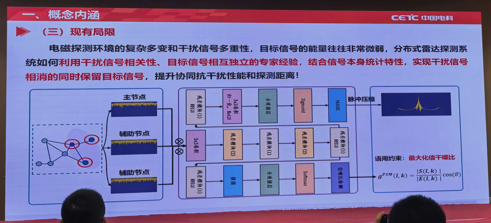

*原PPT图，来源：[照片4](4.jpg)。左侧是不同节点输入，中间是多分支网络，右侧是约束与处理结果。这是前述专用处理方法的示例，不是后文IQFM结构图。*

照片5主要是结果图。因图例、坐标和不同方法对应关系不完整，不能从中可靠读出统一增益值，也不能推定它就是IQFM实验。

照片6明确指出三类泛化不足：

- 难以适应未见过的类型。
- 训练与测试目标位置范围不同，性能变差。
- 测试干扰强度超出训练范围时，出现不准确预测。

**技术解析：** 这几页为基础模型提供了问题动机，但没有展示IQFM在同一套分布外测试上已经解决这些失效。后面跨领域分类有效，不能直接推出前述复杂处理链的所有泛化问题均已解决。

## 5. 技术线一：IQFM统一I/Q基础模型

### 5.1 研究范围（照片9）

报告列出7个数据集、通信/雷达/干扰/环境4类领域、9种模型规模，参数范围为25.74M—1.23B，即约2574万—12.3亿参数。

这一设计至少同时考察两件事：统一I/Q表征能否服务不同领域，以及增加参数是否带来下游收益。照片没有列全7个数据集清单，也没有完整数据配比，不应根据其他论文补齐。

### 5.2 预训练与微调流程（照片10）

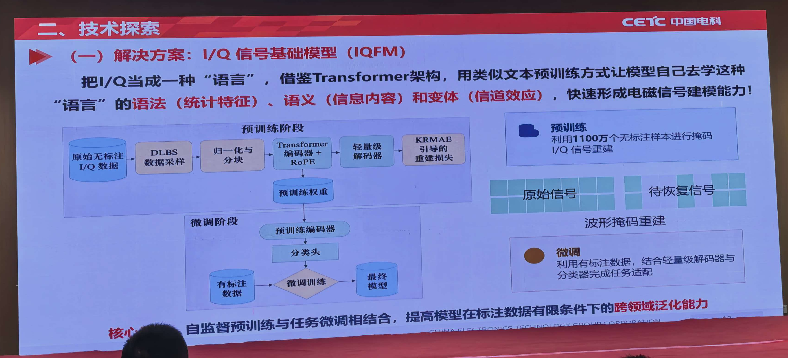

*原PPT图，来源：[照片10](10.jpg)。上半部分是用无标注I/Q进行掩码重建的预训练；下半部分是复用编码器、接分类头并使用标签的微调。右侧小图说明遮挡与恢复的任务。*

```text
原始无标注I/Q
  → DLBS数据采样
  → 归一化与分块
  → Transformer编码器＋RoPE
  → 轻量解码器
  → KRMAE引导的重建损失
  → 得到预训练权重

有限有标注数据＋预训练编码器＋分类头 → 下游微调
```

照片明确给出约1100万个无标注样本。DLBS的全称、采样权重和是否按数据量平衡没有说明，本文保留缩写。归一化方式也未明确：对单条样本归一化可能削弱绝对幅度信息，对不同任务的影响需要单独评估。

报告把I/Q类比为一种“语言”，统计规律、信息内容和信道变化分别对应“语法、语义、变体”。这是理解预训练的类比，不能直接理解为把I/Q数值转换成文本，让已有聊天模型读取。

基础MAE用遮挡输入与重建目标学习表征，其原始非对称编码器/解码器设计见[MAE原论文](https://arxiv.org/abs/2111.06377)。本报告中的关键区域选择是面向信号特点的改造，不能与视觉MAE的随机遮挡方案混为一谈。

### 5.3 参数规模与预训练损失（照片11）

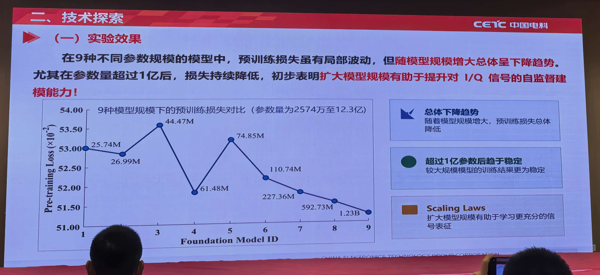

*原PPT图，来源：[照片11](11.jpg)。看点是大模型区间损失整体下降，同时注意横轴为模型编号、前段曲线并不单调。*

图中9个模型参数量依次为25.74M、26.99M、44.47M、61.48M、74.85M、110.74M、227.36M、592.73M、1.23B。小模型区间存在明显非单调变化，较大模型区间整体呈下降趋势。

这支持“扩大规模可能改善I/Q自监督建模”的初步观察，但不够构成严格的Scaling Law：

- 横轴为模型编号，不是对数参数量。
- 没有展示参数量、数据量和训练计算量的联合拟合。
- 没有误差条，单条曲线不能证明训练方差变小。
- 不同规模的优化器、训练步数和预算是否一致未知。

因此，“超过1亿后趋于稳定”宜理解为PPT对该组曲线的描述，不能推广为通用规模阈值。

### 5.4 预训练损失与下游能力（照片12）

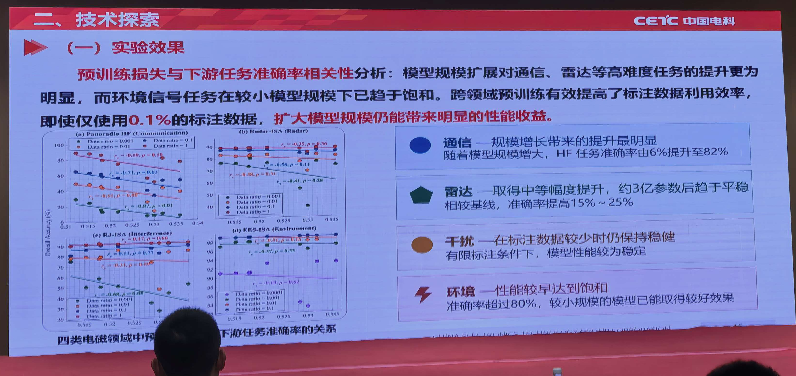

*原PPT图，来源：[照片12](12.jpg)。每个小图对应不同领域，比较预训练损失与下游准确率；右侧说明通信、雷达、干扰和环境任务的收益差异。*

| 领域 | PPT给出的观察 | 应保留的解释边界 |
|---|---|---|
| 通信 | 规模提升收益最明显，示例准确率约60%→82% | 只对图示任务/数据条件成立 |
| 雷达 | 中等增益，约3亿参数后趋平，称提升15%—25% | 百分比口径未明确，不改写成百分点 |
| 干扰 | 标注较少时仍相对稳健 | 需查看具体比例、类别和方差 |
| 环境 | 小模型已取得较好效果，较早饱和 | 可能与任务难度、数据特点相关，不能证明领域天然简单 |

报告强调仅0.1%标注时，增加规模仍可能带来收益。但0.1%对应多少条、是否每类均匀抽取，照片未说明。

这页最有用的启示是：预训练损失相近时，下游收益可能因任务而异。选择模型规模应看目标任务的收益曲线和部署成本，不能只依据重建损失最低或参数最多。

## 6. 技术线二：KRMAE关键区域掩码

### 6.1 为什么不直接随机遮挡（照片13）

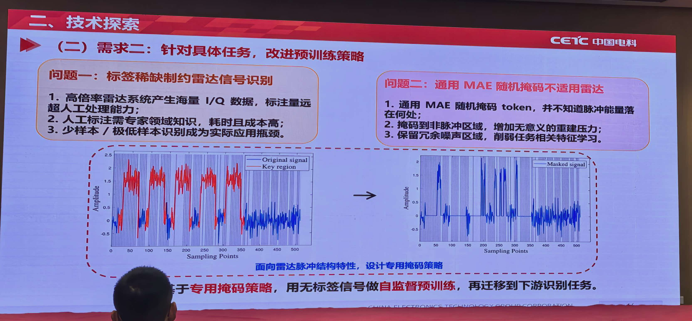

*原PPT图，来源：[照片13](13.jpg)。下方波形把脉冲相关区域和背景区分开，用来解释为什么需要针对脉冲结构选择掩码位置。*

雷达脉冲在时间上常呈稀疏分布，大片区域可能以背景/噪声为主。普通随机掩码不知道有效脉冲位置，有可能把大量监督预算用于无判别力的背景，而对任务相关区域约束不足。

本报告据此引入关键区域掩码：先通过波形中的结构先验定位信息集中的区域，再从这些区域选择需要恢复的token。这里是无标签信号的自监督预训练，不等于训练过程完全不使用领域知识。

### 6.2 照片14给出的三个步骤

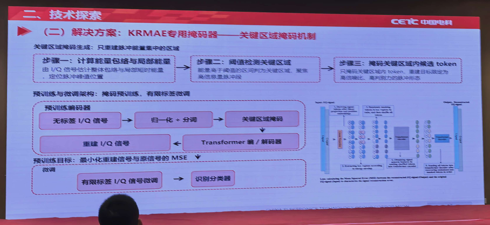

*原PPT图，来源：[照片14](14.jpg)。上方三个框分别是能量计算、区域检测和区域内掩码；下方是编码器/解码器重建与有限标签微调的连接。*

1. 计算I/Q信号的能量包络和局部能量，定位脉冲峰值附近。
2. 根据阈值检测关键区域，将脉冲区域视为主要信息区域。
3. 在关键区域内选择token进行掩码重建，尽量避免无关背景占用监督预算。

流程为：无标签I/Q→归一化与分词/分块→关键区域掩码→Transformer编解码→重建I/Q→MSE；之后用有限标签微调分类器。

**技术解析：** 能量常可由 \(I[n]^2+Q[n]^2\) 表示，并通过局部平滑估计区域能量。但照片没有给出窗口大小、阈值公式和掩码比例，不能把上述一般写法当作报告实现。

照片中的“掩码关键区域”要理解为让模型学习恢复这些位置，不能误读成把关键信息永久从数据中删除。

### 6.3 数值结果（照片15）

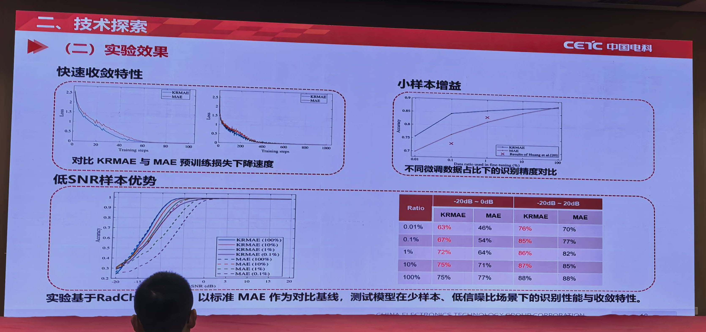

*原PPT图，来源：[照片15](15.jpg)。左侧看损失和SNR曲线，右下表按标注比例比较；阅读时尤其保留100%标签下“略低或持平”的结果。*

该页以标准MAE为基线，展示RadChar相关实验。可读表格如下：

| 微调数据比例 | −20—0 dB：KRMAE | −20—0 dB：MAE | −20—20 dB：KRMAE | −20—20 dB：MAE |
|---|---:|---:|---:|---:|
| 0.01% | 63% | 46% | 76% | 70% |
| 0.1% | 67% | 54% | 85% | 77% |
| 1% | 72% | 64% | 86% | 82% |
| 10% | 75% | 71% | 87% | 85% |
| 100% | 75% | 77% | 88% | 88% |

这张表非常清楚地限定了方法价值：

- 在0.01%标注、−20—0 dB条件下，高17个百分点；0.1%时高13个百分点。
- 标注增加后，差距整体缩小。
- 在100%标注、−20—0 dB条件下，KRMAE低2个百分点；在完整SNR范围下两者持平。

因此，正确结论是**关键区域掩码提高了特定少样本条件下的数据利用效率**，不能概括成“所有数据量和SNR下均优于MAE”。左侧损失曲线提示部分阶段收敛更快，但未给出总训练时间、同等掩码数和计算预算，不能据曲线直接换算加速倍数。

### 6.4 适用边界与建议

能量高不总等于目标信息多：低SNR目标可能很弱，强噪声/背景可能更强；连续通信信号也不一定适合脉冲式区域规则。建议在相同骨干、相同总遮挡数量下比较随机掩码、关键区域掩码、关键区域与背景混合掩码，并统计区域检测的漏检情况。以上是验证建议，不是已展示的实验。

## 7. 技术线三：可靠性加权差分相位表征

### 7.1 为什么保留I/Q后还要单独设计表征（照片16）

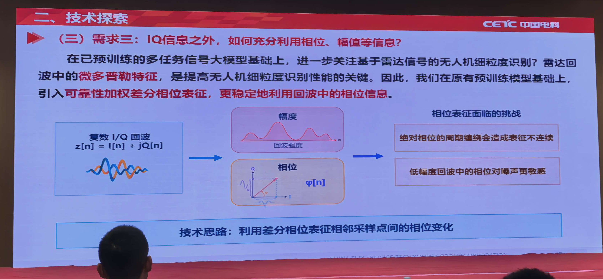

*原PPT图，来源：[照片16](16.jpg)。左侧把I/Q分解为幅度和相位，右侧指出绝对相位的周期缠绕和低幅度位置的不稳定。*

报告针对细粒度目标分类指出，相位信息可能携带有效的动态差异，但直接使用绝对相位存在两个问题：相位的周期缠绕造成数值不连续；低幅度位置的相位对噪声更敏感。

因此，引入两步改造：用相邻采样点的相位变化代替绝对相位，再利用幅度估计其可靠性，抑制不稳定位置的影响。

### 7.2 差分相位的解释公式

以下是**数学解释，并非照片给出的实现公式**：

\[
\Delta\phi[n]=\arg\left(z[n]\overline{z[n-1]}\right).
\]

若整个信号乘以恒定初相 \(e^{j\phi_0}\)，这一相邻乘积中的初相会抵消。这解释了差分相位可能比绝对相位更稳健。

但它仍可能受频偏、相位噪声、采样率和低幅噪声影响；差分相位本身也有角度边界问题。使用sin/cos编码、如何处理首采样点、是否去除平均频偏，照片没有说明。

### 7.3 可靠性加权（照片17）

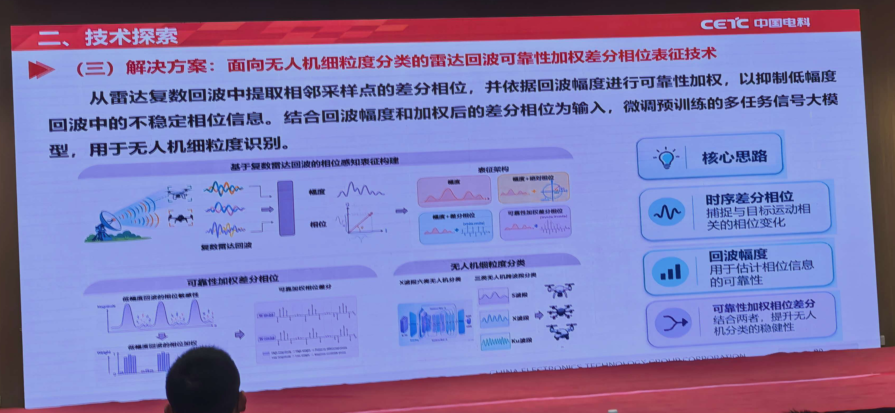

*原PPT图，来源：[照片17](17.jpg)。顺着上方箭头看复数回波如何分出幅度和相位，再组成不同表征；右侧列出相位变化、幅度可靠性和加权的作用。*

报告描述了从复数回波提取相邻点差分相位，再按回波幅度加权，最终将幅度和加权差分相位作为输入微调预训练模型。

可用示意形式理解：

\[
r[n]=g(A[n],A[n-1]),\quad
u[n]=r[n]\Delta\phi[n],\quad
\text{输入}\sim[A[n],u[n]].
\]

函数 \(g\) 的实际定义未提供，不能自行认定是幅度平方、最小值、阈值或某种特定归一化。它的核心作用是降低不可靠相位对判别的影响。

如果把I/Q换成幅度与相位类输入，即便仍是两个通道，也改变了各通道统计含义；预训练嵌入如何适配，是照片中没有展开的重要问题。

### 7.4 三种骨干、四种表征的结果（照片18）

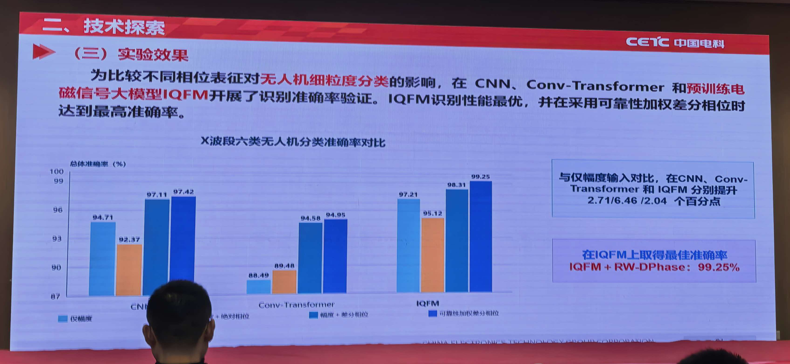

*原PPT图，来源：[照片18](18.jpg)。同一组四根柱子比较输入表征，不同组比较骨干；深蓝柱对应可靠性加权差分相位方法，IQFM组达到99.25%。*

图题是X波段六类无人机分类，结果为总体准确率：

| 骨干 | 仅幅度 | 幅度＋绝对相位 | 幅度＋差分相位 | 可靠性加权差分相位表征 |
|---|---:|---:|---:|---:|
| CNN | 94.71 | 92.37 | 97.11 | 97.42 |
| Conv-Transformer | 88.49 | 89.48 | 94.58 | 94.95 |
| IQFM | 97.21 | 95.12 | 98.31 | 99.25 |

最后一列为PPT简称RW-DPhase所对应的方法；报告文字说明输入同时结合幅度。按图中数字：相对仅幅度，最终方法分别提升2.71、6.46、2.04个百分点；在IQFM上，加权相对不加权差分相位再提高0.94个百分点。

这说明：

- 直接加入绝对相位并不一定有益，CNN和IQFM均出现下降。
- 相邻相位变化比原始绝对相位更适合这组实验。
- 可靠性加权和预训练骨干存在互补，但没有误差条，不能判断0.31或0.37个百分点小差异的稳定性。

99.25%只对应展示的实验，不代表跨波段、跨站点或全新类别也达到这一结果。照片17展示多波段任务示意，照片18给出的是X波段结果，两者不能混写成多波段全面验证。

## 8. 部署与未来架构要分开看

### 8.1 阶段成果：部署管理体系（照片19）

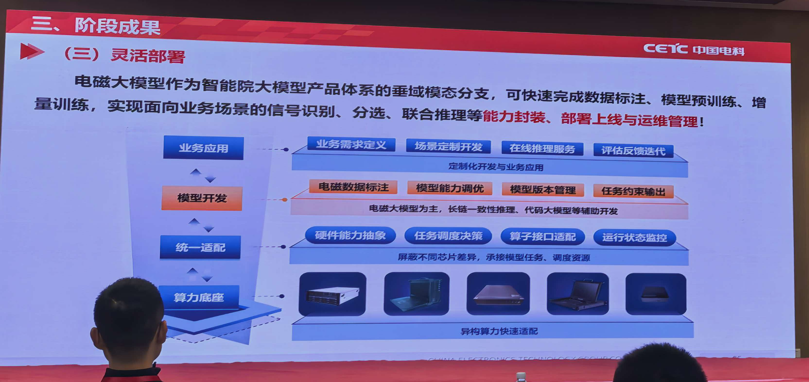

*原PPT图，来源：[照片19](19.jpg)。按从下往上的顺序看：算力支持、硬件适配、模型管理，再到业务应用。它描述系统组织，不是识别精度实验。*

这页把系统分为算力底座、统一适配、模型开发和业务应用。可见能力包括数据标注、模型调优、版本管理、任务约束输出、硬件抽象、任务调度、接口适配与运行监控。

它说明团队在考虑模型生命周期管理。但照片没有提供设备型号、吞吐、延迟、量化精度损失或现场部署规模，因此无法评价“异构算力快速适配”的具体性能。

### 8.2 未来架构（照片20）

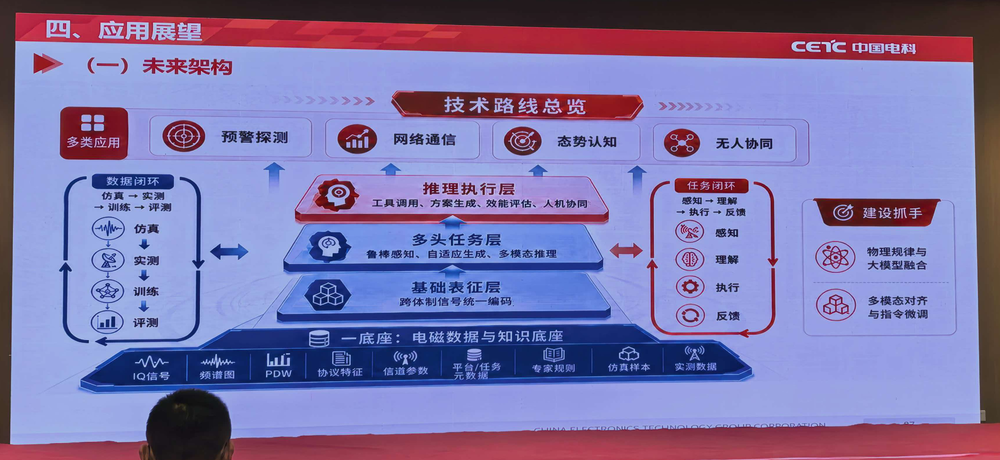

*原PPT图，来源：[照片20](20.jpg)。底部是数据与知识，上方依次为基础表征、多头任务和推理执行；左右两边分别是数据闭环和任务闭环。这张图属于未来规划。*

| 层次/闭环 | PPT内容 | 技术解析 |
|---|---|---|
| 数据与知识底座 | I/Q、频谱图、PDW、协议特征、信道参数、平台/任务元数据、专家规则、仿真及实测 | 重点在数据的关联、对齐、质量和可追溯性 |
| 基础表征层 | 跨体制信号统一编码 | 需要处理长度、采样率和输入模态差异 |
| 多头任务层 | 鲁棒感知、自适应生成、多模态推理 | 不同目标需要单独设计训练与评价 |
| 推理执行层 | 工具调用、方案生成、效能评估、人机协同 | 超出单纯信号分类器的系统能力 |
| 数据闭环 | 仿真→实测→训练→评测 | 需要独立测试集和版本管理 |
| 任务闭环 | 感知→理解→执行→反馈 | 需要明确各环节接口与实际效果指标 |

这页是“应用展望”中的未来架构，不能把图中每个能力都写成已经实现。物理规律融合、多模态对齐与指令微调是建设方向；现有照片未给出完整实现和验证。

## 9. 赛题与数据（照片21）

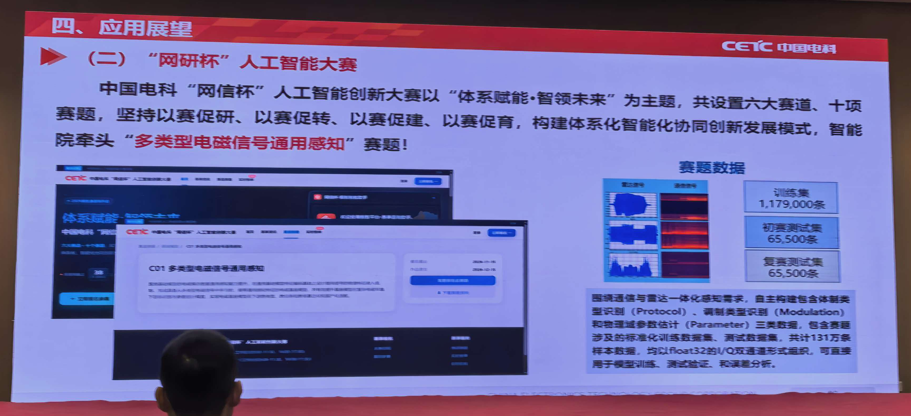

*原PPT图，来源：[照片21](21.jpg)。右侧列出赛题数据的训练集和两阶段测试集数量；其规模与IQFM预训练样本量需要分开理解。*

正文提到中国电科“网信杯”人工智能创新大赛；该页小标题似写“网研杯”，页内存在用字不一致，正式名称需另行核对。本文以正文“网信杯”表述记录，不将其作为已核实的活动公告。

材料介绍“多类型电磁信号通用感知”赛题，涉及协议类型识别、调制类型识别和信号参数估计。数据数量为：

| 数据部分 | 条数 |
|---|---:|
| 训练集 | 1,179,000 |
| 初赛测试集 | 65,500 |
| 复赛测试集 | 65,500 |
| 合计 | 1,310,000 |

合计131万，与正文一致。照片还提到Float32的I/Q形式。这里的131万赛题数据与照片10的1100万预训练样本属于不同语境，不能相加或认为同一数据集。

本页没有足够清晰的下载地址、当前开放状态与使用条款，因此只记录报告内容，不推定数据当前可公开获取。

## 10. 对自身电磁大模型项目最有价值的借鉴

以下为整理者建议。

### 10.1 优先建立数据和评测闭环

在追求更大参数量前，把信号、元数据、标签和来源关系整理好。除了训练集/测试集随机划分，还需要按原始记录、设备、会话、地点、采样率和时间隔离，避免相邻切窗让结果过于乐观。

建立覆盖分类、回归及不同标注量的固定基准。报告中的成功案例提示少样本迁移的重要性，但不能用单一高准确率替代跨条件评估。

### 10.2 通用基座与任务适配分阶段验证

先训练一个资源可承受的I/Q基座，确认多个领域有迁移收益；再在目标任务中加入关键区域掩码或适合的相位表征。每次只引入一个主要变化，以便判断收益来自数据、骨干、预训练目标还是输入特征。

### 10.3 规模扩展以任务收益为依据

照片12显示不同任务的饱和点不同。应同时记录准确率/误差、标注需求、训练成本、时延和显存，再选择参数规模。少样本改进或稳定性改善，可能比继续扩大参数更有实际价值。

### 10.4 值得优先开展的实验

| 目标 | 对照方案 | 重点观察 |
|---|---|---|
| 验证预训练价值 | 从头训练 vs 相同骨干预训练微调 | 多任务、少样本、同预算 |
| 验证掩码先验 | 随机 vs 关键区域 vs 混合掩码 | 弱信号、强背景、满量数据是否退化 |
| 验证相位表征 | I/Q、幅度、绝对相位、差分相位、加权差分 | 频偏、低幅噪声、不同会话稳定性 |
| 验证规模效应 | 若干相近训练预算的模型规模 | 下游收益是否抵得上推理成本 |

## 11. 最值得继续核实的问题

1. 7个数据集的完整清单与预训练配比是什么？1100万样本如何去重？
2. DLBS如何处理不同长度、不同领域和不同采样率？
3. 9个模型是否采用相同训练token预算，是否针对大模型调整超参数？
4. IQFM所有领域是否共享一个预训练检查点？跨领域是联合训练后适配，还是严格留出某个领域测试？
5. KRMAE的阈值与掩码比例是什么？是否比较相同重建位置数量？
6. 为什么全量标注、低SNR时KRMAE低于MAE？差异是否稳定？
7. RW-DPhase的权重函数、输入通道适配、频偏处理及数据划分是什么？
8. 99.25%的结果是否按目标实体、会话和站点隔离？各类召回和混淆矩阵如何？
9. 部署是否已有延迟、吞吐、资源占用及不同硬件的一致性数据？

## 12. 与前两场共同形成的认识

讲座1提醒我们关注长度和多尺度；讲座2提醒我们关注物理坐标与观测偏差；本场强调统一预训练、任务先验及工程闭环。它们共同指向：电磁大模型构建不能只靠扩大网络，还需要正确的数据坐标、合适的学习目标、清晰的迁移评价和物理意义明确的输入适配。

从照片中最有把握保留下来的结论是：统一I/Q预训练具有跨任务价值，任务先验能改善特定数据稀缺条件下的效率，而收益范围必须用分场景实验来界定。

### 来源与术语核对说明

- 报告事实与实验数据来自本目录21张照片，每张图片的独立入口见第2节表格。KRMAE表来自[照片15](15.jpg)，相位表征表来自[照片18](18.jpg)。
- [MAE原论文](https://arxiv.org/abs/2111.06377)、[RoFormer原论文](https://arxiv.org/abs/2104.09864)仅用于基础机制背景。
- 公开检索存在其他同名IQFM工作，其作者、训练方式及任务范围与本报告未建立可靠对应，本文没有把那些结果归到中国电科报告名下。KRMAE、DLBS的未展示全称也未擅自扩写。
